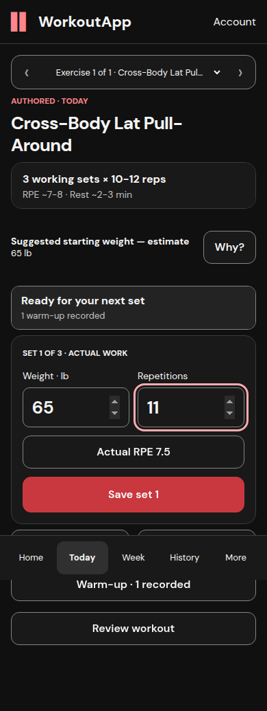

# Fresh combined application journeys

Qualification source `188a45d`; same runtime tree as #112. Build
`ZLEpb6JBscpHyieWEipdp`, real loopback web/API, new synthetic PostgreSQL records.
These captures were made during this combined rehearsal, not copied from earlier
PR galleries. Other earlier evidence remains available under its original revision.

| Mobile before save | Mobile after confirmed save/rest |
| --- | --- |
|  |  |

[Authored assertions](browser-journeys.json),
[retained database chains](browser-db-preservation.json),
[Customized assertions](customized-runtime.json),
[Customized consent/receipt preservation](customized-db-preservation.json),
[existing-account/preferences proof](account-preservation.json).

Source-defined working/warm-up fields are compared against each original seeded
prescription. The unsupported target is explicitly a synthetic boundary fixture;
it does not alter a program artifact or impersonate a licensed source workbook.
Real Customized construction, consent and activation use the existing lifecycle.

Authored mobile weight/reps top **564 px**, Save top **694 px**, scroll **0 px**
before/after. Desktop weight/reps top **614 px**, Save **744 px**, scroll **0 px**
before/uncertain/confirmed. Exact x/y/width/height equality is asserted, not inferred
from screenshots. This qualifies the tested Chromium layouts, not Safari's keyboard.

The network harness distinguishes abort-before-server from response-loss-after-real
commit. It checks frozen command/payload, receipt count, locked other-receipt action,
close/reload recovery, correction parent retention and next-set count after undo.
Committed lost saves reconcile by matching command receipt without another POST.
The existing web/API/core test suites cover late reply, account/date/occurrence/
revision and edited-draft negatives beyond these representative browser journeys.
Fresh full web/core runs completed; full API completion and corrected weekly cases
await the final head-linked CI result.

No unhandled page exceptions or unexpected API/chunk failures occurred in these
workout journeys. Exact injected paths may log ERR_FAILED. Authored desktop `/programs`
prefetch generated inherited 404s, retained in JSON; favicon 404 is an allowed
historical resource exception, not asserted to have occurred in every run. Do not
turn this into a console-clean claim.

## Reproduction boundaries

Helpers in [reproduce](reproduce) are external synthetic qualification tools, not
application features. Use an isolated worktree, explicit cleared environment, pinned
API/core/web dependencies and verified disposable DB/user before app imports.
Inspect tmpfs/no-mounts/loopback metadata; never inherit ordinary environment or
Compose defaults. Run real Alembic upgrades only after verifying the target and
existing head. No `drop_all`, truncate, reset or production data copies.

The private `run-browser-python pg` launcher used here supplies the verified exact
`integration_1024` target, matching test URL, synthetic signing material, absolute
program/knowledge paths, Customized enabled only in this isolated server, cleanup
false, and the existing qualification virtualenv. It is intentionally not exported
because credential-bearing launchers are not public evidence. Port/PID readiness and
an API marker protect against accidentally testing another listener. `run-browser.py`
launches/stops only its own processes. `run-account-browser.py` runs the separate
existing-account check.

Seed browser accounts once per rerun, then qualified history and real Customized
proposal/consent. Seed helpers create unique accounts and store credentials only
under ignored `.qualification`. The source-shaped session has Cross-Body Lat
Pull-Around; selected dates/timezone must match the actual coherent test week.
Follow [physical-device instructions](IPHONE.md) separately. Do not rerun a completed
journey against its old records and pretend duplicate fixture actions are regressions.

Full raw transport logs, private account files, additional captures and the exact
synthetic dump remain local ignored evidence. Three representative PNGs plus small
assertion files suffice; no duplicate gallery or performance raw-data series added.
