# Authored provisional starting-load application evidence

Application revision: **96ef19d43c88440b987d290844e4da7775a70912** on PR #111.
These are actual application PNG captures, not design mockups. The web production
build at loopback 3020 called the API at loopback 8020 and the explicitly verified,
disposable PostgreSQL database `initial_load_migration_1023`. Only synthetic accounts
were used. Classic WorkoutApp Dark/lb was retained. Chromium viewports were
390 × 844 and 1440 × 900; this is **not physical-iPhone acceptance**.

[Implementation and limits](../IMPLEMENTATION.md) ·
[Assertions and geometry](browser-journeys.json) ·
[Database verification](browser-db-preservation.json) ·
[Reproduction](REPRODUCE.md)

## A — Actionable provisional estimate

For the original Cross-Body Lat Pull-Around source prescription (three working
sets, first set 10–12 reps at RPE 7–8), the optional confirmed 100 lb maximum on
the declared exact cable setup produces **65 lb**. The server owns the calculation;
actual weight remains editable. The benchmark itself creates no performed set.

| Mobile | Desktop |
|---|---|
| 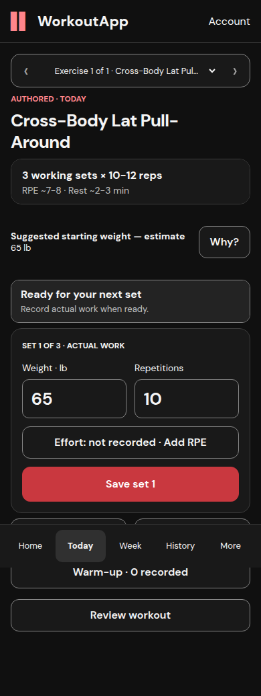 |  |

The benchmark request was sent to the real API and committed, then Playwright
discarded its response. The application kept the uncertain action, survived
closing the sheet and reloading, and retried exactly the original command/body.
Database verification found one calibration row for that command.

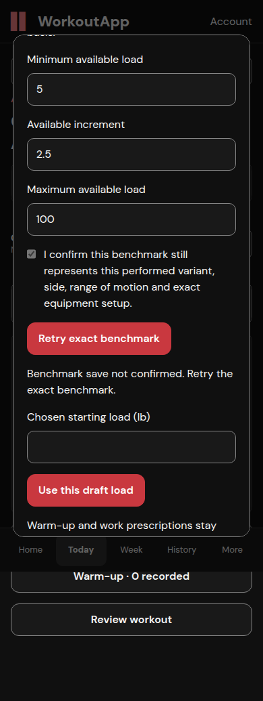

The existing source warm-up owner uses the provisional load, source instruction
of about 60%, and the declared attainable grid: **37.5 lb for the warm-up**.
Eight actual warm-up repetitions were entered separately; the desktop receipt
below shows the saved 37.5 lb warm-up. No source set count or recipe was altered.

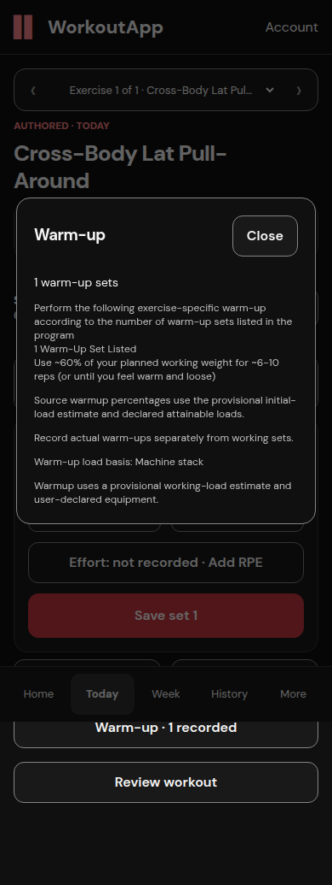

## D — First set, rest, next set and recovery

The first set saved 11 repetitions at 65 lb with actual RPE 7.5. The initial
estimate retired into existing remaining-set guidance. The next actual load
stayed 65 lb; the rep field cleared for the next observation. A single saved
confirmation and rest timer appeared. The weight input, repetition input and
Save button retained identical bounding boxes and scroll position.

| Before first working save | Confirmed, resting and ready for set two |
|---|---|
|  | 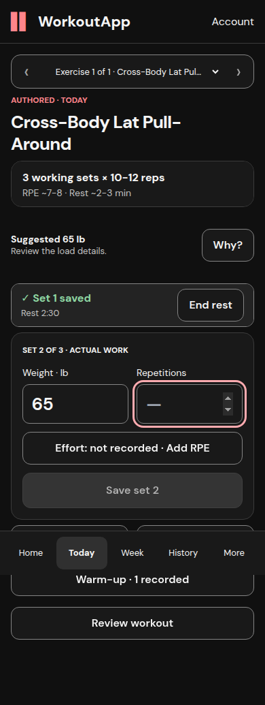 |

| Measured element | Mobile before / after y | Desktop before / uncertain / after y |
|---|---|---|
| Weight input | 564 / 564 px | 614 / 614 / 614 px |
| Repetition input | 564 / 564 px | 614 / 614 / 614 px |
| Save button | 694 / 694 px | 744 / 744 / 744 px |
| Window scroll | 0 / 0 px | 0 / 0 / 0 px |

Desktop set two deliberately lost its response after the server committed.
The inputs became read-only, the exact command/body retried once, and one set
receipt remained. No duplicate set or changed occurrence was observed. The
third-set view preserves the source's RPE 8–9 and long-length-partial technique.

| Response lost | Exact retry confirmed |
|---|---|
| 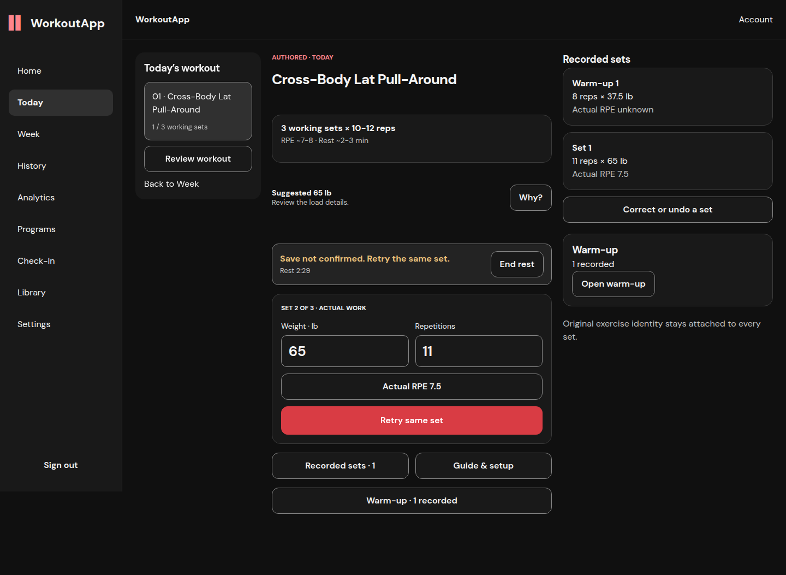 | 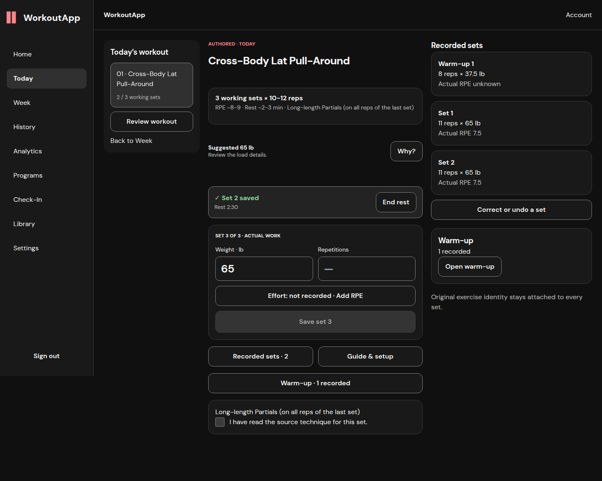 |

Set one's correction from 11 to 12 repetitions also lost its committed response.
Editing set two was disabled. Closing the panel and reloading restored the
original correction; retry used the same receipt URL, command and frozen body.
The second set was then undone and the page reloaded. Set one remained effective
at 12 repetitions, set two's voided row and the original corrected row remained
in history, and the composer resumed set two at 65 lb.

| Uncertain correction | Confirmed correction |
|---|---|
| 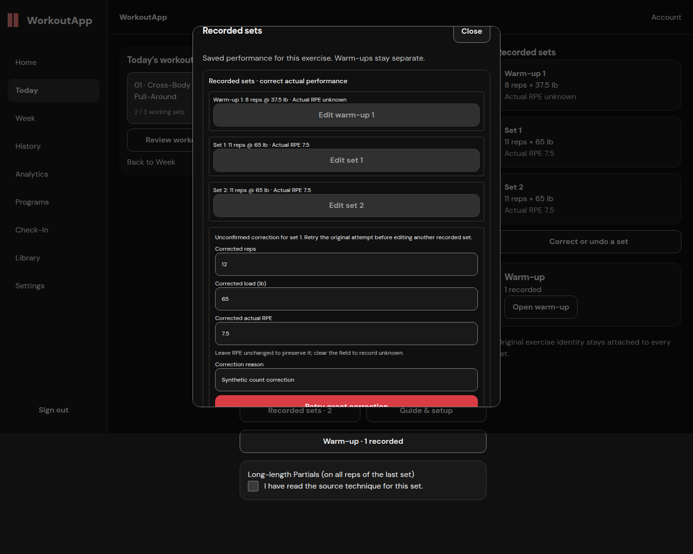 | 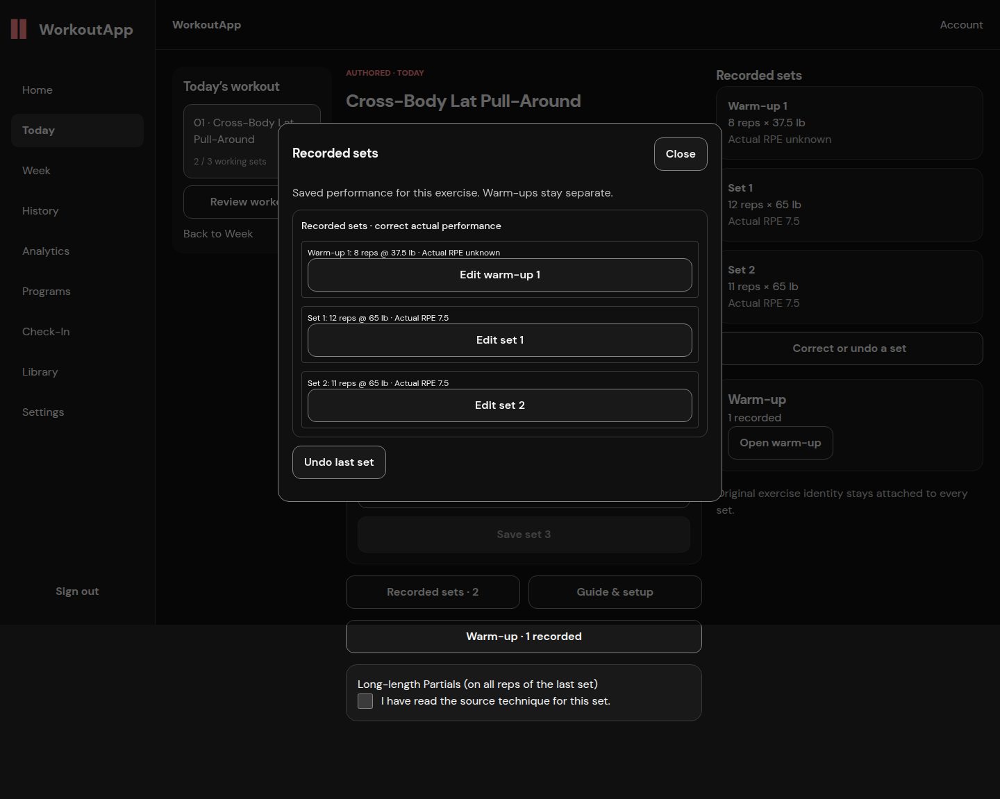 |

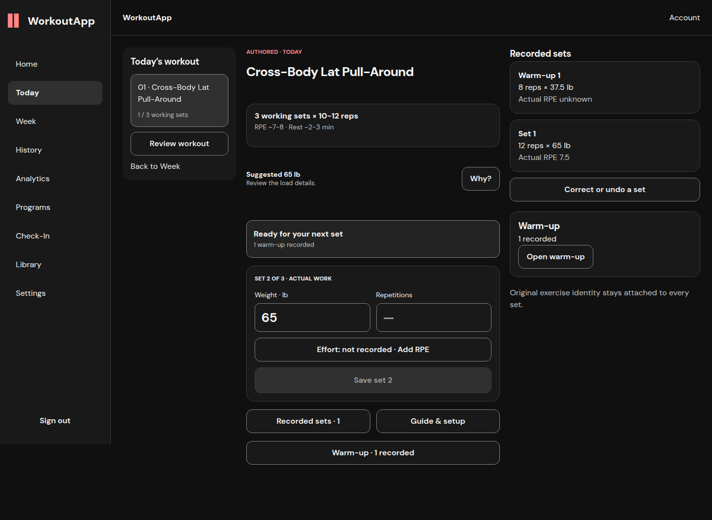

| Mobile History | Desktop History |
|---|---|
| 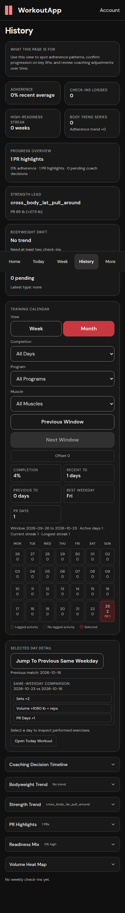 | 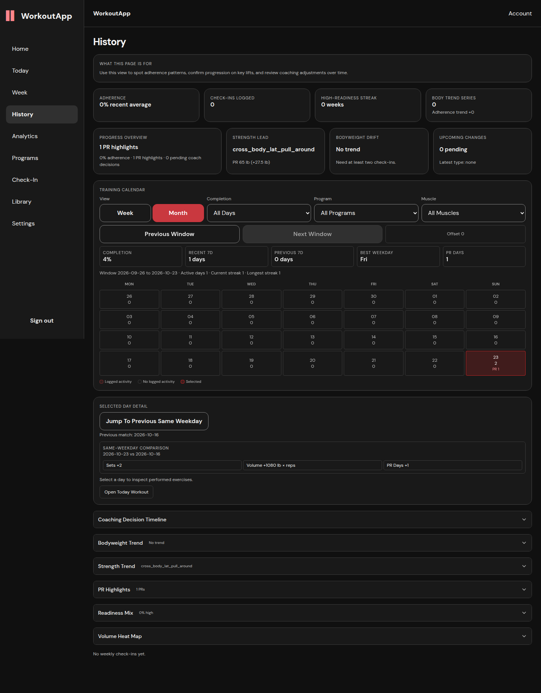 |

## B — Specific unsupported prerequisite and manual fallback

An owned synthetic fixture changes only its first source-shaped target to AMRAP;
it does not alter the compiled program. The server specifically explains that
an ordinary numeric target with upper bound 6–12 is required. The benchmark is
saved as a report, but no estimate or performed work is invented. Manual entry
of 55 lb and 10 repetitions leaves Save enabled.

| Mobile explanation | Desktop explanation |
|---|---|
| 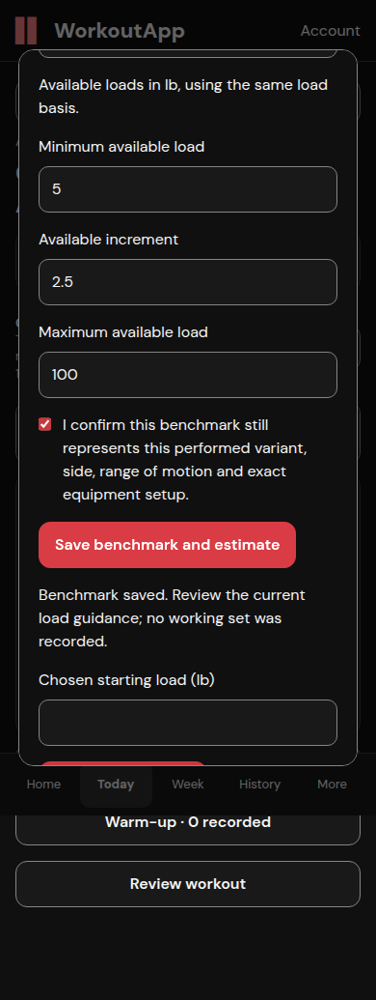 | 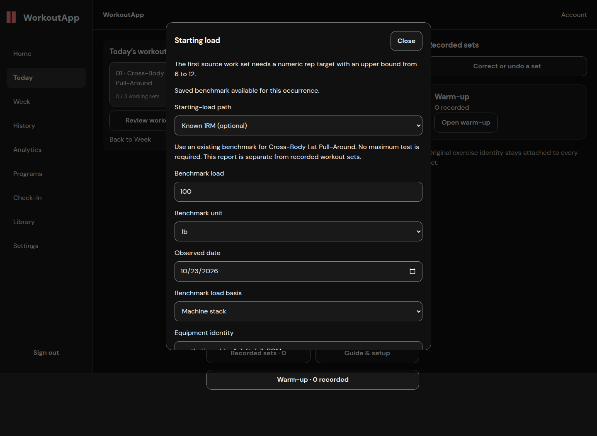 |

| Mobile manual entry | Desktop manual entry |
|---|---|
| 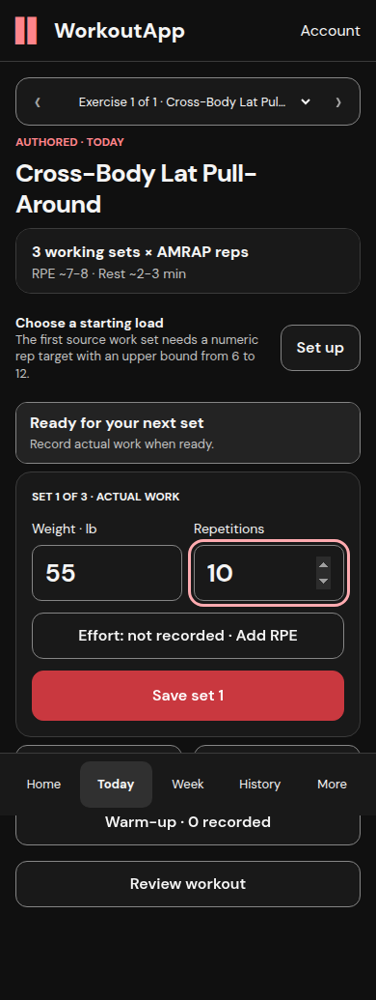 | 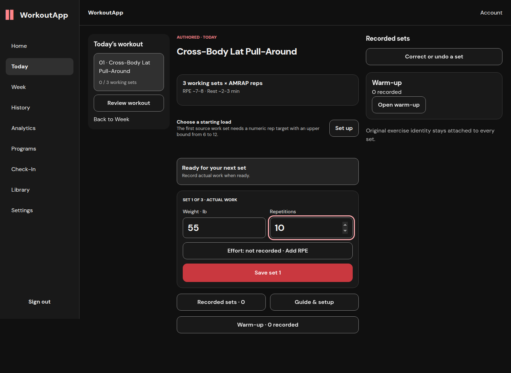 |

## C — Qualified history takes precedence

Three source-target sets from a prior synthetic exposure at **40 kg** produce
existing history-backed hold guidance, displayed **88.2 lb**. A saved 100 lb
benchmark cannot replace that guidance. The initial branch is unavailable,
and the actual input receives the history-backed value.

| Mobile | Desktop |
|---|---|
| 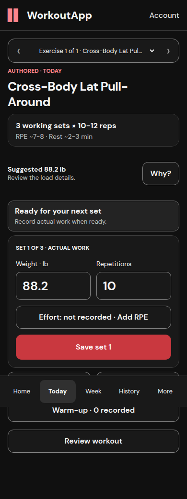 | 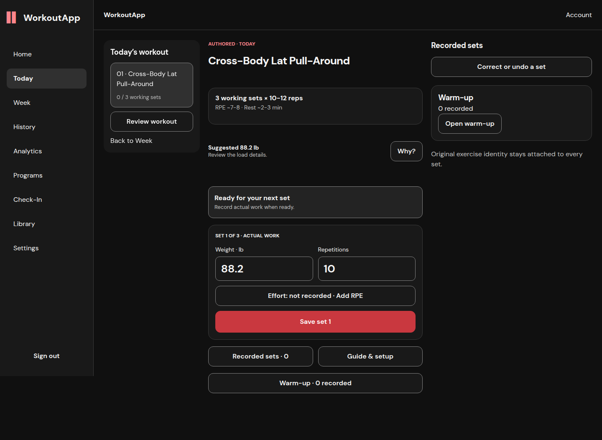 |

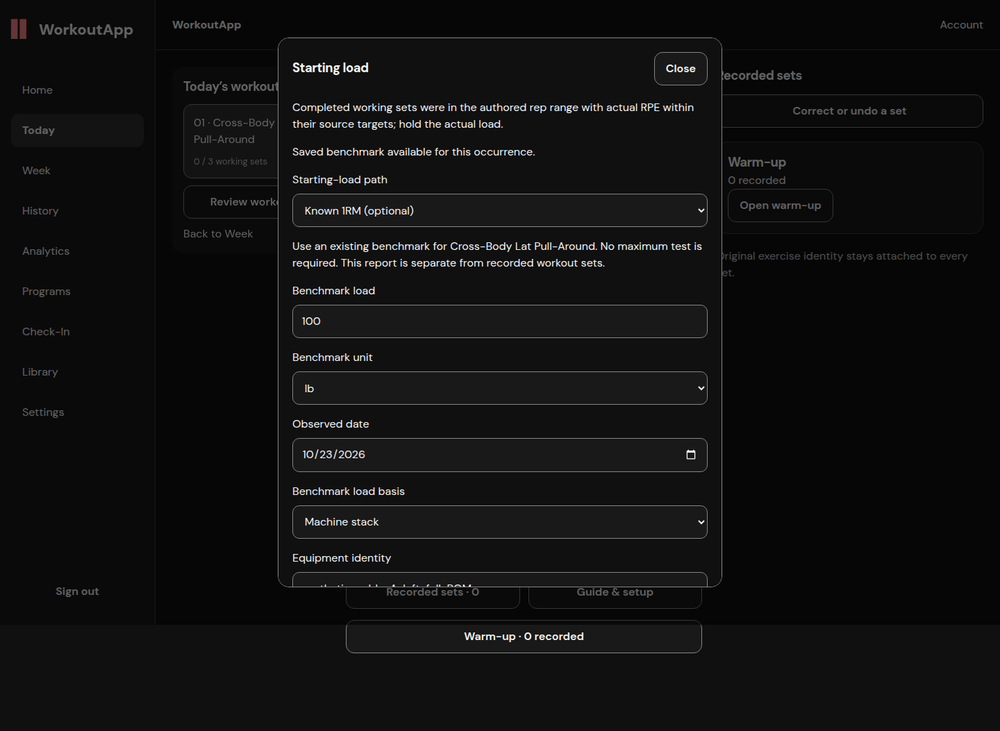

The complete run had no uncaught page errors. Deliberately aborted transport
responses are intentional fault injection. Earlier harness attempts used an
incorrect hidden-element selector and expected a warm-up toast that this UI
does not have; those attempts are not counted as passes. The final fresh-account
run passed every assertion above. This bounded run does not qualify cold Today
latency, physical keyboard/background behavior, every browser, or production.
