# Unified UX implementation: account safety, appearances and gym execution

First application-code slice of the [approved design, PR #108 at 33598c3](https://github.com/Shadowgar/hypertrophyapp/tree/33598c3fb35328cc2d2b6310865f716380b6c81e/docs/ux/astra-2026-10-20/unified-2026-10-21). Base: merged production source `fc3bd0c`. The design branch and its static asset collection are not merged into this branch.

**Development qualification only. No merge, deployment, production migration or production-data access.** Screenshots below show the actual Next.js application and FastAPI API using disposable PostgreSQL and synthetic accounts. They are not design mockups or mocked network responses. Network interception is used only for named failure tests.

[Revision and artifact manifest](manifest.json). Runtime screenshots and structured evidence are committed; synthetic credentials, database contents and private harness configuration are excluded.

## Implemented behavior

- Existing-account sign-in stops after authentication. It cannot write setup/profile, regenerate a plan or submit onboarding answers. Equipment updates use a narrow authenticated PATCH; omitted constraints remain intact in the compatibility profile endpoint.
- Six shared semantic appearances, local DM Sans, responsive navigation and independent Theme / Appearance / Weight unit controls. Missing preference records resolve to Classic WorkoutApp Dark, without a backfill. Updates use account ownership, revision checking and immutable uncertain retries. Follow Device Settings resolves separately on each device.
- Persistent exercise navigation and source prescriptions surround a stationary working-set composer. Warm-ups, load context, actual effort and recorded-set corrections use named native dialogs. Saving does not remount or reorder the inputs or Save button. One acknowledgement occupies a reserved region; the rest countdown uses a durable deadline.
- Canonical kilograms remain stored; pounds are a display/entry preference. Untouched qualified prefills retain canonical precision. Manually entered 40 lb saves as 18.1436948 kg. Targets never become actual RPE/RIR. Unknown pain, quality and effort remain unknown for the next set.
- An unconfirmed save freezes the complete attempted payload and command ID. Reload, retry and late receipt reconciliation preserve identity. A definitive duplicate-slot rejection asks for refreshed receipts. Correction chains and voided rows remain stored. Interrupted technique children have a persistent, reachable retry entry.
- History detail shows units, actual effort, warm-up/technique kind, correction status and original/performed exercise identity.

The existing deterministic engine still owns recommendations, evidence qualification, prescriptions and source substitutions. Known 1RM is an optional reference; this PR does **not** invent an Authored 1RM-to-working-load formula or admit it as qualified progression evidence. Recent performance appears only when provided by the existing owner. Manual calibration remains available when guidance is unqualified.

## Actual application gallery

| Mobile, before save | Mobile, confirmed save and rest |
|---|---|
| 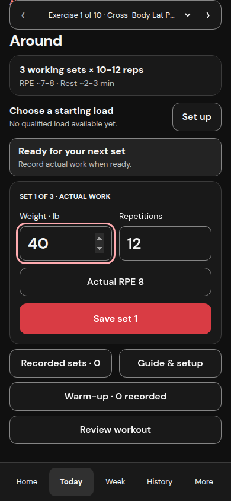 | 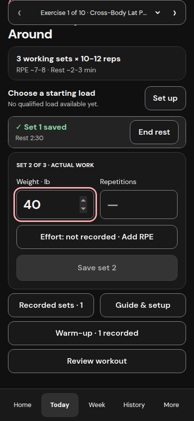 |

| Desktop, before save | Desktop, confirmed save and rest |
|---|---|
| 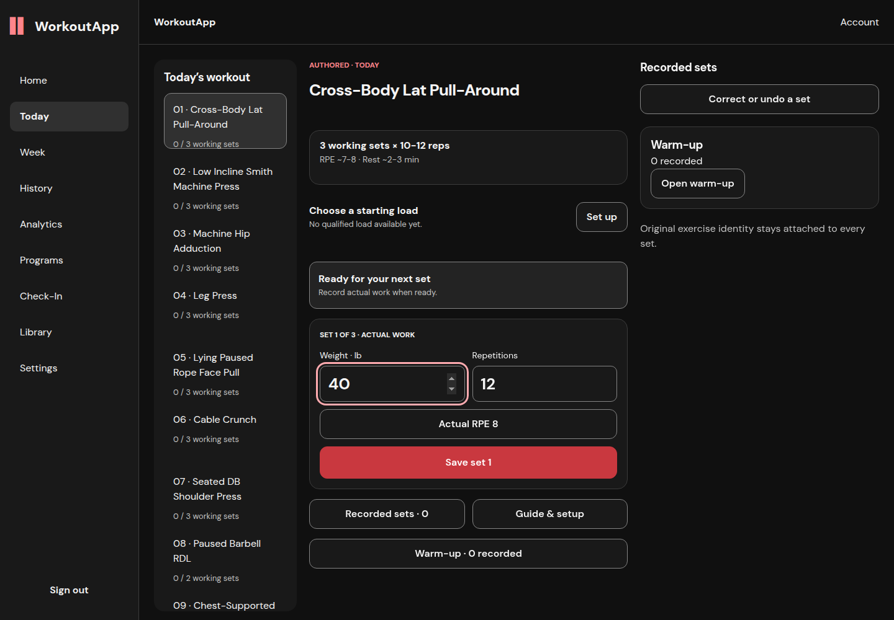 | 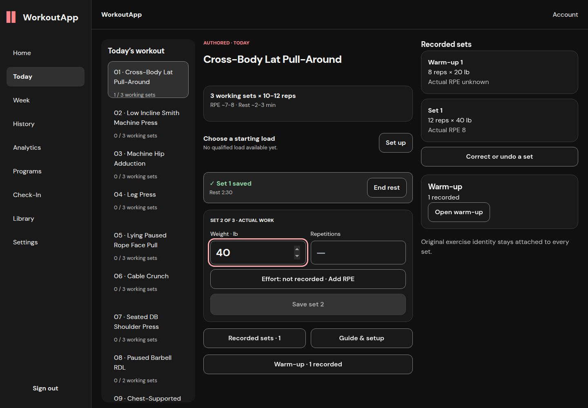 |

| Unconfirmed outcome | Corrected receipt | Recovered entry |
|---|---|---|
| 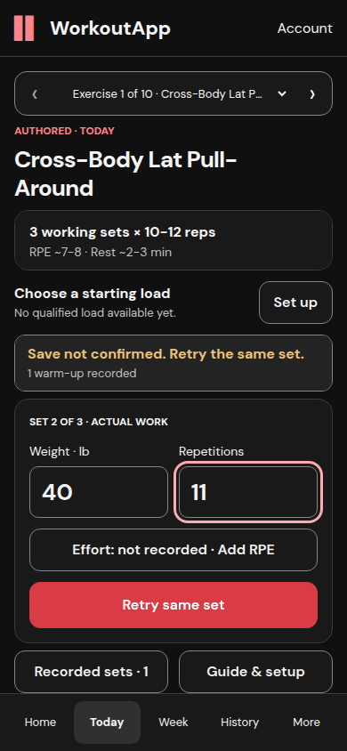 | 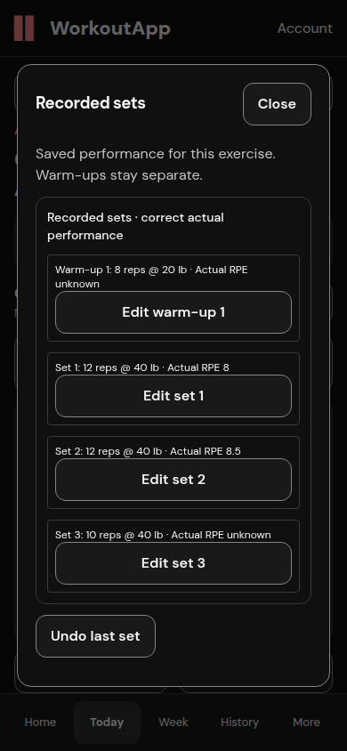 | 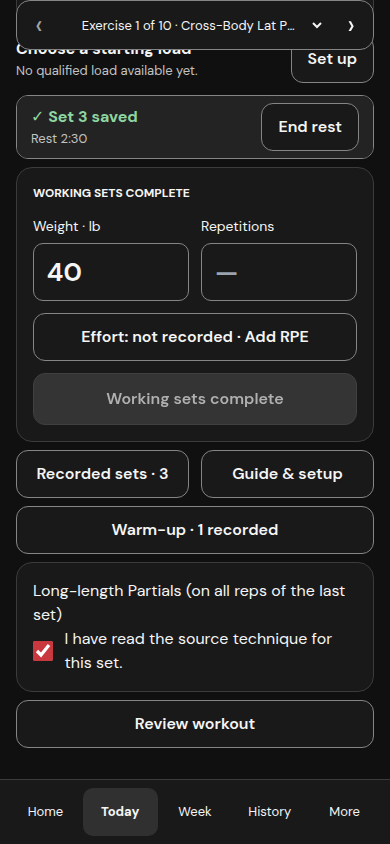 |

## Verified logging sequence

For both 390×844 and 1440×1000 Chromium viewports: open Cross-Body Lat Pull-Around → record source warm-up 1 → enter 40 lb × 12 and actual RPE 8 → save → confirmed receipt/rest → next set → lose its response **after server commit** → retry the identical command → reload → fail set 3 **before reaching the server** → reload the frozen attempt → retry → correct set 2 to 12 reps / actual RPE 8.5 → undo set 3 → reload → save replacement set 3 with a new command → History.

[Mobile replay evidence](mobile-recovery.json), [desktop replay evidence](desktop-recovery.json), and [database receipt checks](receipt-preservation.json) distinguish five submission attempts from three effective working sets. Each account retains six Cross-Body rows: one warm-up, three effective working sets, the superseded original and the voided original. No duplicate command rows were created.

After the recovery sequence, both accounts completed the other 26 prescribed working sets and reached the server-owned 29/29 total. [Mobile completion](mobile-completion.json) and [desktop completion](desktop-completion.json) include the corrected History assertion and no browser runtime exceptions. The run crossed midnight UTC; the existing History day grouping splits the receipts across October 22 and 23. Calendar/timezone policy is unchanged and remains part of the subsequent History/Week work.

| Mobile completion | Desktop completion |
|---|---|
| 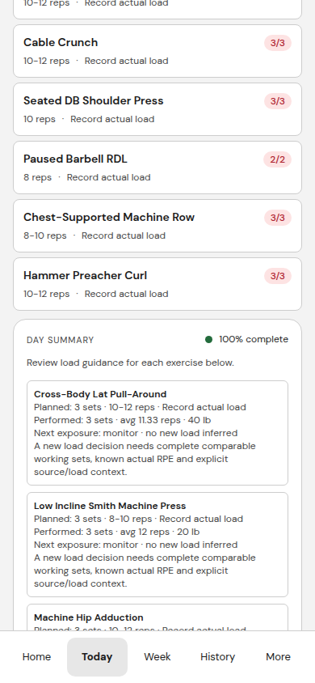 | 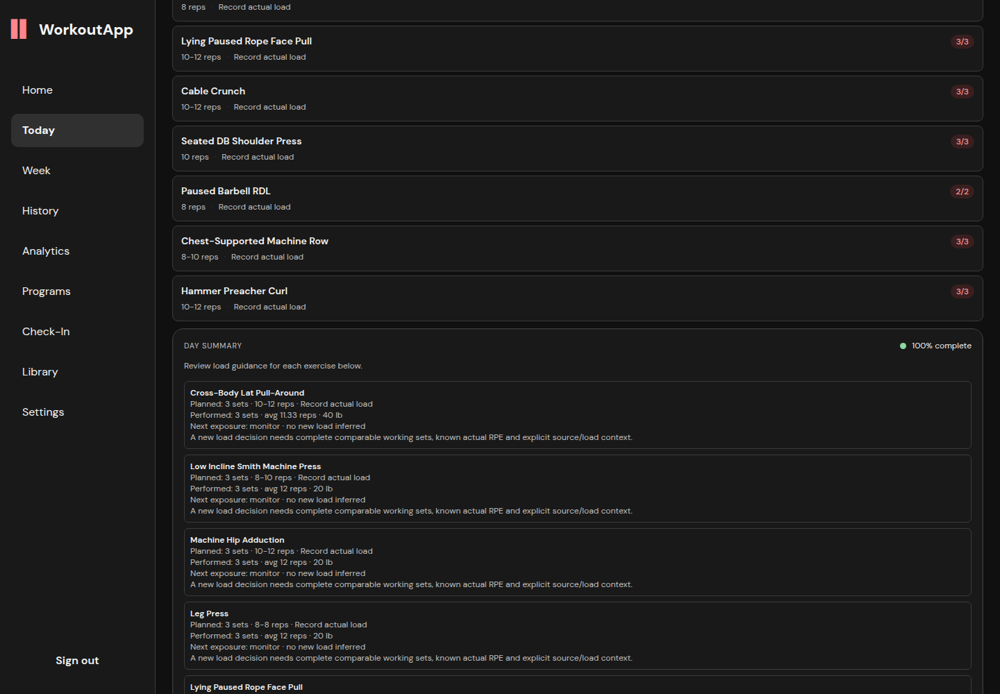 |

[Final overview layout check](overview-layout.json) confirms the rest bar clears the mobile navigation and desktop sidebar. For this final capture, the last synthetic Hammer Preacher Curl set was reopened through the real undo endpoint and saved again through the UI; completion and timer data are server-backed. [Mobile rest bar](assets/mobile-overview-rest.png) · [Desktop rest bar](assets/desktop-overview-rest.png).

[Mobile corrected History receipt](assets/mobile-history-receipts.png) · [Desktop corrected History receipt](assets/desktop-history-receipts.png). History content is improved here; its full approved page layout is a subsequent slice.

## Six appearances and account preservation

| Family | Light | Dark |
|---|---|---|
| Graphite | 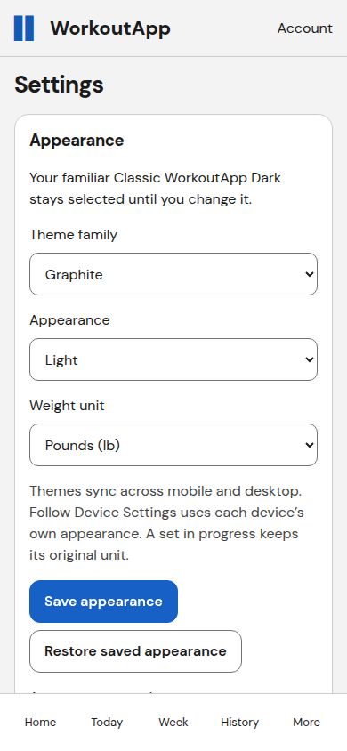 | 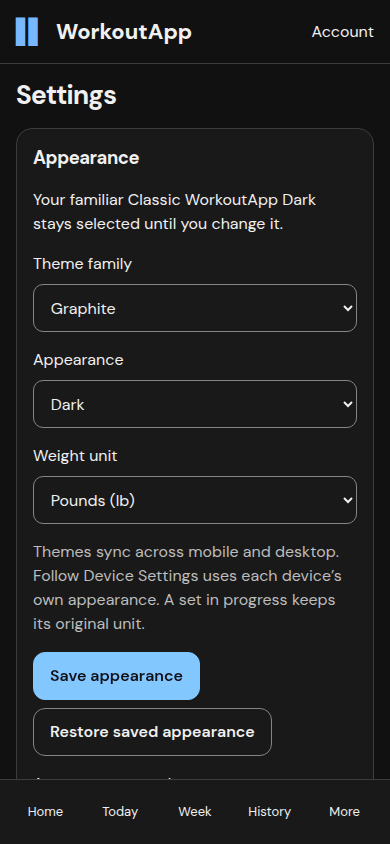 |
| Charcoal | 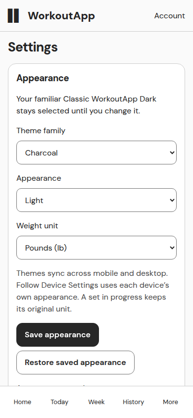 | 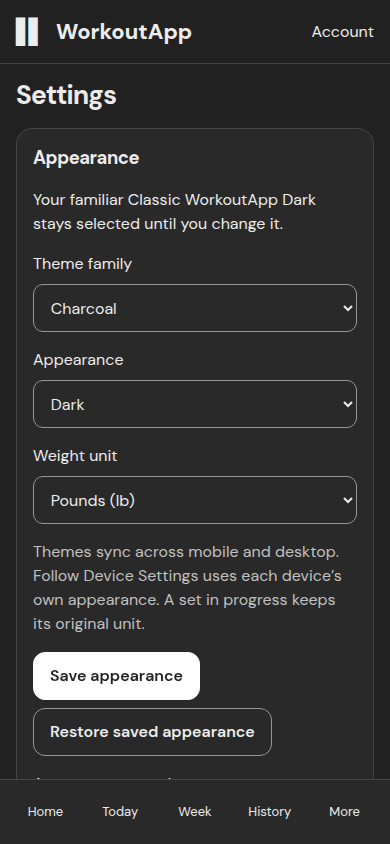 |
| Classic WorkoutApp | 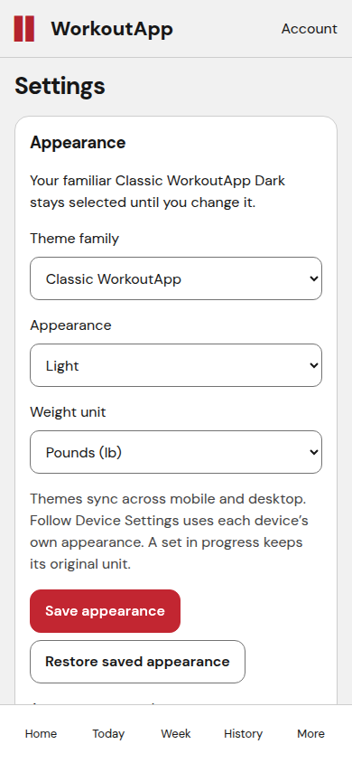 | 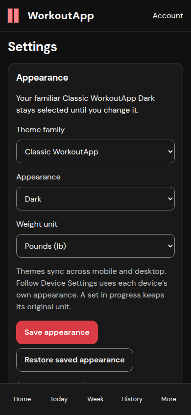 |

[Actual appearance persistence checks](appearance-proof.json) cover all six saves, Follow Device Settings, a separate desktop context loading the same account, another account retaining Classic Dark, and unchanged training-profile hashes. [Desktop device-following screenshot](assets/settings-desktop-system.png).

[Existing-account onboarding sign-in](login-preservation.json) issued only `/api/auth/login`; its profile hashes are identical before and after. API regression tests additionally check equipment-only changes against unrelated profile fields, plans and set history.

Before the final overview capture, on a separate disposable PostgreSQL target at schema 0024, the additive 0025 migration preserved **234 synthetic rows across all 20 existing tables**, including 9 accounts, 9 plans, 83 set-log rows and 87 command rows. [Before hashes](migration-before.json) and [after hashes](migration-after.json) are identical. The new presentation-preferences table was empty after upgrade: no silent preference backfill. Tables with zero rows are listed explicitly; populated Customized candidate behavior is covered by the separate 17-test qualification, not claimed as part of this migration sample. Historical schema seed rows and self-referencing correction chains were copied in dependency order. This is a disposable rehearsal, not a production migration.

## Measurements

Measurements capture input and button coordinates at `pointerdown`, after Playwright has scrolled the button into view, then after confirmation. Window scroll and nested old-overlay scroll are recorded separately. [Baseline](baseline-metrics.json), [mobile](mobile-full.json), [desktop](desktop-full.json).

| Observation | Baseline mobile | Candidate mobile | Candidate desktop |
|---|---:|---:|---:|
| Confirmed save to ready/acknowledged UI | 6699 ms | 2268 ms | 5560 ms |
| Weight / Save control movement | +70 px | 0 px | 0 px |
| Input focus retained | No | Yes | Yes |
| Open Today through first exercise | 27864 ms | 9686 ms | 16682 ms |

These are individual local observations on a shared development host, with fresh synthetic schedules and varying background load. They establish behavior and observed latency, not production p95 or a controlled throughput benchmark. Cold first-use schedule construction remains expensive; no backend planner-performance claim is made.

Physical iOS/Android keyboards and screen readers were not tested. Chromium focus, native dialog behavior, viewport reflow and keyboard focus retention were exercised; a headless mobile viewport does not establish physical IME behavior.

## Regression qualification

Current application source: `d0cdaf95880e5f04794ea2f4bf5ea37e1021309d`. The before/after logging and appearance journeys ran at `400a646`; final overview captures include the overview fixes at `8957890`. The subsequent technique-persistence and snapshot-test fixes have fresh unit/build verification and do not change the captured layout. See the [manifest](manifest.json) for artifact hashes and exact scope.

- 237 web tests across 43 files, including immutable retry, account changes, unit conversion, late responses, source prescriptions, corrections, undo, warm-up and technique reloads.
- 4 PostgreSQL profile tests, including preservation, strict field boundaries, account isolation and concurrent preference updates.
- 76 authored load/warm-up API tests, including consuming the exact guidance returned by the first warm-up.
- 38 History/occurrence/core receipt tests.
- 17 registered Customized application API tests on a separately marked disposable database.
- Production Next.js build and TypeScript pass. The final rest-bar layout correction additionally verifies that the overview timer clears both navigation layouts. ESLint has no errors; eight hook dependency warnings remain and are not represented as a warning-free run.
- [Six-token contrast checks](contrast.json): ordinary/status/action text ≥4.5:1; focus and control borders ≥3:1 against canvas. This is a token check, not a claim that every legacy screen has completed accessibility qualification.

Python 3.12, Node 22, Chromium 145, PostgreSQL 16. API tests use explicit isolated targets; browser data uses an additive-migrated database in a dedicated tmpfs container on loopback port 55418. Production services and persistence were not used.

The initial full suite run during a concurrent build exceeded one interaction test’s 5000 ms timeout (235 passed, one timed out). The 236-test suite passed on frozen application revision `8957890`; the follow-up suite passes 237 tests across 43 files in 142.91 s without a concurrent build. The final loading-mock refinement additionally passes all four visual-route tests; the timeout is retained as a host-load limitation, not reclassified as a passing run. Initial preservation-copy attempts also rejected a duplicate migration-seeded schema marker and out-of-order self-referencing corrections; the copy harness was corrected to verify seed rows and insert parent receipts first, with transaction rollback preserving the disposable source.

## Global CI status

The first global CI run found four core-engine and five API failures, all independently reproduced on unchanged base `fc3bd0c`. Two API failures require a licensed source workbook absent from both checkouts. It also exposed a loading snapshot race and source-text technique persistence warning; both are corrected in the follow-up. Global CI is **not** reported green. See [CI evidence and limits](CI.md).

## Review and limits

A fresh Astra reviewer examined the complete application diff, then verified fixes for appearance request shape, cross-tab draft resets, per-set observation carryover, late receipt reconciliation and interrupted technique entries. The final targeted reviews found the acknowledgement races resolved and no material regression in the overview unit, guidance and navigation corrections or reference-only technique recovery. The reviewer also caught a scheduling-context request missing from the loading snapshot mock; that mock now holds all initial reads pending. This source review does not substitute for runtime tests above.

Codex Security preflight passed; its 25-file diff inventory and source review found no validated new cross-account vulnerability. **Canonical scan export remains incomplete:** the host artifact writer rejected existing group-writable Codex state ancestors. Scan `4dd811ac-78b3-4cd8-b36b-2c583ed97644` is retained; no host configuration or permission changes were made. This is not reported as a completed sealed security scan.

## Remaining approved work

The shared shell/themes apply across routes, but this PR is the first focused implementation, not the complete full-application redesign. Next: guided Home/onboarding and program/equipment selection, followed by Week, the full History/Analytics layouts, Check-In and remaining Settings/account screens. Existing Authored/Customized contracts and accepted history remain authoritative. See [all 28 finding statuses](TRACEABILITY.md).

## Reproducing the browser evidence

The scripts in [reproduce](reproduce/) require loopback application instances at 3017 (baseline), 3018 (candidate) and an explicitly disposable API. Never point them at production. Prepare synthetic account tokens in a private `fixtures.json` beside the output files; do not commit it. Set `UX_OUTPUT_DIR` to that directory, `PLAYWRIGHT_MODULE` to an installed Playwright module if necessary, and optionally `CHROMIUM_EXECUTABLE`. Run `full-journey.cjs <fixture-name>`, then `recovery-journey.cjs <fixture-name>`, then `complete-workout.cjs <fixture-name>`. Desktop fixture names start with `desktop`. `settings-journey.cjs` expects fresh `mobile_final` / `desktop_final` fixtures whose saved appearance is still Classic Dark. `baseline-confirmed.cjs` and `login-preservation.cjs` use `before_final`; the login script also requires that synthetic fixture’s email and password. Tokens and credentials remain local. These scripts intentionally perform writes only in the isolated qualification application.

`overview-layout.cjs` additionally requires the completed synthetic fixture’s `overview_workout_id` and Hammer Preacher Curl `overview_exercise_occurrence_id`; it deliberately undoes and re-saves that final set through the real API/UI to qualify the overview timer after the last layout fix. Do not run it against an account whose history should remain untouched.
