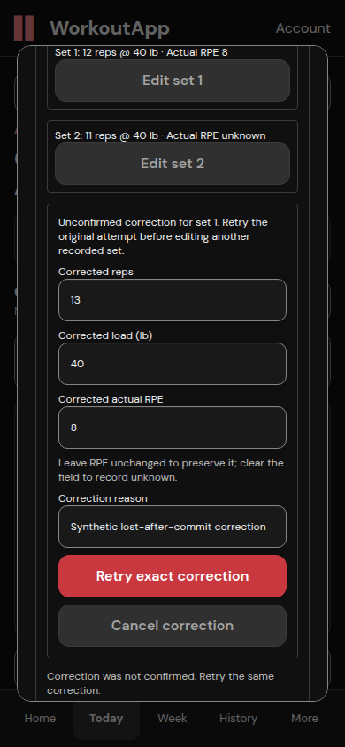
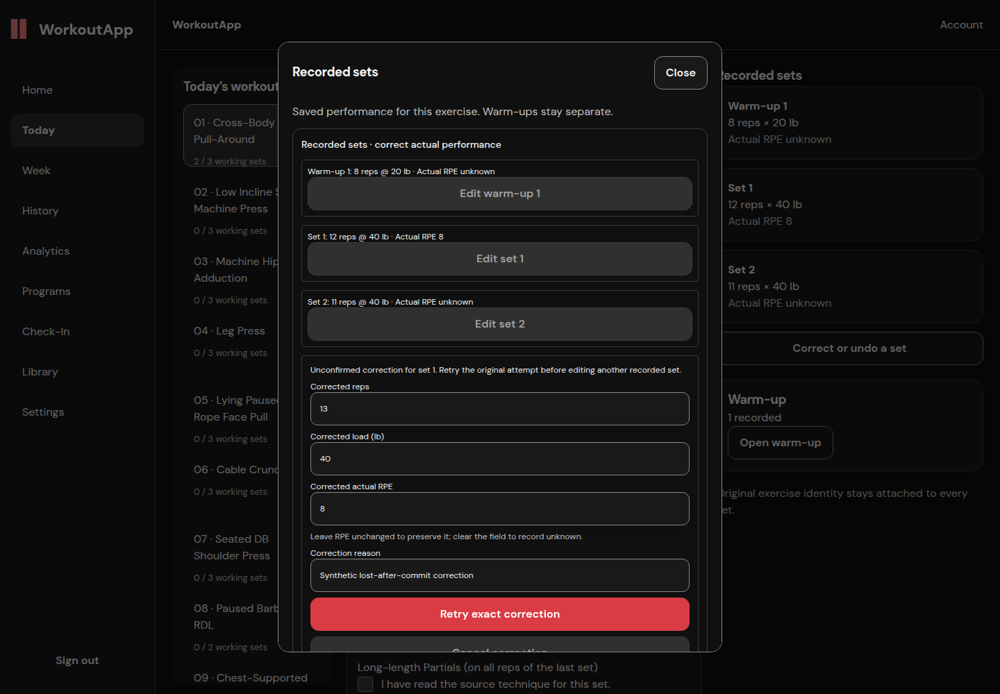
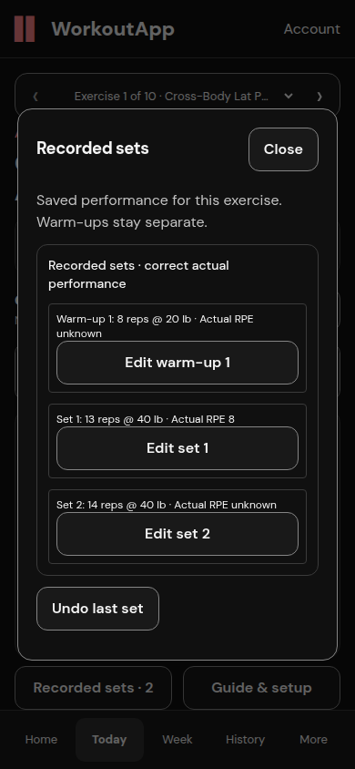
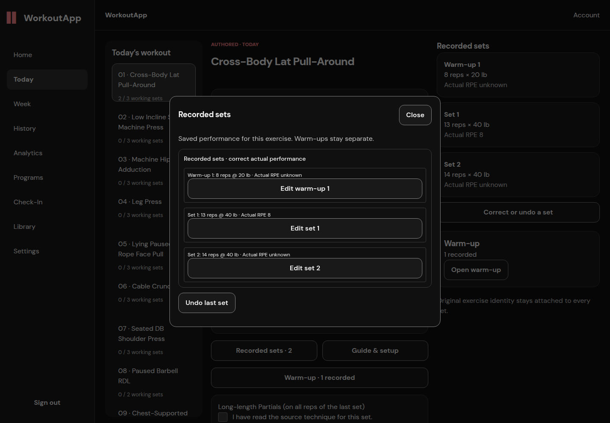
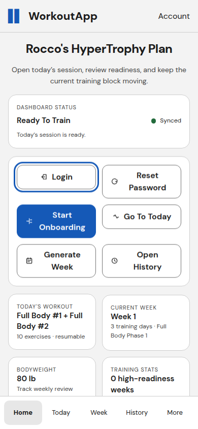
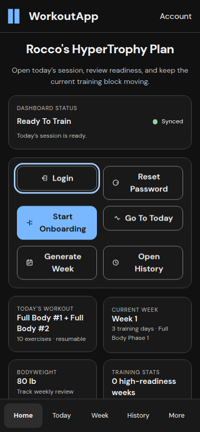
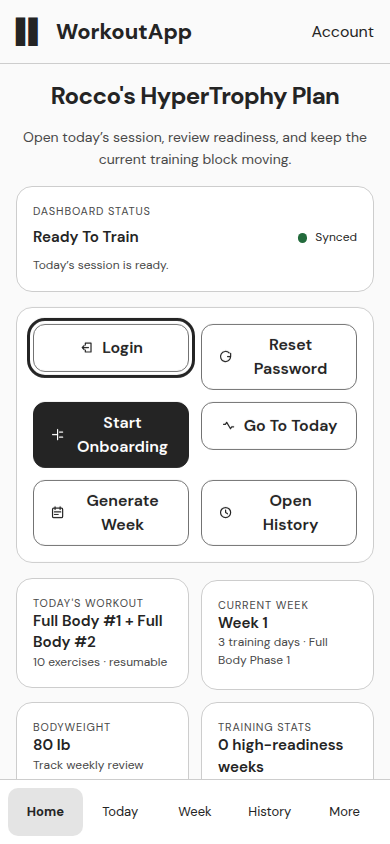
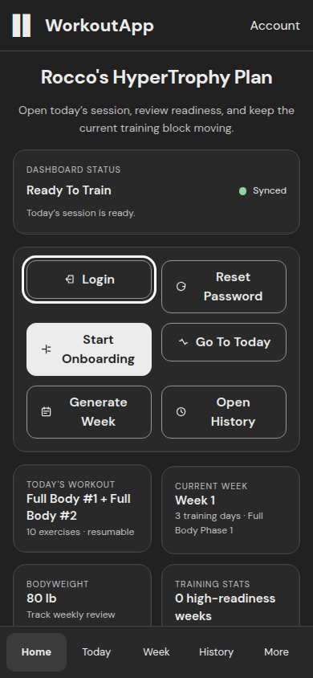
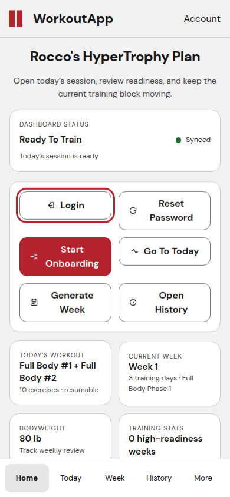
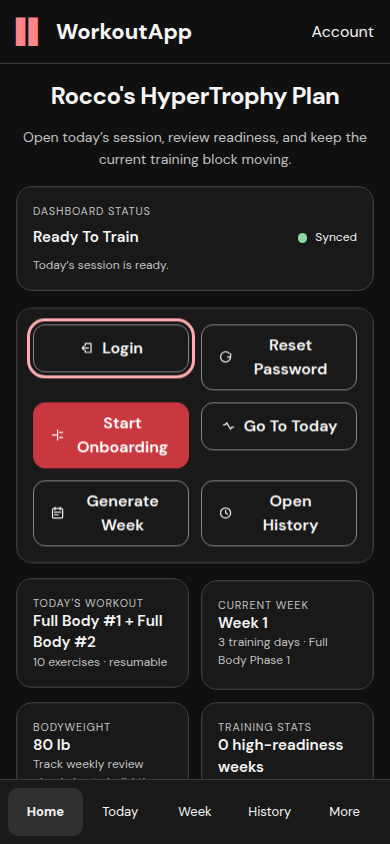

# Bounded correction and qualification pass

This package corrects PR #110 from verified review target `a3f5760badfe2d5fbc76fcb12b026286a256e4f9`. The original four-finding runtime source is `aa43248`. [Additional undo recovery and final application qualification](undo-followup/README.md) records later source `1226fb3`; earlier captures are not relabeled as that revision. No broader Home/onboarding slice, palette redesign, merge, deployment, production migration or live-data operation occurred.

[Finding dispositions](REVIEW.md) · [Remaining Issue #103 requirements and physical iPhone procedure](REMAINING.md) · [Precise managed security limitation](SECURITY.md)

## Corrected behavior

- An uncertain correction retains the original receipt, command, payload and entry unit before transport. Another receipt cannot replace it. Closing/reopening and reload restore the exact retry, including when the server already superseded the original receipt. A late acknowledgement cannot create a replacement command. Correction history remains intact.
- Legacy body, small text, labels, section titles, telemetry text, placeholder/options/focus and disclosure hover states use existing semantic colors. No palette values or Classic Dark default changed.
- Every History mass/volume presentation uses saved lb/kg, including actual receipts, bodyweight/strength summaries and charts, accessible names, tooltips and PR differences. Centimetre measurements and canonical data stay unchanged.
- Both existing development cleanup transactions explicitly delete only the target user's preference row before deleting that user. No broad cascade or schema change. Existing authorization, confirmation and disabled defaults are retained.

## Verification scope

The original gallery and timing evidence in the parent README retain their original revision labels. They are not recertified as final-source evidence by this document. New correction and rendered-appearance evidence below is from the final rebuilt application using Next.js/FastAPI and a dedicated disposable PostgreSQL database on loopback, with new synthetic accounts. Network interception is restricted to named failure injections.

Local checks: 246 web tests across 45 files passed on `3dfcfb5`; the later layout-effect lint correction additionally passes 16 focused correction/RPE tests. The final application production build/TypeScript and lint checks are reported with the collected results. Four fresh PostgreSQL profile/persistence tests passed. The new cleanup tests passed on dedicated PostgreSQL and standalone SQLite, three cases each. Both FK failures reproduced before the fix. The additive migration rehearsal preserved exact in-memory snapshots of existing synthetic account/plan/log rows and migration markers, with zero preference backfill. [Sanitized rehearsal proof](additive-upgrade.json) states its original snapshot-retention limitation.

Global CI: the review-target API rerun finished **872 passed, 5 failed, 118 skipped**; its overall CI failed. All five API and four core failures were independently reproduced on unchanged base `fc3bd0c` in the preceding pass. They remain failed qualification requirements, not waivers. No tests were skipped/loosened or licensed source fixture fabricated. Final published-head CI status is recorded in the PR after its run; pending jobs are never treated as passed.

The managed Codex Security export remains incomplete with a freshly reproduced host writer error. Independent source review of this correction pass found no material finding; it did not execute browser/database tests and does not replace a sealed security scan.

## Final application runtime evidence

Both final-source Cross-Body flows passed: source warm-up → weight/reps/actual RPE → confirmed save/rest → next set → correction response lost after server commit → other receipt locked → close/reopen → reload → exact original retry → correction failed before commit → close/reopen/reload → exact retry → History. [Mobile attempts](mobile_correction-correction-recovery.json) and [desktop attempts](desktop_correction-correction-recovery.json) preserve each request URL, command ID and payload. [Database proof](correction-database-proof.json) verifies five Cross-Body rows per account, including both superseded originals and exactly two effective corrected working sets (13/14 reps), with no duplicate correction rows and unchanged canonical load.

| Mobile unknown outcome | Desktop unknown outcome |
|---|---|
|  |  |

| Mobile confirmed | Desktop confirmed |
|---|---|
|  |  |

[Final mobile save measurements](mobile_correction-full.json) and [desktop measurements](desktop_correction-full.json): 0 px weight/reps/Save movement and retained focus. Local open/save observations were 33270/9782 ms mobile and 30604/10440 ms desktop under concurrent qualification load. These retain the slower observations; they are not controlled production benchmarks or cold-loading acceptance.

[Rendered appearance measurements](rendered-themes.json) cover Home, Week, History, Check-In and Settings in all six appearances after network idle, with actual text/ancestor-background compositing, focus outlines/control colors and legacy disclosure hover. All sampled normal/large text meets 4.5/3:1 and focus outlines remain visible. This is representative sampling, not whole-application WCAG certification.

| Family | Light Home | Dark Home |
|---|---|---|
| Graphite |  |  |
| Charcoal |  |  |
| Classic |  |  |

[History saved-unit browser proof](history-saved-units.json): persisted kg → lb → kg updates actual bodyweight and strength chart titles/accessible labels, with identical canonical analytics hashes before/after. [kg screenshot](assets/history-saved-kg.png) · [lb screenshot](assets/history-saved-lb.png). The fixture adds two explicitly synthetic check-ins and two prior-week strength rows to the new disposable account. Current UTC receipts were excluded from that local-date analytics window; this existing date-policy limitation is not repaired or accepted here. Both units, PR deltas, receipts, volumes, summaries and cm preservation are additionally covered by the component regressions.

## Harness limitations and reproduction

Initial browser attempts failed because the harness assumed an unopened runner and a retained working-load input after reload; it now waits for either overview or runner and enters the load explicitly. One concurrent desktop cold-load attempt timed out; its successful rerun is recorded separately, with cold-load acceptance still open. Initial rendered checks found the Classic Light hover defect and motivated the semantic hover fix. The History assertion requiring bodyweight plus strength labels was retained; synthetic prior-week data supplied the missing analytics fixture. No application tests/assertions were weakened.

Portable browser scripts are in [reproduce](reproduce/). Set PLAYWRIGHT_MODULE, CHROMIUM_EXECUTABLE and UX_OUTPUT_DIR to a private directory containing fresh synthetic `mobile_correction` / `desktop_correction` / `before_final` fixtures. Run `pass-full-journey.cjs` then `correction-recovery.cjs` per fresh correction account; never reuse an already completed fixture as fresh input. The History script requires the named synthetic historical check-ins/strength rows, and writes only saved preferences. Appearance tests change only the synthetic before_final account. Endpoints are fixed to isolated loopback 3018; do not point these tools or databases at production. Synthetic credentials, raw API logs and database contents are excluded.
