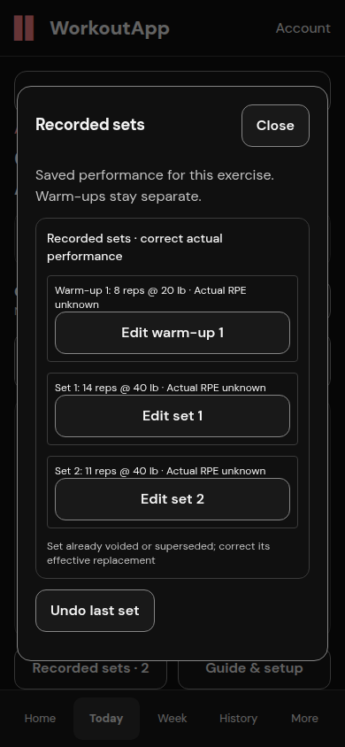
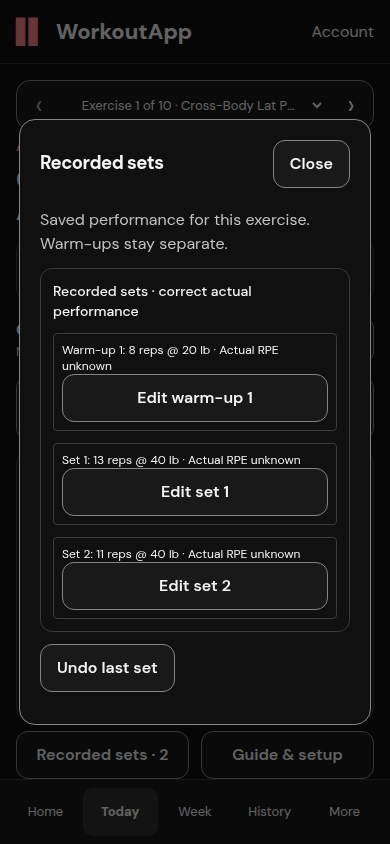
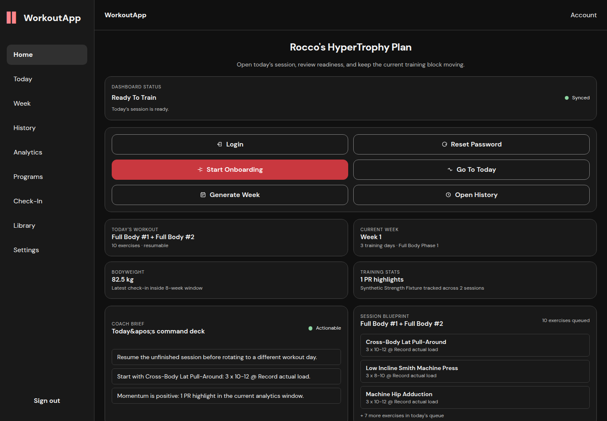

# Additional correction and unit compatibility findings

Application source `d0685829d913c3a4db46293dce95dcd975c8fc4e`, including route-unit commit `c517e5b`. This follows the earlier correction runtime (`aa43248`) and undo runtime (`1226fb3`); their results retain those revision labels. No palette, layout, backend policy, schema, prescription or consent changes were added.

| Later PR finding | Fix and verification |
|---|---|
| `PRRT_kwDORciBG86vcslR`: definitive stale correction remains frozen | `d068582`: only exact backend obsolete-receipt 409 / confirmed Set-not-found 404 retires that editor and command and refreshes effective receipts; unrelated conflicts/404/transport retain the immutable attempt. Refresh keeps newer concurrent receipts and the current-occurrence boundary. |
| `PRRT_kwDORciBG86vcslU`: switching effort scale preserves invalid counterpart | `d068582`: nonblank RPE/RIR editing visibly clears the other input and explicitly sends null for that counterpart. The full attempted payload remains frozen across lost replies/remount/retry. Other unknown fields stay omitted. |
| `PRRT_kwDORciBG86vcslZ`: other route summaries ignore saved units | `c517e5b`: existing Home mass summaries, Authored/Customized Week loads and previous-week Check-In audit use saved kg/lb. Canonical entry/submission remains kg and the Check-In input is accurately labeled Current Bodyweight (kg). This is display compatibility, not the broader Home/onboarding redesign. |

Focused checks: 58 correction/Today/RPE cases pass, final receipt-refresh regressions pass, and 33 Home/Week/Check-In unit cases pass. Both initial units and round-trip switching are covered without canonical data changes. Final full suite: **269 tests across 47 files pass**; production build/TypeScript and lint pass (zero errors, eight existing warnings). Independent source review found no material regressions in these three fixes; it did not execute the runtime checks.

## Real Customized effort contract

The retained [API qualification script](reproduce/customized-effort-api.py) uses the registered disposable PostgreSQL application fixture, unique synthetic account and the existing proposal/challenge/consent/activate path. It passed one test in 5.79 s, with zero skips and two existing deprecation warnings. It reproduces 422 when a counterpart is omitted, verifies RPE→RIR by explicitly clearing RPE, verifies RIR→RPE by explicitly clearing actual_rir, then retries the identical correction. Exactly three history rows remain and the consent receipt is unchanged. No licensed fixture was fabricated; this is synthetic training data, not source ingestion.

Run from the repository with the existing API test dependencies and an explicitly verified `C3B2B_TARGET_MANIFEST`. Follow AGENTS/DB_SAFETY_LOCK before imports/startup. The fixture's safe missing-manifest refusal is not a passing result; qualification here used the verified marked `c3b2b97_ux` target, never production. An initial invocation could not read a custom environment variable because the isolated wrapper strips inherited variables; the reproducible script resolves the existing test module from the working directory instead. No tests or assertions were weakened.

## Final-source browser and PostgreSQL checks

[Actual stale-receipt and lost-response journey](correction-conflict.json) · [Database chain proof](conflict-database-proof.json) · [Saved-unit route observations](units-routes.json).

The mobile browser records two new synthetic working sets, opens the original receipt for correction, and a separate authenticated API client corrects that receipt first. The UI's stale correction receives the real definitive 409, retires that editor and loads the replacement. Both current receipts are editable. The user explicitly edits the replacement, loses its reply after commit, reloads and retries the identical new receipt/command/payload. PostgreSQL retains the full 12→14→13 rep chain and the unaffected second set at 11 reps. The stale rejected command has no server record; the lost-response correction has exactly one command and one replacement row. All ten Cross-Body rows remain and canonical kilograms are unchanged.

| Definitive rejection and refreshed receipt | Confirmed correction after exact retry |
|---|---|
|  |  |

Existing Home/Week/Check-In browser checks pass kg→lb→kg with no runtime exceptions and identical canonical profile hashes. Home specifically waits for the expected bodyweight readout (82.5 kg / 181.9 lb / 82.5 kg), Week for its loaded current-week context, and Check-In for its loaded review status and explicit kg input. The actual Week remains unqualified for numeric starting load; no recommendation was manufactured to populate the test. Both Authored and Customized numeric Week conversions are separately covered by the positive 80 kg→176.4 lb component fixtures. Check-In's canonical entry contract remains kg; this is labeled accurately rather than silently converting submissions.

| Home kg | Home lb |
|---|---|
|  |  |

[Week kg](assets/units-kg-week.png) · [Week lb](assets/units-lb-week.png) · [Check-In kg preference](assets/units-kg-checkin.png) · [Check-In lb preference](assets/units-lb-checkin.png).

Two initial route-browser attempts timed out at a global network-idle wait. A diagnostic showed all required dashboard APIs returned 200 and the correct 82.5 kg readout already rendered; the unrelated `/programs` background request was pending. Assertions now wait for the required loaded content and exact mass value, not unrelated background idle. The timeout is retained as a performance/navigation observation, not reclassified as passing. Cold-loading acceptance remains open. No application tests were weakened, no backend response was fabricated, and this bounded pass does not implement the broader Home/program-selection redesign.
