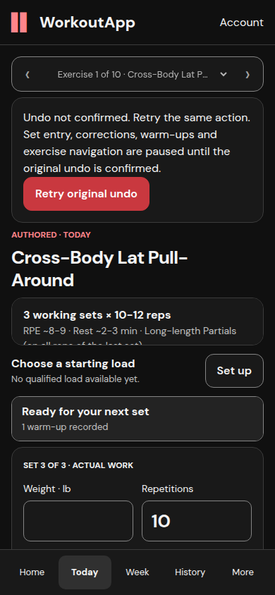
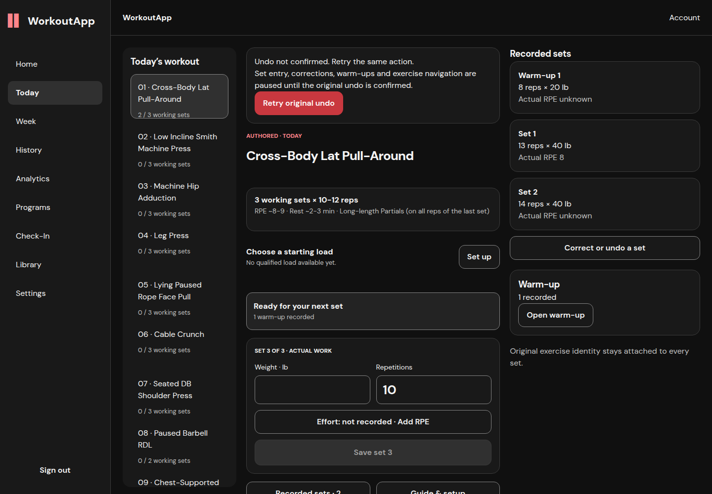
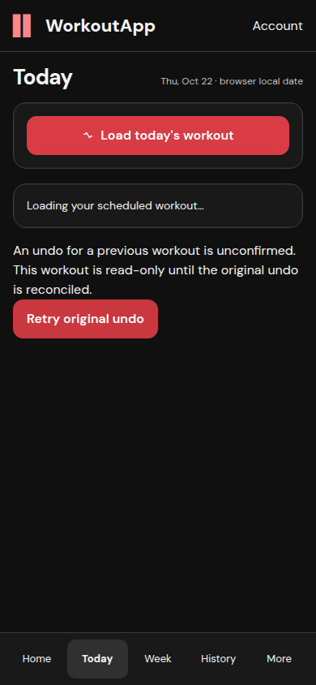
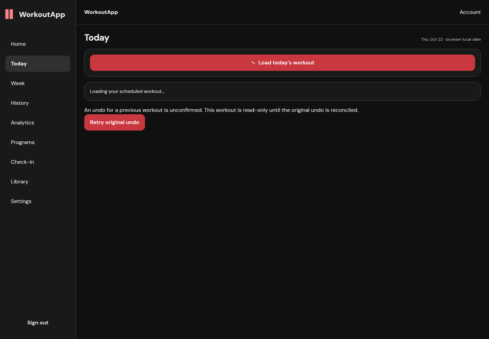

# Additional undo finding and final application qualification

Application revision: `1226fb307a953b70a0ffd8c1422e91cad18ed991`. This follows the original four correction findings, whose runtime assets remain scoped to `aa43248`. The later change affects Today/Atlas undo recovery only; no backend, schema, load owner, prescription, consent or historical-record policy changed.

New PR finding: `PRRT_kwDORciBG86vcYtx` — an unconfirmed undo allowed another set write or exercise selection before retry. The fix stores original account, workout/exercise occurrence and command before transport, makes retries use those arguments, locks working/warm-up/correction/technique writes and exercise navigation, and clears recovery only after the reply and resulting server count reconcile. The rest-bar shortcut follows the same lock. Pending recovery remains reachable with zero working receipts, a different current occurrence, Today 404 or a failed Today projection.

Independent source review found two negative boundaries during development: missing-workout views hid the retry, and a definitive no-mutation rejection could permanently lock the UI. Both were fixed and retested. Only the exact existing backend 409 message “Historical replay context unavailable; original record retained without changes” releases that rejected action; generic 409 and transport uncertainty retain the lock. The actual rejection is shown instead of a saved/undone claim.

Ten focused recovery/legacy-undo tests passed, plus TypeScript and scoped lint. Cases cover before/after commit, last working receipt, cold imports/reload, blocked writes/navigation, exact command and next logical index, account isolation, previous occurrence, rest day, unavailable projections after acknowledgement, precise rejection and generic conflict. Independent review verified both fixes in source only; runtime results below are separate.

Earlier complete global CI at `6af9498`: web 246/45 pass; CodeQL pass; API 875 pass/5 inherited failures/118 skips; core 770 pass/4 inherited failures. Its overall workflow failed. No inherited failure is waived. The final published head receives a fresh CI run; results are reported in the PR without promoting earlier runs to final-head results.

## Final runtime and regression results

**255 web tests across 46 files pass** on the final application revision, as do production Next.js build/TypeScript and ESLint (zero errors, eight existing warnings). Both real API/browser journeys passed in Chromium at 390×844 and 1440×1000. No browser runtime exceptions were recorded.

[Mobile undo replay](mobile_correction-undo-recovery.json) · [Desktop undo replay](desktop_correction-undo-recovery.json) · [PostgreSQL row/command proof](undo-database-proof.json).

Each journey begins with the two corrected Cross-Body working receipts from the earlier package. It injects failure before undo commit; confirms disabled working entry/Save and visible exercise navigation; closes/reloads; retries the exact original action; re-saves logical set 2; loses an undo response after server commit; closes/reloads and retries exactly; then fails another undo before commit, reloads with Today 404 and recovers the original action through the global retry. Three unique undo commands produce six submission attempts and exactly three server undo-action rows. The six Cross-Body set rows are retained, including both correction parents and the replacement set; all working receipts are now void/superseded, with the original warm-up retained and no duplicate set-command rows. No production database was used.

| Mobile unknown undo | Desktop unknown undo |
|---|---|
|  |  |

| Mobile recovery without Today | Desktop recovery without Today |
|---|---|
|  |  |

[Supplemental rendered focus proof](focus-parent-check.json), captured on earlier appearance source `aa43248`: actual Settings controls in all six appearances use 3 px outline/offset; outline-to-composited-parent ratios ≥6.52:1 and control-border ratios ≥4.74:1. The undo follow-up does not change theme values or these components.

An initial desktop browser assertion looked for the mobile-only Select exercise control, hidden at desktop width. The harness now asserts that all visible persistent desktop exercise/navigation buttons are disabled, while mobile asserts its visible selector. No application regression/assertion was weakened. The portable script expects the earlier two-set corrected synthetic fixtures and must run only against the isolated loopback application. It deliberately undoes synthetic rows; never use an account whose data should remain unchanged.
