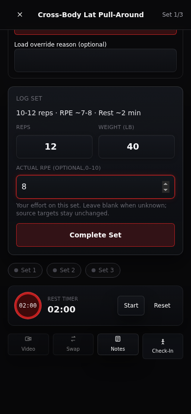
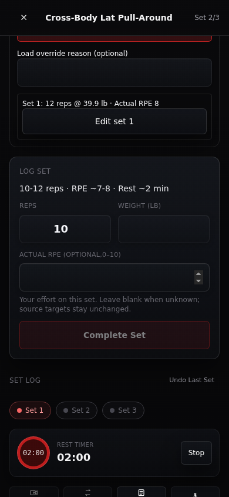

# Exercise logging: current behavior and proposed flows

**Review sketches only.** Every proposed behavior below requires explicit owner design approval and subsequent implementation/qualification. No new calculation, program authority or offline capability is established by a drawing. All example training records are fictional.

## Current, independently observed

At 390×844, the Authored exercise opens with expanded warm-ups, constraint actions and technical load controls before the working-set input. The working-weight input initially sits at y=1526.75. After scrolling to the form, saving the first set moves it from y=274.75 to y=364.75 while the inner scroll position stays at 1236. A single effective receipt appears above the form. A separate Set Log/Undo region and set-progress pills sit below it. Current intelligence paths suppress duplicate local receipt values; literal duplicate values were not reproduced.

| Before save | After acknowledged save |
|---|---|
|  |  |

The failed-save message is outside the opaque runner. Tab from its last Check-In link reaches background navigation. Three synthetic acknowledgements produce three editable receipts; correction/undo/reload rebuild the synthetic receipt list. See [audit](AUDIT.md) and [evidence limits](EVIDENCE.md).

## Shared interaction contract for both proposals

The alternatives differ in navigation and spatial organization. They must meet the same state and training-authority obligations.

| State / action | What the person sees and does | What must remain true |
|---|---|---|
| Open an exercise | Exercise, mode/program, current working set, exact prescribed reps/effort/rest and any applicable technique are visible. Source warm-up is a separate task. | Source slot and performed variant remain distinct; repeated exercise names do not merge occurrences. A source technique or pair is not hidden as optional decoration. |
| First load, no comparable history | Three distinct optional paths: known 1RM, recent weight × reps, or guided manual starting load. Each states what information is being entered. Manual logging remains available. | These entry paths are **proposed capabilities**. Current Customized historical reports are informational only. No client-side percentage recipe is authorized. If the responsible engine cannot supply a supported estimate, say so and offer manual calibration. |
| Existing qualified guidance | Show suggested working load, explicit unit/basis and concise owned reason; keep actual load editable. “Why this suggestion?” opens evidence/context. | Comparable effective performed evidence outranks unqualified self-reports. Unknown equipment, effort or history is not invented. User edits never alter prescribed sets/reps/effort. |
| Warm-up | Show the source-required warm-up separately; log actual load/reps and optional effort. Make raw source instructions available. | Warm-up count/instructions and authoritative guidance are preserved. Warm-ups never advance the working-set count. Technique children remain distinct too. |
| Before working save | Stable current-set composer, prescribed target, actual reps/load, explicit unit and one Save set action. Actual effort is optional, unknown by default. | Authored RPE and Customized RIR retain their native meanings. Do not prefill performed effort from the target or silently convert between scales. |
| Saving | Same reserved status region says “Saving set 1…”; immutable attempted values remain visible; repeated submit is disabled. | Pending is not completed. The same occurrence-scoped command identity and payload are retained for an uncertain retry. A late result cannot update a different account, exercise or occurrence. |
| Confirmed | Reserved region says “Set 1 saved”; the existing ordered receipt slot becomes confirmed once. Current-set label advances in place. | Confirmation follows server acknowledgement. The next composer and primary action retain their coordinates. No new receipt list appears above the form. Screen-reader status is announced without stealing focus. |
| Rest / next set | Countdown beside the same composer; next-set preparation remains available. Timer controls have text labels. | Rest is a UI aid, not automatic work. Browser suspension/reload needs deadline-based reconciliation in a future implementation; the sketch is not a timer reliability claim. Do not skip mandatory source sequence/rest requirements. |
| Optional feedback | Plain wording such as “How many more reps could you have done?” for RIR, with Unknown/Skip. RPE retains its own explanation. Pain/technique choices stay available. | If entered before Save, feedback belongs to that command. If entered after acknowledgement, attach it through an explicit receipt correction/update; never silently mutate a saved set or guess missing feedback. |
| No acknowledgement / offline | Same region says “Save not confirmed”; show exact attempted values and Retry this set. Distinguish a rejected validation from an uncertain outcome. | Never display Saved or advance on timeout. No unqualified promise of offline saving. Reconcile server evidence before permitting a different command for the same logical set. Draft support must state its scope and limitations. |
| Validation or stale guidance | Keep draft visible; identify field or outdated advice; refresh/review explicitly. | Do not keep retrying a stale rejected payload as though it were a transport timeout. Preserve original actual values and canonical-unit precision. |
| Correct one receipt | Tap its Edit action; a named correction panel shows original and proposed actuals, reason and Save correction/Cancel. Return to the same set task on close. | Only that receipt chain changes. Rebuild dependent guidance from effective evidence; do not edit source prescription or erase historical provenance. Unknown effort can be recorded explicitly. |
| Undo | Name the exact latest record and kind, request confirmation in-place, then update its effective state after acknowledgement. | Warm-up versus work undo is explicit. A voided record is not silently deleted from audit history. Completed count and guidance follow server evidence. |
| Reload / resume | Reconstruct current set and the one ordered receipt list from effective occurrence evidence. Show a reconciliation state while loading. | Browser memory is not saved-history authority. Freeze account/occurrence identity while reconciling an in-flight attempt. No stale response restores another user's draft. |
| Exercise / workout finished | Distinguish all prescribed working sets completed, partial work, and unresolved slots. Offer review of actuals and next permitted action. | One logged set or a warm-up does not equal a completed workout. Rest days are not missed days. No automatic program switch or new plan activation. |

## Alternative-specific interaction model

**A — Next Step:** The application presents the next meaningful task. Setup is a short path; exercise work moves through source warm-up, work, rest and review with an overview always reachable. Confirmed work changes the state of the same composer rather than adding a new screen above it. This reduces decisions in the gym, but requires a clear route back to any prior exercise or receipt.

**B — Training Atlas:** The session map remains present. Mobile keeps a selected exercise and a pinned composer; desktop gives the map, composer and evidence their own columns. Saving updates the existing set slot and receipt region. This supports experienced users comparing and correcting work, but has a larger information burden on a small phone.

See each [A gallery](designs/direction-a/GALLERY.md) and [B gallery](designs/direction-b/GALLERY.md) for original visual states and authored rationale. They are alternatives for owner selection, not two modes proposed for simultaneous implementation.

## Preserved application boundaries

| Area | Current authority / source anchor | Presentation obligation |
|---|---|---|
| Authored prescription and source fidelity | `authored_prescription`, lineage/relationships; [execution contract](../../contracts/execution-plan.md) | Phase 1 and Phase 2 remain separately named; exact sets, set-specific reps/effort, techniques and pairs survive. |
| Authored load and warm-ups | [load contract](../../contracts/load-progression.md); `core_engine.authored_warmups.build_authored_warmup_guidance` in [runtime authority](../../architecture/runtime-authority.md) | Render owned guidance and its uncertainty. Never reactivate the legacy browser ladder for Authored just because the input is easier to find. |
| Customized program construction | C1/C2 owners, `ApplicationLifecycle`; [Customized contract](../../contracts/customized-generation.md) | Explicit original-program permission and exact version review remain distinct from choosing an Authored program or Auto recommendation. |
| Customized attainable load | `customized_inventory`, `customized_load_evidence`, core `customized.inventory` and `customized.calibration` | Actual equipment/setup and effective history remain authoritative; no invented inventory or new policy. |
| Scheduling | Current selected-date validator/placer and immutable occurrence history; [date contract](../../contracts/selected-date-scheduling.md) | Show total/per-date work and unknown duration before activation; date changes preserve permitted identities; replacement is a separate consent action. |
| History and corrections | Effective receipt chains, command IDs and occurrence keys; [source appendix](SOURCE-APPENDIX.md) | One visible effective receipt per set, inspectable correction provenance, no deletion of real history. |
| Onboarding/preferences | [normalized-profile contract](../../contracts/onboarding-profile.md) | Separate sign-in from setup writes; show which fields affect the selected mode. Unit preference changes display/input, never meaning of old records. |
| Explanations | [recommendation contract](../../contracts/recommendations.md) | Use deterministic owned facts; no generated causal story, new scoring, runtime LLM prescription or claim that volume equals growth. |

This review authorizes no domain change, migration, release or production operation. Owner selection must name the direction/version and accepted flow choices before implementation begins.
