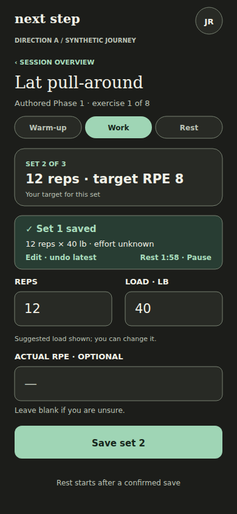
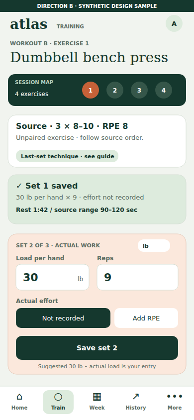

# WorkoutApp — independent Astra UX review

> **Current appearance-system review (21 October):** Keep Graphite, Charcoal and Classic WorkoutApp, each in Light and Dark. [Review the six appearances and independent Settings choices](appearances-2026-10-21/README.md). Existing dark assets are retained; overall layout and typography remain unapproved.

**Audit: 20 October 2026 · Dark-mode revision: 21 October 2026 · AUDIT → SKETCH → PRESENT → STOP. Owner decision pending.**

This package contains a fresh independent Astra audit and two original full-application design directions. Both alternatives now use dark mode throughout, following the owner's requested revision. It addresses [#103](https://github.com/Shadowgar/hypertrophyapp/issues/103) and [#105](https://github.com/Shadowgar/hypertrophyapp/issues/105). It does not implement fixes or authorize a redesign, merge, migration or deployment. Prior GPT-6.1 Medium findings and Focus/Training Ledger designs were not consulted or reused.

## Start the review

| Deliverable | Open |
|---|---|
| Independent audit: 28 findings, 18 route patterns, complete journey map | [AUDIT.md](AUDIT.md) |
| A — Next Step: guided stages, a quiet Home, one immediate task | [Visual gallery](designs/direction-a/GALLERY.md) · [24 mobile frames](designs/direction-a/MOBILE.md) · [8 desktop frames](designs/direction-a/DESKTOP.md) |
| B — Training Atlas: persistent session map, composer and evidence | [Visual gallery](designs/direction-b/GALLERY.md) · [26 mobile frames](designs/direction-b/MOBILE.md) · [6 desktop frames](designs/direction-b/DESKTOP.md) |
| Detailed current → proposed exercise workflow | [FLOW-REVIEW.md](FLOW-REVIEW.md) |
| Advantages, disadvantages and Astra's preferred direction | [COMPARISON.md](COMPARISON.md) |
| Browser measurements, captures and limits | [EVIDENCE.md](EVIDENCE.md) · [Source causal traces](SOURCE-APPENDIX.md) |
| Asset and scope verification | [VALIDATION.md](VALIDATION.md) |

The **64 visual frames** are provided as PNGs that display directly on GitHub, native SVGs, and text transcripts. No local development server is needed to review them. Mobile sketches are 390 × 844; desktop sketches are 1440 × 900. Representative desktop layouts establish each system; route-by-route behavior and responsive obligations are covered in each direction's specification.

## Compare the repeated gym task

| A — Next Step, after saving | B — Training Atlas, after saving |
|---|---|
|  |  |

**Astra's preference is B's persistent workspace**, with A's concise setup/Home approach as a possible influence if the owner wants a combination. B makes source context, session position and corrections easier to revisit between sets. A is calmer for a first-time user. These are different interaction structures, with distinct dark surface palettes and green accents. The recommendation is not a selected design or approval.

An additional [editable Figma comparison board](https://www.figma.com/design/c8bXGuOnGAQfxMJwjEED9Q?node-id=2-2) contains eight native mobile/desktop before-and-after logging frames. It uses the proposed fonts; GitHub exports use available system fallbacks, so text metrics differ slightly. GitHub is the complete, externally viewable review record and does not depend on Figma access.

## What was actually established

The audit inspected the deployed guest experience and current frontend/backend source. With the owner's explicit permission, signed-in journeys used **intercepted synthetic API responses in the deployed frontend**. The audit measured a 90 px downward movement of the working input after acknowledgement at an unchanged scroll offset, an initially buried logger, a hidden save-error message, unit-label errors and a desktop layout capped at 448 px. Conditional source traces also identified onboarding sign-in and Settings profile-write risks. No real account damage is asserted.

The reported real two-minute Today delay, literal duplicated receipt values and the 29-set/doubled-title scenario were **not independently reproduced**. Real authenticated persistence/timing, physical Safari, OS keyboards, screen readers and full accessibility qualification remain untested. [Evidence limits](EVIDENCE.md) are part of the result.

All proposed directions preserve separate Authored Phase 1/2 and Customized authority, exact source prescriptions, deterministic load intelligence, explicit consent, occurrence identities and effective historical records. New historical-strength intake and saved unit preferences are labeled proposed capabilities; sketches do not activate calculations or grant backend mutation authority.

## Owner review

Choose A, B, a specific combination, or request revised sketches. Any selection should identify the accepted version and flow choices. This package stops here: **no production UI changes, deployment, migration, live-data modification or implementation follows without explicit approval.**
