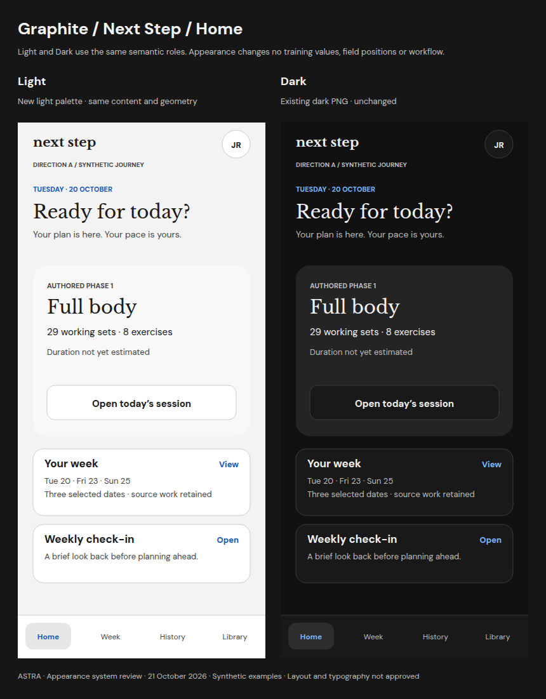
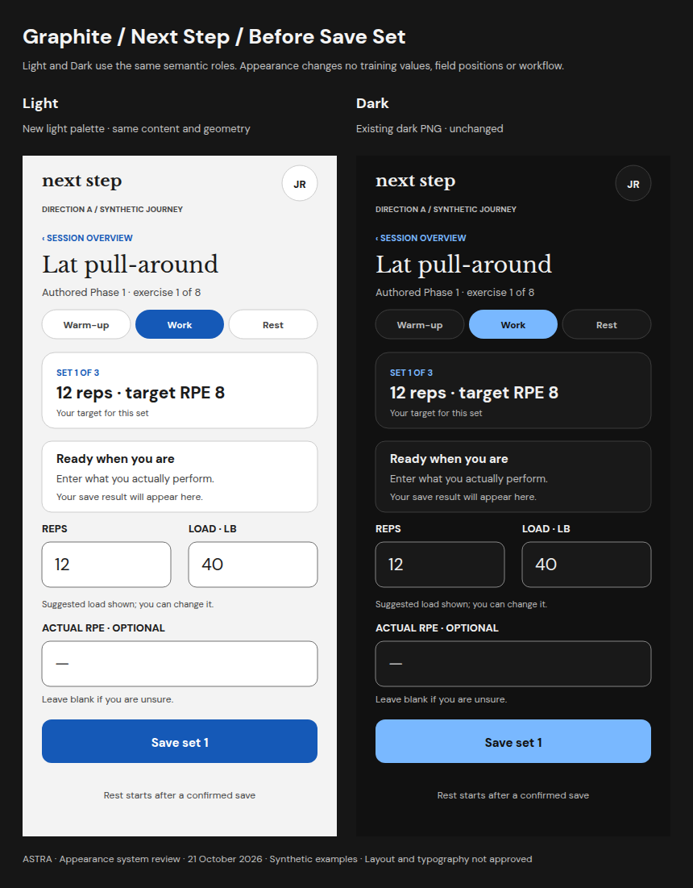
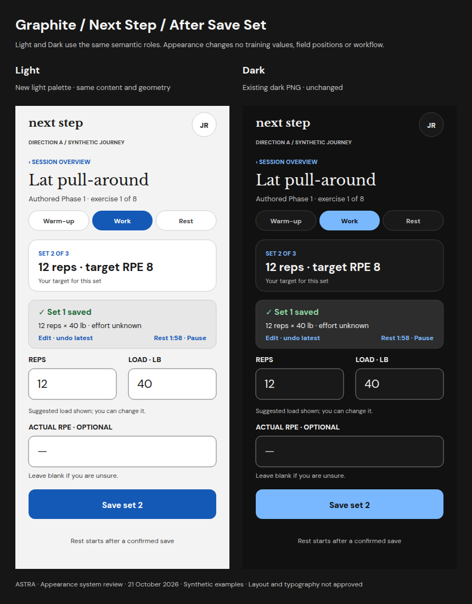
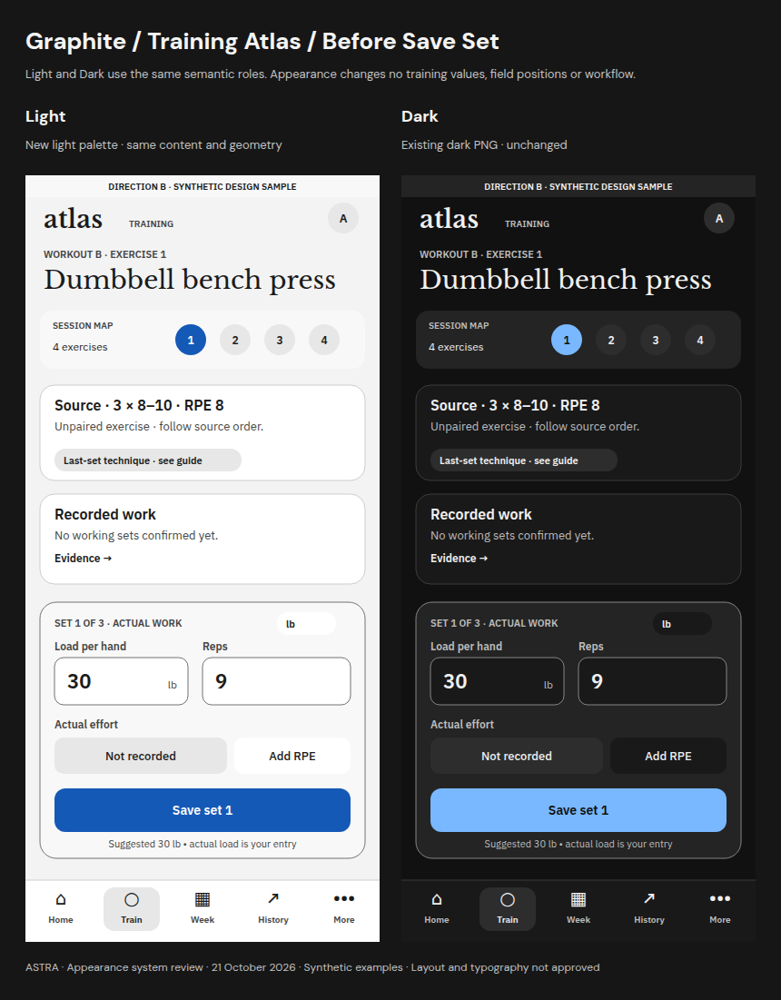
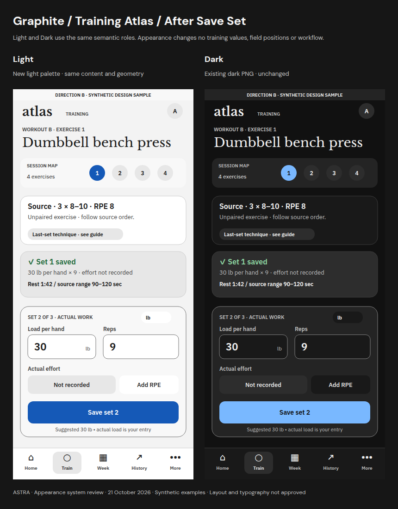
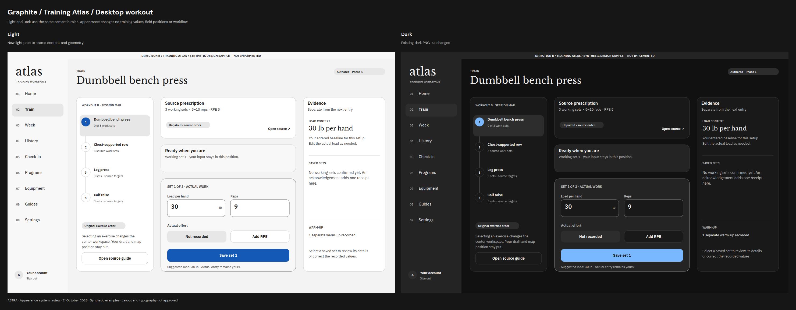

# Graphite — Light and Dark

**One family, two appearances.** Light is new; Dark reuses the existing PNG unchanged. Screen wording, geometry and training workflow are identical within each pair.

[Appearance overview](README.md) · [Shared tokens](TOKENS.md) · [Settings selector](SETTINGS.md) · [Text alternatives](TRANSCRIPTS.md)

## Next Step — Home

[Full-size pair](boards/graphite-a-home.png) · [Light PNG](screens/graphite-a-home-light.png) · [Dark PNG](../theme-comparison-2026-10-21/variants/a-home-option-1.png)

## Next Step — Before Save Set

[Full-size pair](boards/graphite-a-before-save.png) · [Light PNG](screens/graphite-a-before-save-light.png) · [Dark PNG](../theme-comparison-2026-10-21/variants/a-before-save-option-1.png)

## Next Step — After Save Set

[Full-size pair](boards/graphite-a-after-save.png) · [Light PNG](screens/graphite-a-after-save-light.png) · [Dark PNG](../theme-comparison-2026-10-21/variants/a-after-save-option-1.png)

## Training Atlas — Before Save Set

[Full-size pair](boards/graphite-b-before-save.png) · [Light PNG](screens/graphite-b-before-save-light.png) · [Dark PNG](../theme-comparison-2026-10-21/variants/b-before-save-option-1.png)

## Training Atlas — After Save Set

[Full-size pair](boards/graphite-b-after-save.png) · [Light PNG](screens/graphite-b-after-save-light.png) · [Dark PNG](../theme-comparison-2026-10-21/variants/b-after-save-option-1.png)

## Training Atlas — Desktop workout

[Full-size pair](boards/graphite-b-desktop-workout.png) · [Light PNG](screens/graphite-b-desktop-workout-light.png) · [Dark PNG](../theme-comparison-2026-10-21/variants/b-desktop-workout-option-1.png)
