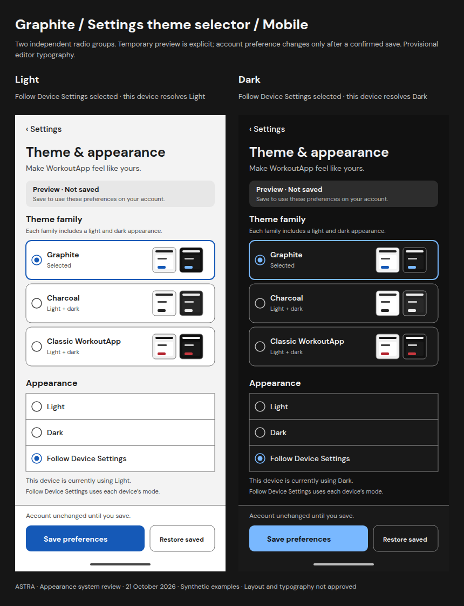
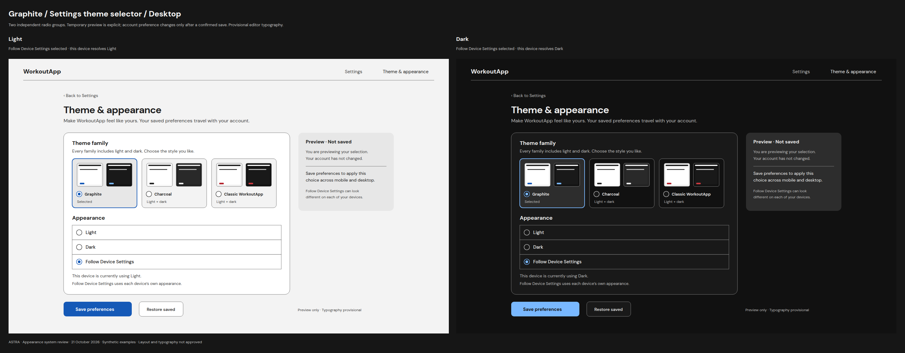
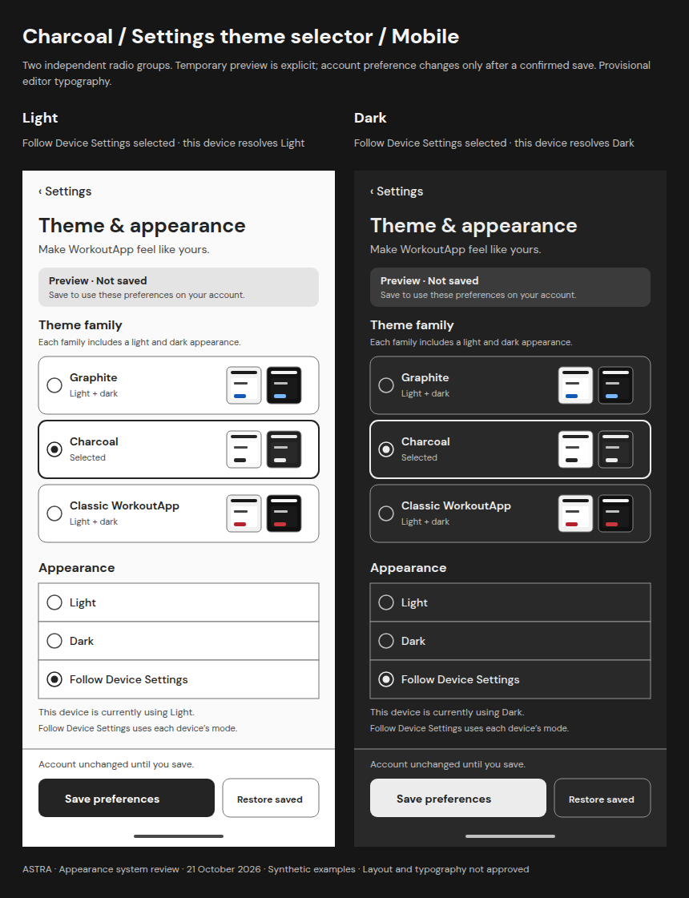
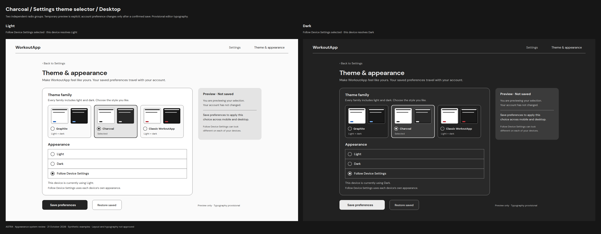
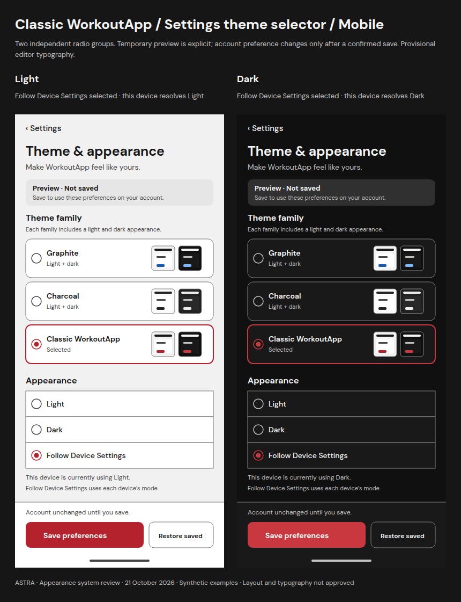
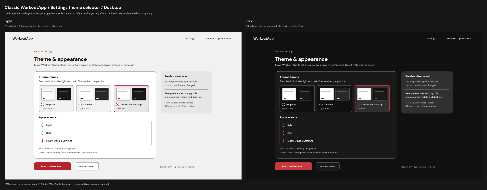

# Settings — Theme & appearance

**New portable editor proposal.** Overall layout and typography are not selected. DM Sans is provisional for this editor; it does not change the existing screen typography. All device modes and records are synthetic.

[Appearance overview](README.md) · [Preference behavior](PREFERENCE-BEHAVIOR.md) · [Tokens and feedback states](TOKENS.md) · [Text alternatives](TRANSCRIPTS.md)

Add a **Theme & appearance** entry to Settings with a confirmed summary such as **Charcoal · Follow Device Settings**. It opens this editor in either application direction. The editor changes only appearance preferences.

## Independent controls

- **Theme family:** Graphite / Charcoal / Classic WorkoutApp. Each row/card is one radio option; its paired miniatures show both appearances and are not extra controls.
- **Appearance:** Light / Dark / Follow Device Settings. Selecting a family preserves this choice, and selecting an appearance preserves the family.
- **Save preferences:** persists the two choices only after acknowledgement. The mockups show a temporary draft, explicitly marked **Preview · Not saved**.
- **Restore saved:** discards the preview and returns to the latest confirmed preference; it does not reset defaults or write an account update.

All twelve full-screen specimens intentionally select Follow Device Settings. Each pair shows the same choice resolved on opposite device modes. Explicit Light and Dark are visible options; their actual interaction and device-override behavior remain proposed, not tested.

## Graphite

### Mobile

[Full-size pair](boards/settings-graphite-mobile.png) · [Light PNG](settings/settings-graphite-light-mobile.png) · [Dark PNG](settings/settings-graphite-dark-mobile.png)

### Desktop

[Full-size pair](boards/settings-graphite-desktop.png) · [Light PNG](settings/settings-graphite-light-desktop.png) · [Dark PNG](settings/settings-graphite-dark-desktop.png)

## Charcoal

### Mobile

[Full-size pair](boards/settings-charcoal-mobile.png) · [Light PNG](settings/settings-charcoal-light-mobile.png) · [Dark PNG](settings/settings-charcoal-dark-mobile.png)

### Desktop

[Full-size pair](boards/settings-charcoal-desktop.png) · [Light PNG](settings/settings-charcoal-light-desktop.png) · [Dark PNG](settings/settings-charcoal-dark-desktop.png)

## Classic WorkoutApp

### Mobile

[Full-size pair](boards/settings-classic-workoutapp-mobile.png) · [Light PNG](settings/settings-classic-workoutapp-light-mobile.png) · [Dark PNG](settings/settings-classic-workoutapp-dark-mobile.png)

### Desktop

[Full-size pair](boards/settings-classic-workoutapp-desktop.png) · [Light PNG](settings/settings-classic-workoutapp-light-desktop.png) · [Dark PNG](settings/settings-classic-workoutapp-dark-desktop.png)

## Responsive and accessible intent

Mobile uses 350 × 72 family rows, 48 px appearance rows and 48 px action buttons. Save is 220 × 48 and Restore saved is 120 × 48. Desktop uses 212 × 161 family cards and 48 px appearance/action controls. Selected family has a radio dot and explicit Selected text; appearance uses native-radio semantics in the proposed implementation. Back to Settings requires a 44 px or larger hit region.

At tablet widths, reflow the three family cards into rows and move the explanation panel into the main flow before crowding labels. At large text or shorter heights, allow scrolling and keep focused content visible above the action region; do not shrink text or targets. These rules are design requirements, not responsive implementation evidence.

Both groups need accessible legends and labels, standard radio arrow-key behavior, one tab stop per group and a persistent visible focus ring. Decorative miniature previews are excluded from keyboard navigation. Save feedback needs an accessible announcement; errors must retain the draft and focus. The light palette board demonstrates a 3 px ring with a 3 px offset; future component focus treatment must be consistent across all six palettes.

Leaving with unsaved changes offers Keep editing or Discard preview. During a pending save, freeze the submitted choice, disable duplicate actions and do not claim success. Definite failure and an unconfirmed outcome must be distinguished; see [proposed behavior](PREFERENCE-BEHAVIOR.md). No authentication, persistence or navigation behavior is implemented by these sketches.
