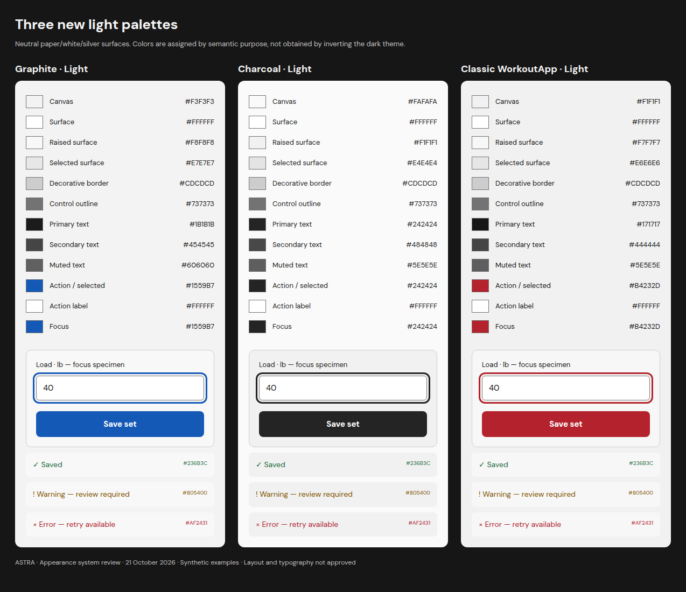
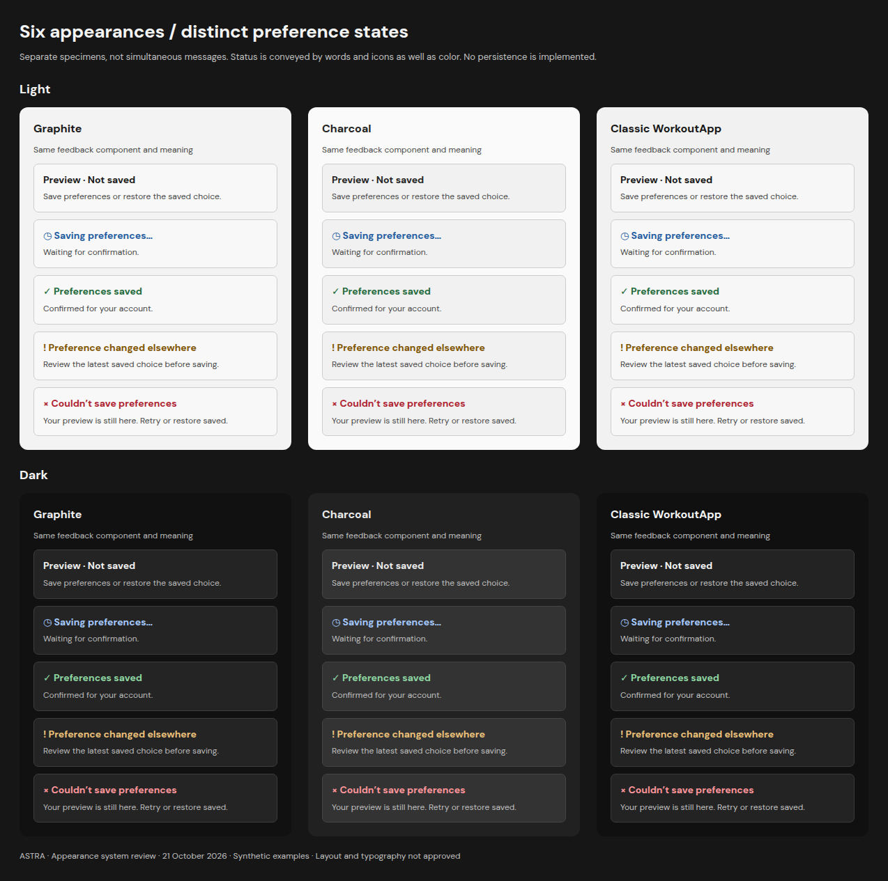

# Palettes and shared semantic tokens

**Design values only.** [TOKENS.json](TOKENS.json) supplies the same 23 semantic keys for all six appearances. Every retained dark value is identical to the previous neutral-dark comparison. The JSON lives in this review directory and is not consumed by application code.

[Appearance overview](README.md) · [Settings selector](SETTINGS.md)

## Family identity

| Family | Light | Retained Dark |
|---|---|---|
| Graphite | Neutral paper canvas, white panels, fine grey borders and deep blue controls | Near-black graphite, fine borders and restrained light blue controls |
| Charcoal | Near-white canvas, quiet grey layers and dark neutral controls | Neutral charcoal layers and off-white controls |
| Classic WorkoutApp | Silver/white surfaces with selective deep red controls | Near-black surfaces with selective red controls |

Light themes use deliberately chosen text, control and status colors. They are not inversions of the dark values. Dominant canvas, panel and status surfaces remain neutral grey; saved/warning/error colors are local and retain text/icon meaning.

## Same component roles in every appearance

| Component purpose | Semantic roles |
|---|---|
| Page and navigation | `canvas`, `surface`, `text_primary`, `text_secondary` |
| Card, composer, sheet, dialog and menu | `surface`, `surface_raised`, `border_subtle` |
| Selected row or tab | `surface_selected`, `selection_fill`, `selection_text`; radio dot or explicit selected label |
| Text and help | `text_primary`, `text_secondary`, `text_muted` |
| Editable field | `input_fill`, `border_control`, `text_primary` |
| Primary action and link | `action_fill`, `action_text`, `accent_text` |
| Keyboard focus | `focus`; offset ring separated from the control |
| Saved, pending, warning and failure | `status_surface`, `success_text`, `info_text`, `warning_text`, `error_text`; distinct labels/icons |
| Disabled state | `disabled_fill`, `disabled_text`; disabled semantics still required |

Shared components resolve the family and effective Light/Dark result, then read these same roles. There are no six separate page implementations. Spacing, responsive geometry, font choices, component states and training behavior are independent of the family. Hover/pressed mappings and browser-native control treatment remain common-component qualification work after layout approval, not completed runtime behavior.

One semantic mapping must cover onboarding, Home, Authored/Customized programs, equipment, Week, Today, warm-ups, working sets, load/RPE/RIR guidance, corrections, timers, History, Check-In, analytics, Settings, auth, overlays and transient messages. Status meanings remain consistent. Charts also need labels/patterns beyond color; complete chart and interaction qualification is outside this representative subset.

## Graphite

| Role | Light | Dark |
|---|---|---|
| canvas | `#F3F3F3` | `#111111` |
| surface | `#FFFFFF` | `#191919` |
| surface raised | `#F8F8F8` | `#242424` |
| surface selected | `#E7E7E7` | `#2D2D2D` |
| border subtle | `#CDCDCD` | `#3D3D3D` |
| border control | `#737373` | `#858585` |
| text primary | `#1B1B1B` | `#F0F0F0` |
| text secondary | `#454545` | `#BDBDBD` |
| text muted | `#606060` | `#A0A0A0` |
| accent text | `#1559B7` | `#79B8FF` |
| action fill | `#1559B7` | `#79B8FF` |
| action text | `#FFFFFF` | `#111111` |
| focus | `#1559B7` | `#A5CEFF` |
| success text | `#236B3C` | `#8ED6A2` |
| warning text | `#805400` | `#EBC17A` |
| error text | `#AF2431` | `#FF969B` |
| info text | `#245DA0` | `#A6CAFF` |
| status surface | `#F8F8F8` | `#242424` |
| input fill | `#FFFFFF` | `#191919` |
| disabled fill | `#E7E7E7` | `#2D2D2D` |
| disabled text | `#606060` | `#A0A0A0` |
| selection fill | `#1559B7` | `#79B8FF` |
| selection text | `#FFFFFF` | `#111111` |

## Charcoal

| Role | Light | Dark |
|---|---|---|
| canvas | `#FAFAFA` | `#212121` |
| surface | `#FFFFFF` | `#292929` |
| surface raised | `#F1F1F1` | `#333333` |
| surface selected | `#E4E4E4` | `#3B3B3B` |
| border subtle | `#CDCDCD` | `#454545` |
| border control | `#737373` | `#969696` |
| text primary | `#242424` | `#ECECEC` |
| text secondary | `#484848` | `#C0C0C0` |
| text muted | `#5E5E5E` | `#AAAAAA` |
| accent text | `#242424` | `#ECECEC` |
| action fill | `#242424` | `#ECECEC` |
| action text | `#FFFFFF` | `#212121` |
| focus | `#242424` | `#FFFFFF` |
| success text | `#236B3C` | `#8ED6A2` |
| warning text | `#805400` | `#EBC17A` |
| error text | `#AF2431` | `#FF969B` |
| info text | `#245DA0` | `#A6CAFF` |
| status surface | `#F1F1F1` | `#333333` |
| input fill | `#FFFFFF` | `#292929` |
| disabled fill | `#E4E4E4` | `#3B3B3B` |
| disabled text | `#5E5E5E` | `#AAAAAA` |
| selection fill | `#242424` | `#ECECEC` |
| selection text | `#FFFFFF` | `#212121` |

## Classic WorkoutApp

| Role | Light | Dark |
|---|---|---|
| canvas | `#F1F1F1` | `#101010` |
| surface | `#FFFFFF` | `#191919` |
| surface raised | `#F7F7F7` | `#232323` |
| surface selected | `#E6E6E6` | `#303030` |
| border subtle | `#CDCDCD` | `#3B3B3B` |
| border control | `#737373` | `#858585` |
| text primary | `#171717` | `#F5F5F5` |
| text secondary | `#444444` | `#C2C2C2` |
| text muted | `#5E5E5E` | `#A3A3A3` |
| accent text | `#B4232D` | `#FF858B` |
| action fill | `#B4232D` | `#C9383F` |
| action text | `#FFFFFF` | `#FFFFFF` |
| focus | `#B4232D` | `#FFABB0` |
| success text | `#236B3C` | `#8ED6A2` |
| warning text | `#805400` | `#EBC17A` |
| error text | `#AF2431` | `#FF969B` |
| info text | `#245DA0` | `#A6CAFF` |
| status surface | `#F7F7F7` | `#232323` |
| input fill | `#FFFFFF` | `#191919` |
| disabled fill | `#E6E6E6` | `#303030` |
| disabled text | `#5E5E5E` | `#A3A3A3` |
| selection fill | `#B4232D` | `#C9383F` |
| selection text | `#FFFFFF` | `#FFFFFF` |

## Distinct status specimens

These are separate proposed states, not simultaneous messages. A saved result requires confirmation. Warning asks for review; error preserves a retry/recovery route. Classic branding red does not replace error text or an error icon.

[Full-size state board](boards/six-appearance-states.png) · [Contrast and limits](VALIDATION.md)
