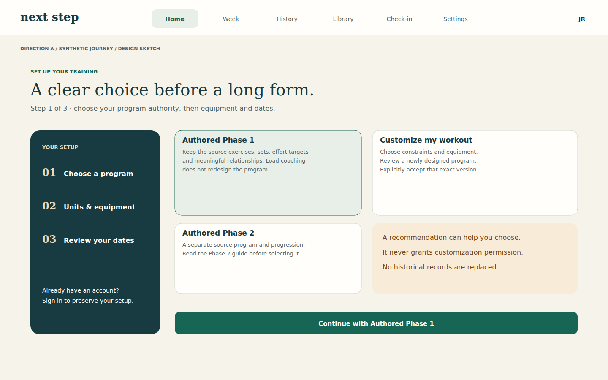
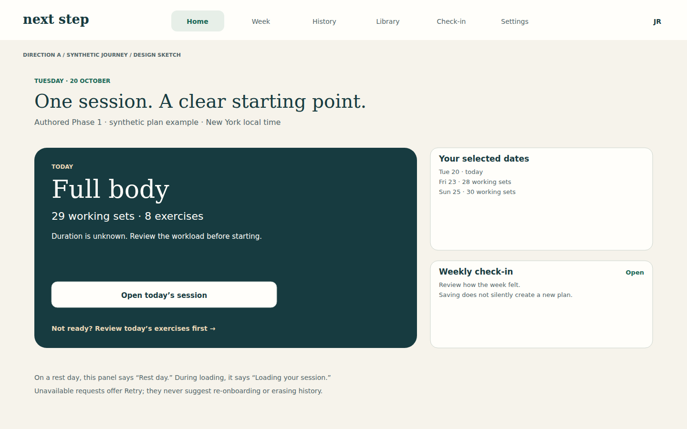
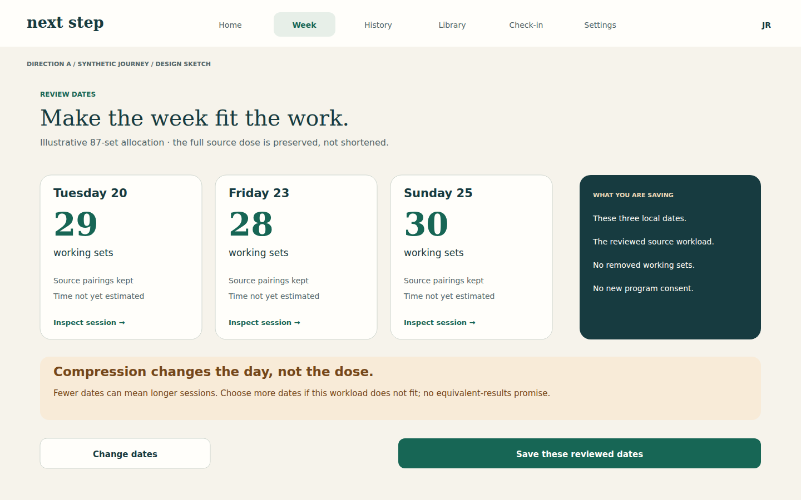
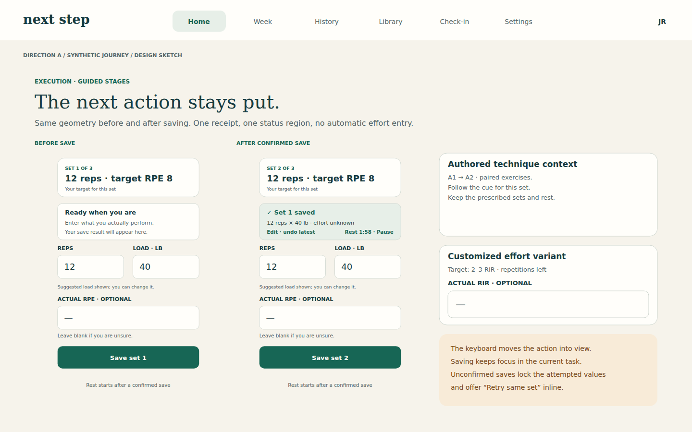
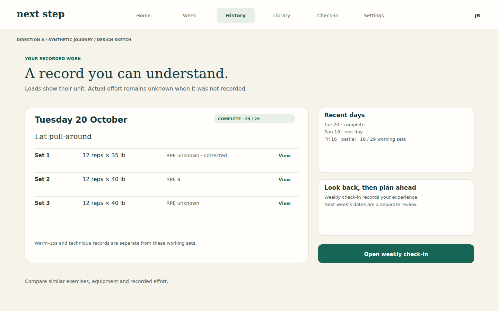
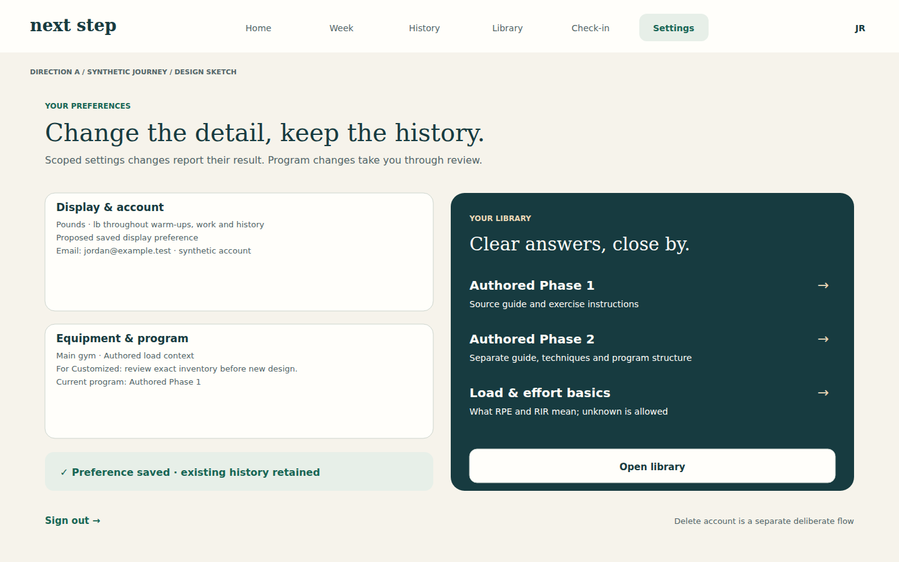
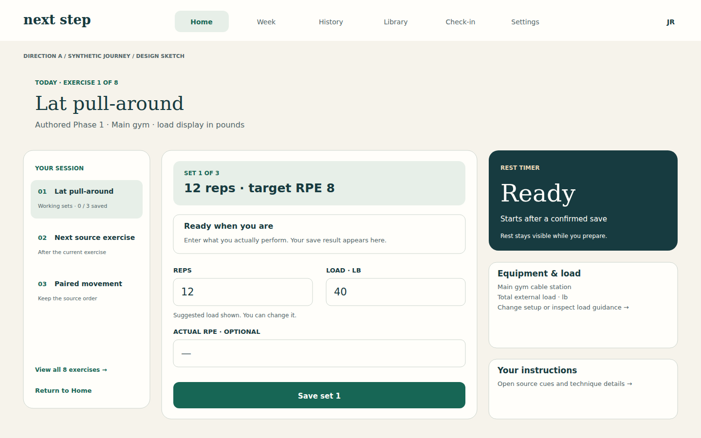
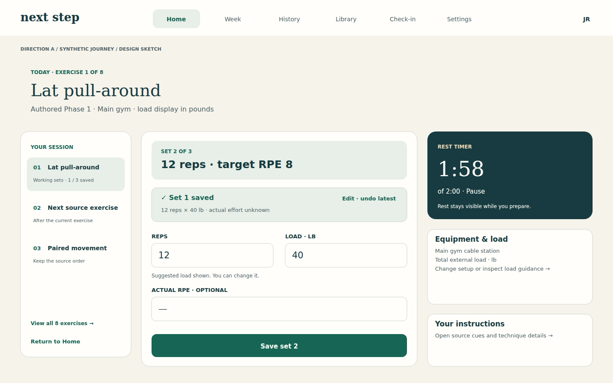

# Next Step — Desktop gallery

**8 original proposed frames.** Fictional accounts, training and history. These are static design illustrations, not implemented application pages.

[Review overview](../../README.md) · [Direction comparison](../../COMPARISON.md) · [Gallery index](GALLERY.md) · [Interaction specification](direction.md) · [Logging flow](../../FLOW-REVIEW.md)

Each image has a written description and an expandable text transcript. Open the PNG for full-size inspection or the SVG for editable source. Keyboard, screen-reader and zoom behavior are specified in the direction document; static images do not qualify those behaviors.

## desktop 01 start program

Guided account and permission setup across a desktop canvas Direction A. Documentation-only synthetic design sketch.

[Full-size PNG](desktop-01-start-program.png) · [Native SVG](desktop-01-start-program.svg)

All visible text

next step

Home

Week

History

Library

Check-in

Settings

JR

DIRECTION A  /  SYNTHETIC JOURNEY  /  DESIGN SKETCH

SET UP YOUR TRAINING

A clear choice before a long form.

Step 1 of 3 · choose your program authority, then equipment and dates.

YOUR SETUP

01

Choose a program

02

Units & equipment

03

Review your dates

Already have an account?

Sign in to preserve your setup.

Authored Phase 1

Keep the source exercises, sets, effort targets

and meaningful relationships. Load coaching

does not redesign the program.

Authored Phase 2

A separate source program and progression.

Read the Phase 2 guide before selecting it.

Customize my workout

Choose constraints and equipment.

Review a newly designed program.

Explicitly accept that exact version.

A recommendation can help you choose.

It never grants customization permission.

No historical records are replaced.

Continue with Authored Phase 1

## desktop 02 home

One primary next step and useful week context on desktop Direction A. Documentation-only synthetic design sketch.

[Full-size PNG](desktop-02-home.png) · [Native SVG](desktop-02-home.svg)

All visible text

next step

Home

Week

History

Library

Check-in

Settings

JR

DIRECTION A  /  SYNTHETIC JOURNEY  /  DESIGN SKETCH

TUESDAY · 20 OCTOBER

One session. A clear starting point.

Authored Phase 1 · synthetic plan example · New York local time

TODAY

Full body

29 working sets · 8 exercises

Duration is unknown. Review the workload before starting.

Open today’s session

Not ready? Review today’s exercises first →

Your selected dates

Tue 20 · today

Fri 23 · 28 working sets

Sun 25 · 30 working sets

Weekly check-in

Review how the week felt.

Saving does not silently create a new plan.

Open

On a rest day, this panel says “Rest day.” During loading, it says “Loading your session.”

Unavailable requests offer Retry; they never suggest re-onboarding or erasing history.

## desktop 03 week

Workload evidence precedes schedule activation Direction A. Documentation-only synthetic design sketch.

[Full-size PNG](desktop-03-week.png) · [Native SVG](desktop-03-week.svg)

All visible text

next step

Home

Week

History

Library

Check-in

Settings

JR

DIRECTION A  /  SYNTHETIC JOURNEY  /  DESIGN SKETCH

REVIEW DATES

Make the week fit the work.

Illustrative 87-set allocation · the full source dose is preserved, not shortened.

Tuesday 20

29

working sets

Source pairings kept

Time not yet estimated

Inspect session →

Friday 23

28

working sets

Source pairings kept

Time not yet estimated

Inspect session →

Sunday 25

30

working sets

Source pairings kept

Time not yet estimated

Inspect session →

WHAT YOU ARE SAVING

These three local dates.

The reviewed source workload.

No removed working sets.

No new program consent.

Compression changes the day, not the dose.

Fewer dates can mean longer sessions. Choose more dates if this workload does not fit; no equivalent-results promise.

Change dates

Save these reviewed dates

## desktop 04 execution

Working-set before and after designs preserve control coordinates; context variants preserve source and effort boundaries Direction A. Documentation-only synthetic design sketch.

[Full-size PNG](desktop-04-execution.png) · [Native SVG](desktop-04-execution.svg)

All visible text

next step

Home

Week

History

Library

Check-in

Settings

JR

DIRECTION A  /  SYNTHETIC JOURNEY  /  DESIGN SKETCH

EXECUTION · GUIDED STAGES

The next action stays put.

Same geometry before and after saving. One receipt, one status region, no automatic effort entry.

BEFORE SAVE

next step

JR

DIRECTION A  /  SYNTHETIC JOURNEY

‹  SESSION OVERVIEW

Lat pull-around

Authored Phase 1 · exercise 1 of 8

Warm-up

Work

Rest

SET 1 OF 3

12 reps  ·  target RPE 8

Your target for this set

Ready when you are

Enter what you actually perform.

Your save result will appear here.

REPS

12

LOAD · LB

40

Suggested load shown; you can change it.

ACTUAL RPE · OPTIONAL

—

Leave blank if you are unsure.

Save set 1

Rest starts after a confirmed save

AFTER CONFIRMED SAVE

next step

JR

DIRECTION A  /  SYNTHETIC JOURNEY

‹  SESSION OVERVIEW

Lat pull-around

Authored Phase 1 · exercise 1 of 8

Warm-up

Work

Rest

SET 2 OF 3

12 reps  ·  target RPE 8

Your target for this set

✓ Set 1 saved

12 reps × 40 lb · effort unknown

Edit · undo latest

Rest 1:58 · Pause

REPS

12

LOAD · LB

40

Suggested load shown; you can change it.

ACTUAL RPE · OPTIONAL

—

Leave blank if you are unsure.

Save set 2

Rest starts after a confirmed save

Authored technique context

A1 → A2 · paired exercises.

Follow the cue for this set.

Keep the prescribed sets and rest.

Customized effort variant

Target: 2–3 RIR · repetitions left

ACTUAL RIR · OPTIONAL

—

The keyboard moves the action into view.

Saving keeps focus in the current task.

Unconfirmed saves lock the attempted values

and offer “Retry same set” inline.

## desktop 05 history review

Unit-labeled history, honest partial/rest labels and a separate weekly review Direction A. Documentation-only synthetic design sketch.

[Full-size PNG](desktop-05-history-review.png) · [Native SVG](desktop-05-history-review.svg)

All visible text

next step

Home

Week

History

Library

Check-in

Settings

JR

DIRECTION A  /  SYNTHETIC JOURNEY  /  DESIGN SKETCH

YOUR RECORDED WORK

A record you can understand.

Loads show their unit. Actual effort remains unknown when it was not recorded.

Tuesday 20 October

COMPLETE · 29 / 29

Lat pull-around

Set 1

12 reps × 35 lb

RPE unknown · corrected

View

Set 2

12 reps × 40 lb

RPE 8

View

Set 3

12 reps × 40 lb

RPE unknown

View

Warm-ups and technique records are separate from these working sets.

Recent days

Tue 20 · complete

Sun 18 · rest day

Fri 16 · partial · 18 / 29 working sets

Look back, then plan ahead

Weekly check-in records your experience.

Next week’s dates are a separate review.

Open weekly check-in

Compare similar exercises, equipment and recorded effort.

## desktop 06 settings library

Settings preserves scope and makes reference and account tasks discoverable Direction A. Documentation-only synthetic design sketch.

[Full-size PNG](desktop-06-settings-library.png) · [Native SVG](desktop-06-settings-library.svg)

All visible text

next step

Home

Week

History

Library

Check-in

Settings

JR

DIRECTION A  /  SYNTHETIC JOURNEY  /  DESIGN SKETCH

YOUR PREFERENCES

Change the detail, keep the history.

Scoped settings changes report their result. Program changes take you through review.

Display & account

Pounds · lb throughout warm-ups, work and history

Proposed saved display preference

Email: jordan@example.test · synthetic account

Equipment & program

Main gym · Authored load context

For Customized: review exact inventory before new design.

Current program: Authored Phase 1

✓ Preference saved · existing history retained

YOUR LIBRARY

Clear answers, close by.

Authored Phase 1

Source guide and exercise instructions

→

Authored Phase 2

Separate guide, techniques and program structure

→

Load & effort basics

What RPE and RIR mean; unknown is allowed

→

Open library

Sign out →

Delete account is a separate deliberate flow

## desktop 07 execution before

Actual desktop execution composition with a single composer and stable before/after geometry. Synthetic targets and suggestion only. Direction A. Documentation-only synthetic design sketch.

[Full-size PNG](desktop-07-execution-before.png) · [Native SVG](desktop-07-execution-before.svg)

All visible text

next step

Home

Week

History

Library

Check-in

Settings

JR

DIRECTION A  /  SYNTHETIC JOURNEY  /  DESIGN SKETCH

TODAY · EXERCISE 1 OF 8

Lat pull-around

Authored Phase 1 · Main gym · load display in pounds

YOUR SESSION

01

Lat pull-around

Working sets · 0 / 3 saved

02

Next source exercise

After the current exercise

03

Paired movement

Keep the source order

View all 8 exercises →

Return to Home

SET 1 OF 3

12 reps · target RPE 8

Ready when you are

Enter what you actually perform. Your save result appears here.

REPS

12

LOAD · LB

40

Suggested load shown. You can change it.

ACTUAL RPE · OPTIONAL

—

Save set 1

REST TIMER

Ready

Starts after a confirmed save

Rest stays visible while you prepare.

Equipment & load

Main gym cable station

Total external load · lb

Change setup or inspect load guidance →

Your instructions

Open source cues and technique details →

## desktop 08 execution after

Actual desktop execution composition with a single composer and stable before/after geometry. Synthetic targets and suggestion only. Direction A. Documentation-only synthetic design sketch.

[Full-size PNG](desktop-08-execution-after.png) · [Native SVG](desktop-08-execution-after.svg)

All visible text

next step

Home

Week

History

Library

Check-in

Settings

JR

DIRECTION A  /  SYNTHETIC JOURNEY  /  DESIGN SKETCH

TODAY · EXERCISE 1 OF 8

Lat pull-around

Authored Phase 1 · Main gym · load display in pounds

YOUR SESSION

01

Lat pull-around

Working sets · 1 / 3 saved

02

Next source exercise

After the current exercise

03

Paired movement

Keep the source order

View all 8 exercises →

Return to Home

SET 2 OF 3

12 reps · target RPE 8

✓ Set 1 saved

12 reps × 40 lb · actual effort unknown

Edit · undo latest

REPS

12

LOAD · LB

40

Suggested load shown. You can change it.

ACTUAL RPE · OPTIONAL

—

Save set 2

REST TIMER

1:58

of 2:00 · Pause

Rest stays visible while you prepare.

Equipment & load

Main gym cable station

Total external load · lb

Change setup or inspect load guidance →

Your instructions

Open source cues and technique details →

