# Next Step — Mobile gallery

**24 original proposed frames.** Fictional accounts, training and history. These are static design illustrations, not implemented application pages.

[Review overview](../../README.md) · [Direction comparison](../../COMPARISON.md) · [Gallery index](GALLERY.md) · [Interaction specification](direction.md) · [Logging flow](../../FLOW-REVIEW.md)

Each image has a written description and an expandable text transcript. Open the PNG for full-size inspection or the SVG for editable source. Keyboard, screen-reader and zoom behavior are specified in the direction document; static images do not qualify those behaviors.

## 01 welcome mobile

Welcome and clean account entry Static design sketch. Synthetic journey, not real user data or backend qualification.

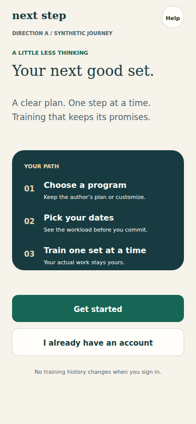

[Full-size PNG](01-welcome-mobile.png) · [Native SVG](01-welcome-mobile.svg)

All visible text

next step

Help

DIRECTION A  /  SYNTHETIC JOURNEY

A LITTLE LESS THINKING

Your next good set.

A clear plan. One step at a time.

Training that keeps its promises.

YOUR PATH

01

Choose a program

Keep the author’s plan or customize.

02

Pick your dates

See the workload before you commit.

03

Train one set at a time

Your actual work stays yours.

Get started

I already have an account

No training history changes when you sign in.

## 02 sign in mobile

Labeled sign-in form and a separate recovery path Static design sketch. Synthetic journey, not real user data or backend qualification.

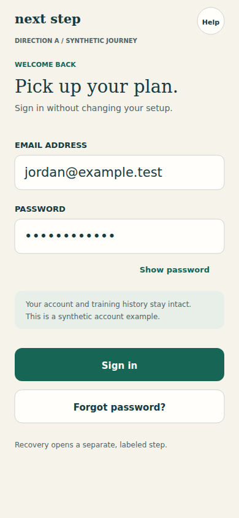

[Full-size PNG](02-sign-in-mobile.png) · [Native SVG](02-sign-in-mobile.svg)

All visible text

next step

Help

DIRECTION A  /  SYNTHETIC JOURNEY

WELCOME BACK

Pick up your plan.

Sign in without changing your setup.

EMAIL ADDRESS

jordan@example.test

PASSWORD

••••••••••••

Show password

Your account and training history stay intact.

This is a synthetic account example.

Sign in

Forgot password?

Recovery opens a separate, labeled step.

## 03 program path mobile

Authored Phase 1 and Phase 2 remain distinct, with an explicit Customized alternative Static design sketch. Synthetic journey, not real user data or backend qualification.

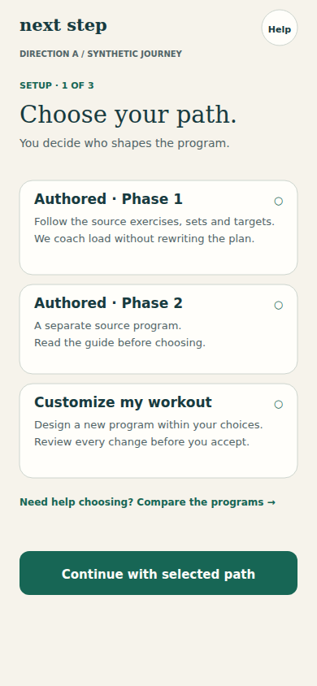

[Full-size PNG](03-program-path-mobile.png) · [Native SVG](03-program-path-mobile.svg)

All visible text

next step

Help

DIRECTION A  /  SYNTHETIC JOURNEY

SETUP · 1 OF 3

Choose your path.

You decide who shapes the program.

Authored · Phase 1

Follow the source exercises, sets and targets.

We coach load without rewriting the plan.

○

Authored · Phase 2

A separate source program.

Read the guide before choosing.

○

Customize my workout

Design a new program within your choices.

Review every change before you accept.

○

Need help choosing? Compare the programs →

Continue with selected path

## 04 setup mobile

Proposed unified unit preference and mode-scoped equipment setup Static design sketch. Synthetic journey, not real user data or backend qualification.

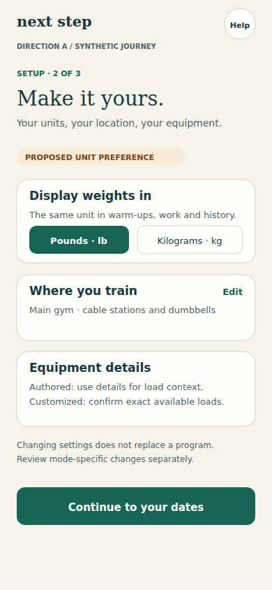

[Full-size PNG](04-setup-mobile.png) · [Native SVG](04-setup-mobile.svg)

All visible text

next step

Help

DIRECTION A  /  SYNTHETIC JOURNEY

SETUP · 2 OF 3

Make it yours.

Your units, your location, your equipment.

PROPOSED UNIT PREFERENCE

Display weights in

The same unit in warm-ups, work and history.

Pounds · lb

Kilograms · kg

Where you train

Main gym · cable stations and dumbbells

Edit

Equipment details

Authored: use details for load context.

Customized: confirm exact available loads.

Changing settings does not replace a program.

Review mode-specific changes separately.

Continue to your dates

## 05 home mobile

A single clear next action with honest scheduled, rest-day and unavailable-state intent Static design sketch. Synthetic journey, not real user data or backend qualification.

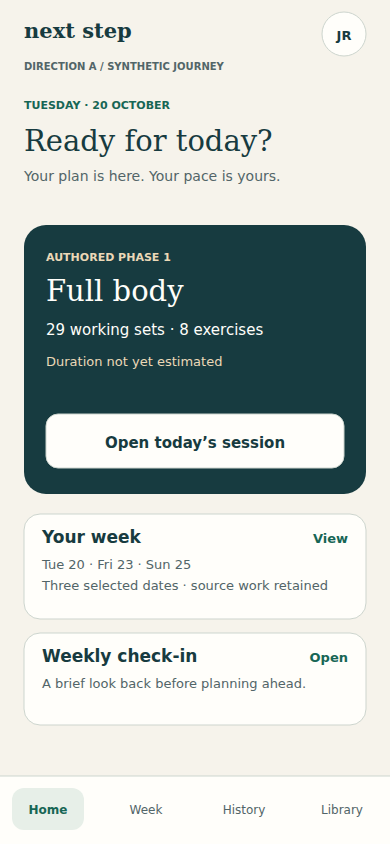

[Full-size PNG](05-home-mobile.png) · [Native SVG](05-home-mobile.svg)

All visible text

next step

JR

DIRECTION A  /  SYNTHETIC JOURNEY

Home

Week

History

Library

TUESDAY · 20 OCTOBER

Ready for today?

Your plan is here. Your pace is yours.

AUTHORED PHASE 1

Full body

29 working sets · 8 exercises

Duration not yet estimated

Open today’s session

Your week

Tue 20   ·   Fri 23   ·   Sun 25

Three selected dates · source work retained

View

Weekly check-in

A brief look back before planning ahead.

Open

## 06 week review mobile

Synthetic allocation review before schedule activation Static design sketch. Synthetic journey, not real user data or backend qualification.

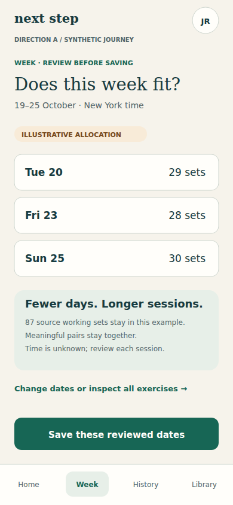

[Full-size PNG](06-week-review-mobile.png) · [Native SVG](06-week-review-mobile.svg)

All visible text

next step

JR

DIRECTION A  /  SYNTHETIC JOURNEY

Home

Week

History

Library

WEEK · REVIEW BEFORE SAVING

Does this week fit?

19–25 October · New York time

ILLUSTRATIVE ALLOCATION

Tue 20

29 sets

Fri 23

28 sets

Sun 25

30 sets

Fewer days. Longer sessions.

87 source working sets stay in this example.

Meaningful pairs stay together.

Time is unknown; review each session.

Change dates or inspect all exercises →

Save these reviewed dates

## 07 customized consent mobile

Exact reviewed version consent precedes activation Static design sketch. Synthetic journey, not real user data or backend qualification.

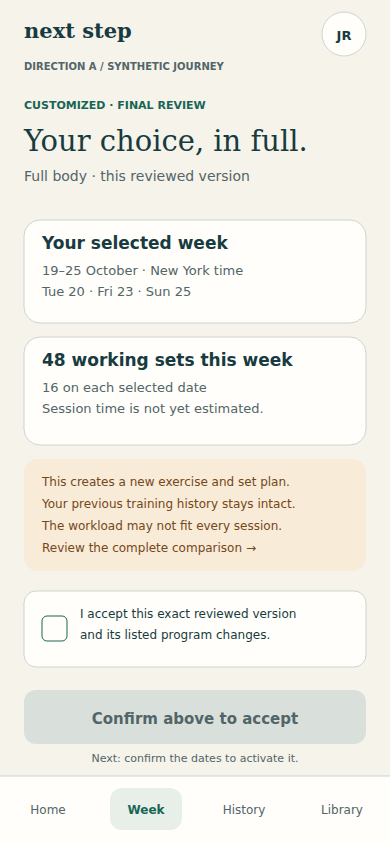

[Full-size PNG](07-customized-consent-mobile.png) · [Native SVG](07-customized-consent-mobile.svg)

All visible text

next step

JR

DIRECTION A  /  SYNTHETIC JOURNEY

Home

Week

History

Library

CUSTOMIZED · FINAL REVIEW

Your choice, in full.

Full body · this reviewed version

Your selected week

19–25 October · New York time

Tue 20 · Fri 23 · Sun 25

48 working sets this week

16 on each selected date

Session time is not yet estimated.

This creates a new exercise and set plan.

Your previous training history stays intact.

The workload may not fit every session.

Review the complete comparison →

I accept this exact reviewed version

and its listed program changes.

Confirm above to accept

Next: confirm the dates to activate it.

## 08 first load mobile

Proposed known-1RM and recent-set evidence intake; no calculation invented Static design sketch. Synthetic journey, not real user data or backend qualification.

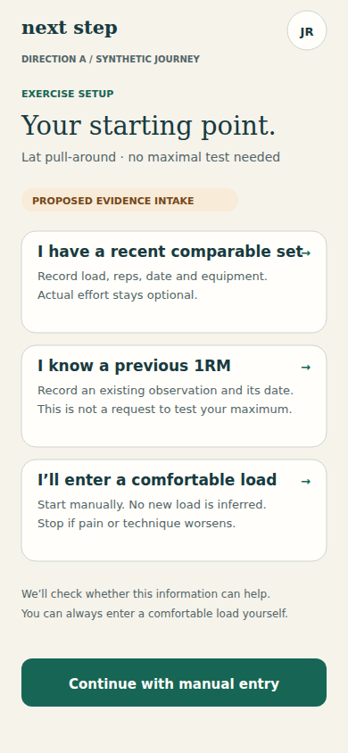

[Full-size PNG](08-first-load-mobile.png) · [Native SVG](08-first-load-mobile.svg)

All visible text

next step

JR

DIRECTION A  /  SYNTHETIC JOURNEY

EXERCISE SETUP

Your starting point.

Lat pull-around · no maximal test needed

PROPOSED EVIDENCE INTAKE

I have a recent comparable set

Record load, reps, date and equipment.

Actual effort stays optional.

→

I know a previous 1RM

Record an existing observation and its date.

This is not a request to test your maximum.

→

I’ll enter a comfortable load

Start manually. No new load is inferred.

Stop if pain or technique worsens.

→

We’ll check whether this information can help.

You can always enter a comfortable load yourself.

Continue with manual entry

## 09 source warmup mobile

Source warm-up count formatted once; actual entry and working sets stay separate Static design sketch. Synthetic journey, not real user data or backend qualification.

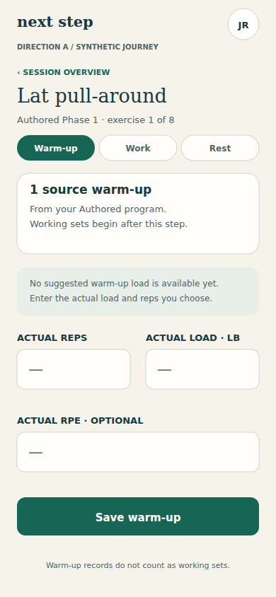

[Full-size PNG](09-source-warmup-mobile.png) · [Native SVG](09-source-warmup-mobile.svg)

All visible text

next step

JR

DIRECTION A  /  SYNTHETIC JOURNEY

‹  SESSION OVERVIEW

Lat pull-around

Authored Phase 1 · exercise 1 of 8

Warm-up

Work

Rest

1 source warm-up

From your Authored program.

Working sets begin after this step.

No suggested warm-up load is available yet.

Enter the actual load and reps you choose.

ACTUAL REPS

—

ACTUAL LOAD · LB

—

ACTUAL RPE · OPTIONAL

—

Save warm-up

Warm-up records do not count as working sets.

## 10 working before mobile

Guided Authored working set. All loads and source targets are illustrative; no prescription calculation is proposed here. Static design sketch. Synthetic journey, not real user data or backend qualification.

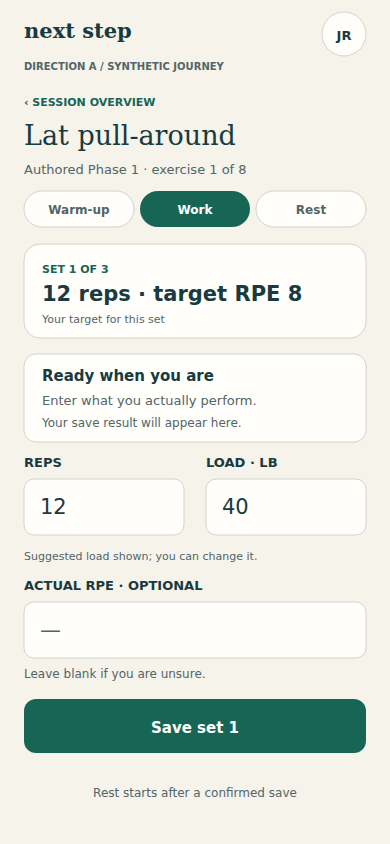

[Full-size PNG](10-working-before-mobile.png) · [Native SVG](10-working-before-mobile.svg)

All visible text

next step

JR

DIRECTION A  /  SYNTHETIC JOURNEY

‹  SESSION OVERVIEW

Lat pull-around

Authored Phase 1 · exercise 1 of 8

Warm-up

Work

Rest

SET 1 OF 3

12 reps  ·  target RPE 8

Your target for this set

Ready when you are

Enter what you actually perform.

Your save result will appear here.

REPS

12

LOAD · LB

40

Suggested load shown; you can change it.

ACTUAL RPE · OPTIONAL

—

Leave blank if you are unsure.

Save set 1

Rest starts after a confirmed save

## 11 working after mobile

Guided Authored working set. All loads and source targets are illustrative; no prescription calculation is proposed here. Static design sketch. Synthetic journey, not real user data or backend qualification.

[Full-size PNG](11-working-after-mobile.png) · [Native SVG](11-working-after-mobile.svg)

All visible text

next step

JR

DIRECTION A  /  SYNTHETIC JOURNEY

‹  SESSION OVERVIEW

Lat pull-around

Authored Phase 1 · exercise 1 of 8

Warm-up

Work

Rest

SET 2 OF 3

12 reps  ·  target RPE 8

Your target for this set

✓ Set 1 saved

12 reps × 40 lb · effort unknown

Edit · undo latest

Rest 1:58 · Pause

REPS

12

LOAD · LB

40

Suggested load shown; you can change it.

ACTUAL RPE · OPTIONAL

—

Leave blank if you are unsure.

Save set 2

Rest starts after a confirmed save

## 12 rest mobile

A rest step with explicit pause and next-set controls Static design sketch. Synthetic journey, not real user data or backend qualification.

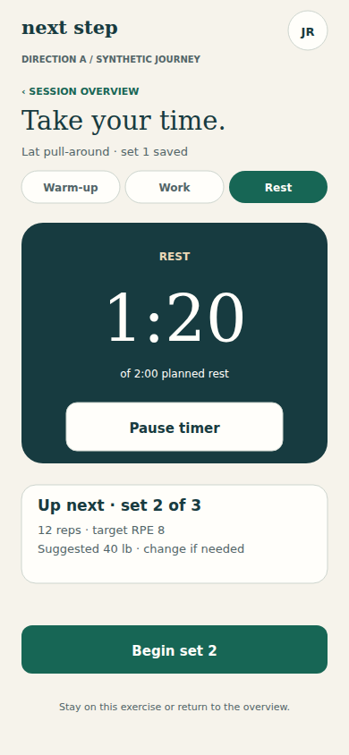

[Full-size PNG](12-rest-mobile.png) · [Native SVG](12-rest-mobile.svg)

All visible text

next step

JR

DIRECTION A  /  SYNTHETIC JOURNEY

‹  SESSION OVERVIEW

Take your time.

Lat pull-around · set 1 saved

Warm-up

Work

Rest

REST

1:20

of 2:00 planned rest

Pause timer

Up next · set 2 of 3

12 reps · target RPE 8

Suggested 40 lb · change if needed

Begin set 2

Stay on this exercise or return to the overview.

## 13 correction mobile

Correction sheet uses the effective receipt and preserves actual effort uncertainty Static design sketch. Synthetic journey, not real user data or backend qualification.

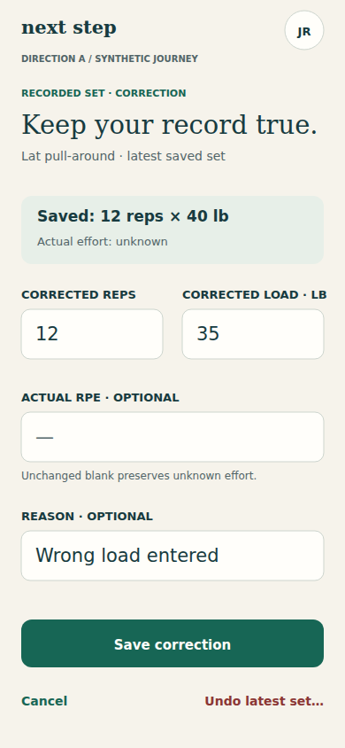

[Full-size PNG](13-correction-mobile.png) · [Native SVG](13-correction-mobile.svg)

All visible text

next step

JR

DIRECTION A  /  SYNTHETIC JOURNEY

RECORDED SET · CORRECTION

Keep your record true.

Lat pull-around · latest saved set

Saved: 12 reps × 40 lb

Actual effort: unknown

CORRECTED REPS

12

CORRECTED LOAD · LB

35

ACTUAL RPE · OPTIONAL

—

Unchanged blank preserves unknown effort.

REASON · OPTIONAL

Wrong load entered

Save correction

Cancel

Undo latest set…

## 14 unconfirmed save mobile

Guided Authored working set. All loads and source targets are illustrative; no prescription calculation is proposed here. Static design sketch. Synthetic journey, not real user data or backend qualification.

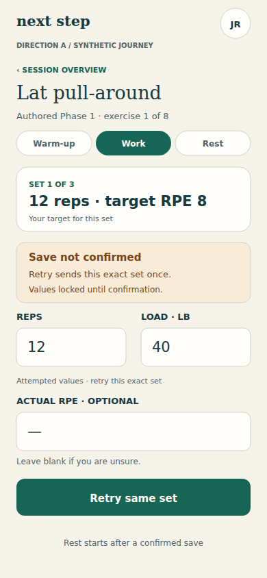

[Full-size PNG](14-unconfirmed-save-mobile.png) · [Native SVG](14-unconfirmed-save-mobile.svg)

All visible text

next step

JR

DIRECTION A  /  SYNTHETIC JOURNEY

‹  SESSION OVERVIEW

Lat pull-around

Authored Phase 1 · exercise 1 of 8

Warm-up

Work

Rest

SET 1 OF 3

12 reps  ·  target RPE 8

Your target for this set

Save not confirmed

Retry sends this exact set once.

Values locked until confirmation.

REPS

12

LOAD · LB

40

Attempted values · retry this exact set

ACTUAL RPE · OPTIONAL

—

Leave blank if you are unsure.

Retry same set

Rest starts after a confirmed save

## 15 complete history mobile

Honest working-set completion and unit-labeled history Static design sketch. Synthetic journey, not real user data or backend qualification.

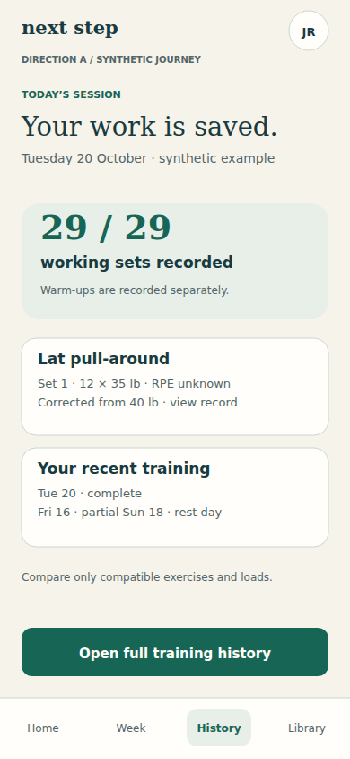

[Full-size PNG](15-complete-history-mobile.png) · [Native SVG](15-complete-history-mobile.svg)

All visible text

next step

JR

DIRECTION A  /  SYNTHETIC JOURNEY

Home

Week

History

Library

TODAY’S SESSION

Your work is saved.

Tuesday 20 October · synthetic example

29 / 29

working sets recorded

Warm-ups are recorded separately.

Lat pull-around

Set 1 · 12 × 35 lb · RPE unknown

Corrected from 40 lb · view record

Your recent training

Tue 20 · complete

Fri 16 · partial      Sun 18 · rest day

Compare only compatible exercises and loads.

Open full training history

## 16 check in mobile

A weekly review kept distinct from next-week date selection Static design sketch. Synthetic journey, not real user data or backend qualification.

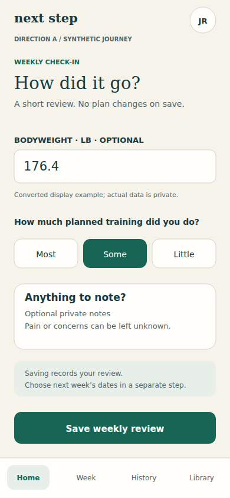

[Full-size PNG](16-check-in-mobile.png) · [Native SVG](16-check-in-mobile.svg)

All visible text

next step

JR

DIRECTION A  /  SYNTHETIC JOURNEY

Home

Week

History

Library

WEEKLY CHECK-IN

How did it go?

A short review. No plan changes on save.

BODYWEIGHT · LB · OPTIONAL

176.4

Converted display example; actual data is private.

How much planned training did you do?

Most

Some

Little

Anything to note?

Optional private notes

Pain or concerns can be left unknown.

Saving records your review.

Choose next week’s dates in a separate step.

Save weekly review

## 17 settings mobile

Account, unit preference and mode-scoped equipment changes with visible feedback Static design sketch. Synthetic journey, not real user data or backend qualification.

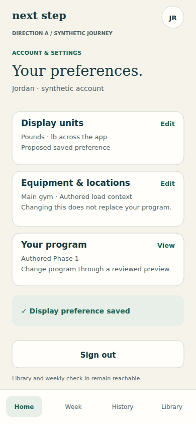

[Full-size PNG](17-settings-mobile.png) · [Native SVG](17-settings-mobile.svg)

All visible text

next step

JR

DIRECTION A  /  SYNTHETIC JOURNEY

Home

Week

History

Library

ACCOUNT & SETTINGS

Your preferences.

Jordan · synthetic account

Display units

Pounds · lb across the app

Proposed saved preference

Edit

Equipment & locations

Main gym · Authored load context

Changing this does not replace your program.

Edit

Your program

Authored Phase 1

Change program through a reviewed preview.

View

✓ Display preference saved

Sign out

Library and weekly check-in remain reachable.

## 18 library mobile

Plain-language program and exercise guides without raw internal data Static design sketch. Synthetic journey, not real user data or backend qualification.

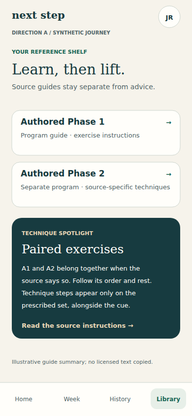

[Full-size PNG](18-library-mobile.png) · [Native SVG](18-library-mobile.svg)

All visible text

next step

JR

DIRECTION A  /  SYNTHETIC JOURNEY

Home

Week

History

Library

YOUR REFERENCE SHELF

Learn, then lift.

Source guides stay separate from advice.

Authored Phase 1

Program guide · exercise instructions

→

Authored Phase 2

Separate program · source-specific techniques

→

TECHNIQUE SPOTLIGHT

Paired exercises

A1 and A2 belong together when the

source says so. Follow its order and rest.

Technique steps appear only on the

prescribed set, alongside the cue.

Read the source instructions →

Illustrative guide summary; no licensed text copied.

## 19 known 1rm entry mobile

Proposed Authored historical-strength intake; a prior observation, never a performed set or new load formula Static design sketch. Synthetic journey, not real user data or backend qualification.

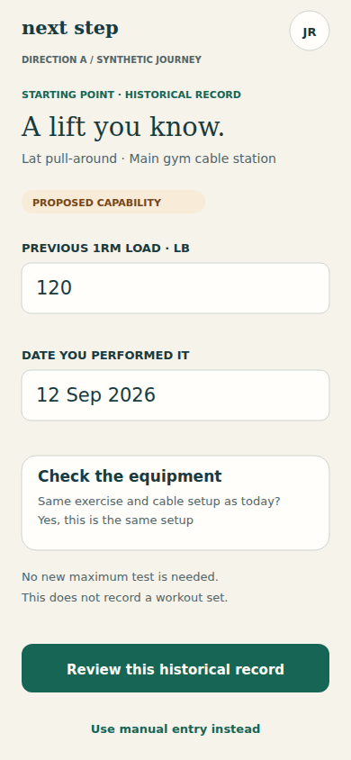

[Full-size PNG](19-known-1rm-entry-mobile.png) · [Native SVG](19-known-1rm-entry-mobile.svg)

All visible text

next step

JR

DIRECTION A  /  SYNTHETIC JOURNEY

STARTING POINT · HISTORICAL RECORD

A lift you know.

Lat pull-around · Main gym cable station

PROPOSED CAPABILITY

PREVIOUS 1RM LOAD · LB

120

DATE YOU PERFORMED IT

12 Sep 2026

Check the equipment

Same exercise and cable setup as today?

Yes, this is the same setup

No new maximum test is needed.

This does not record a workout set.

Review this historical record

Use manual entry instead

## 20 recent set entry mobile

Proposed historical recent-set evidence intake with load, reps, date and optional actual effort Static design sketch. Synthetic journey, not real user data or backend qualification.

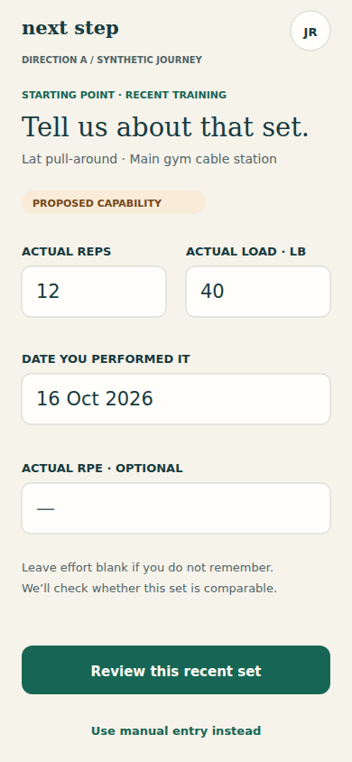

[Full-size PNG](20-recent-set-entry-mobile.png) · [Native SVG](20-recent-set-entry-mobile.svg)

All visible text

next step

JR

DIRECTION A  /  SYNTHETIC JOURNEY

STARTING POINT · RECENT TRAINING

Tell us about that set.

Lat pull-around · Main gym cable station

PROPOSED CAPABILITY

ACTUAL REPS

12

ACTUAL LOAD · LB

40

DATE YOU PERFORMED IT

16 Oct 2026

ACTUAL RPE · OPTIONAL

—

Leave effort blank if you do not remember.

We’ll check whether this set is comparable.

Review this recent set

Use manual entry instead

## 21 manual calibration mobile

Manual entry when synthetic server guidance provides no starting suggestion; no calculation or invented numerical recommendation Static design sketch. Synthetic journey, not real user data or backend qualification.

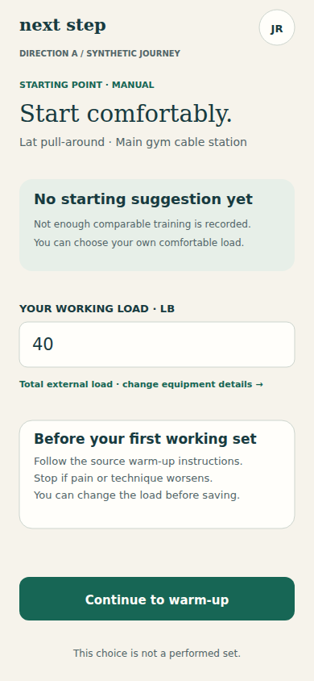

[Full-size PNG](21-manual-calibration-mobile.png) · [Native SVG](21-manual-calibration-mobile.svg)

All visible text

next step

JR

DIRECTION A  /  SYNTHETIC JOURNEY

STARTING POINT · MANUAL

Start comfortably.

Lat pull-around · Main gym cable station

No starting suggestion yet

Not enough comparable training is recorded.

You can choose your own comfortable load.

YOUR WORKING LOAD · LB

40

Total external load · change equipment details →

Before your first working set

Follow the source warm-up instructions.

Stop if pain or technique worsens.

You can change the load before saving.

Continue to warm-up

This choice is not a performed set.

## 22 home loading mobile

Honest Home loading state. No false empty, zero duration or re-onboarding instruction. Static design sketch. Synthetic journey, not real user data or backend qualification.

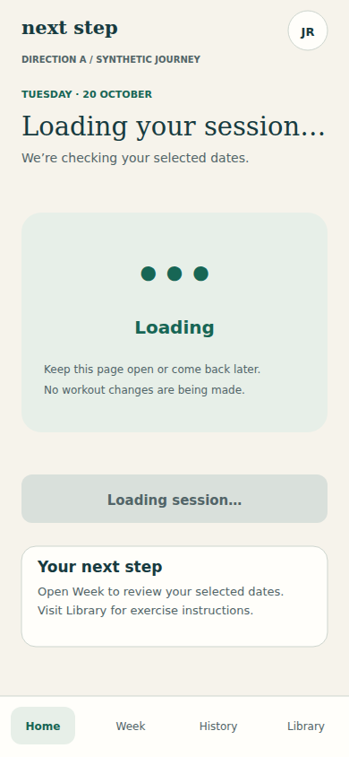

[Full-size PNG](22-home-loading-mobile.png) · [Native SVG](22-home-loading-mobile.svg)

All visible text

next step

JR

DIRECTION A  /  SYNTHETIC JOURNEY

Home

Week

History

Library

TUESDAY · 20 OCTOBER

Loading your session…

We’re checking your selected dates.

•••

Loading

Keep this page open or come back later.

No workout changes are being made.

Loading session…

Your next step

Open Week to review your selected dates.

Visit Library for exercise instructions.

## 23 home rest mobile

Honest Home rest state. No false empty, zero duration or re-onboarding instruction. Static design sketch. Synthetic journey, not real user data or backend qualification.

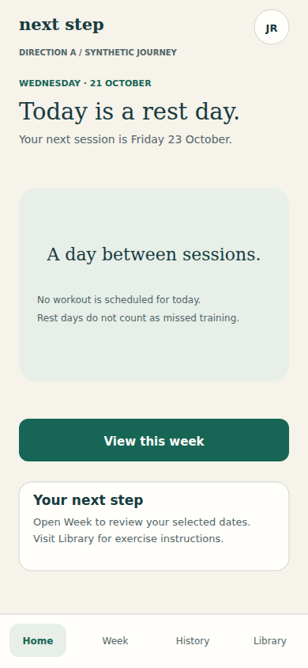

[Full-size PNG](23-home-rest-mobile.png) · [Native SVG](23-home-rest-mobile.svg)

All visible text

next step

JR

DIRECTION A  /  SYNTHETIC JOURNEY

Home

Week

History

Library

WEDNESDAY · 21 OCTOBER

Today is a rest day.

Your next session is Friday 23 October.

A day between sessions.

No workout is scheduled for today.

Rest days do not count as missed training.

View this week

Your next step

Open Week to review your selected dates.

Visit Library for exercise instructions.

## 24 home error mobile

Honest Home error state. No false empty, zero duration or re-onboarding instruction. Static design sketch. Synthetic journey, not real user data or backend qualification.

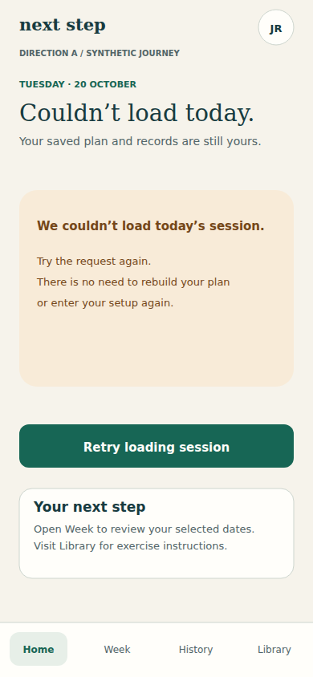

[Full-size PNG](24-home-error-mobile.png) · [Native SVG](24-home-error-mobile.svg)

All visible text

next step

JR

DIRECTION A  /  SYNTHETIC JOURNEY

Home

Week

History

Library

TUESDAY · 20 OCTOBER

Couldn’t load today.

Your saved plan and records are still yours.

We couldn’t load today’s session.

Try the request again.

There is no need to rebuild your plan

or enter your setup again.

Retry loading session

Your next step

Open Week to review your selected dates.

Visit Library for exercise instructions.

