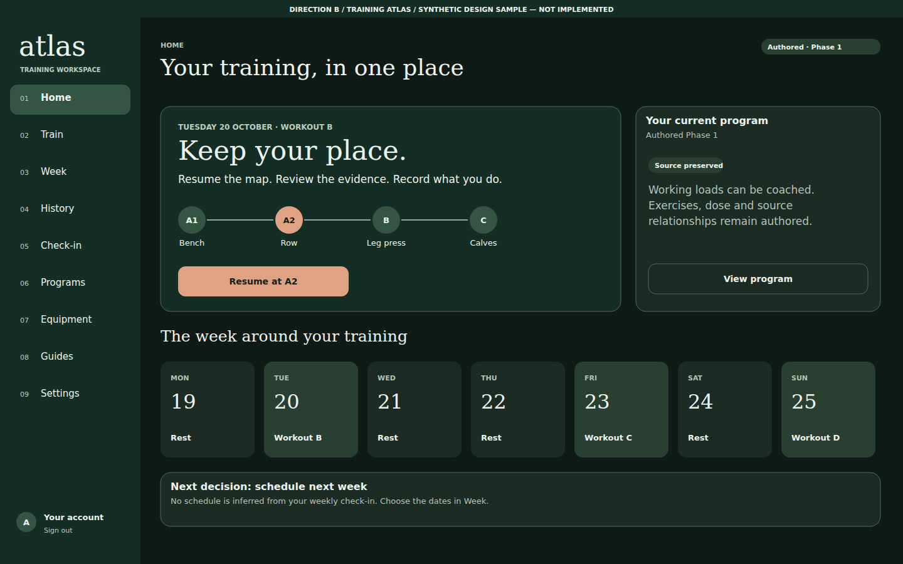
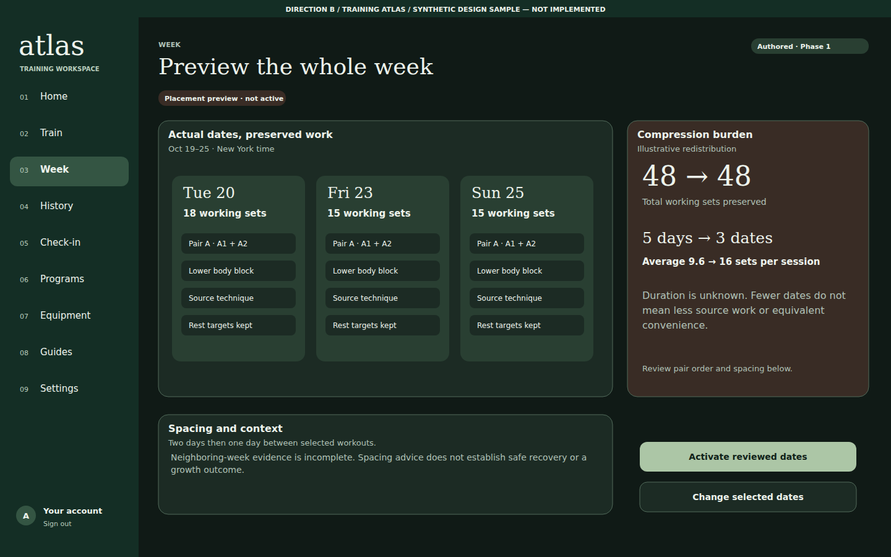
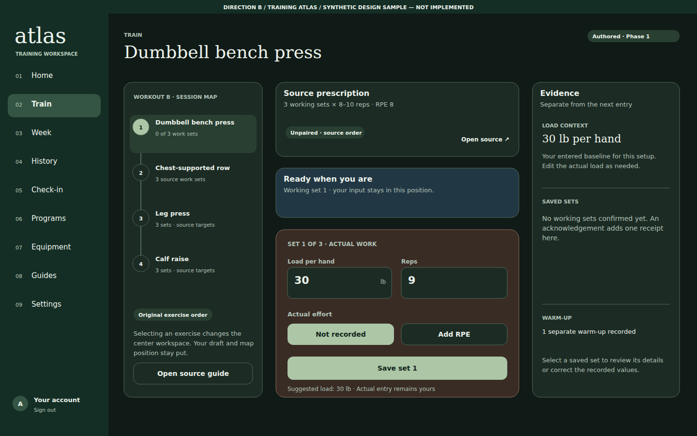
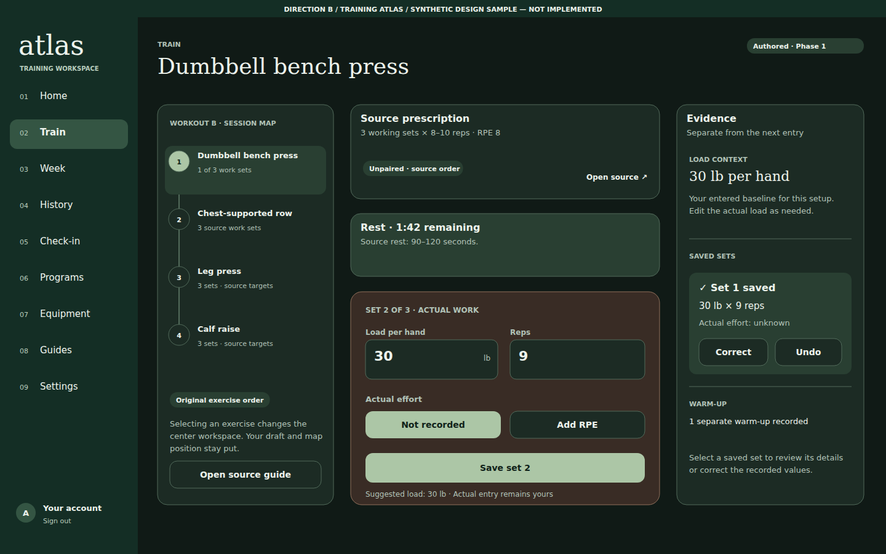
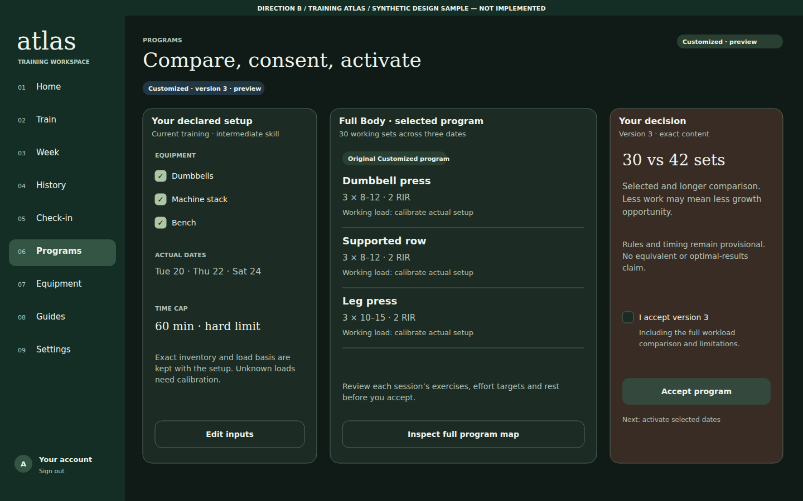
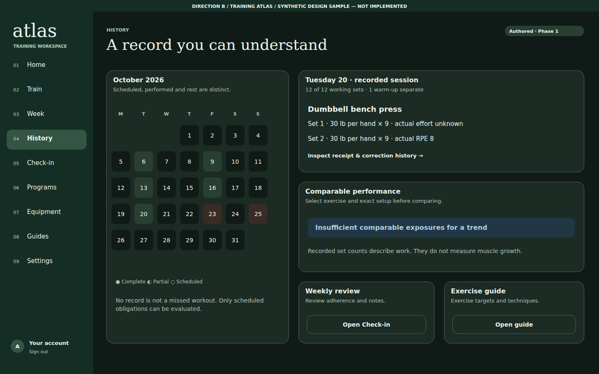

# Training Atlas — Desktop gallery

**Revision 2 — dark mode, 21 October 2026, requested by the owner.** All mobile and desktop frames in this gallery use the revised dark palette.

**6 original proposed frames.** Fictional accounts, training and history. These are static design illustrations, not implemented application pages.

[Review overview](../../README.md) · [Direction comparison](../../COMPARISON.md) · [Gallery index](GALLERY.md) · [Interaction specification](direction.md) · [Logging flow](../../FLOW-REVIEW.md)

Each image has a written description and an expandable text transcript. Open the PNG for full-size inspection or the SVG for editable source. Keyboard, screen-reader and zoom behavior are specified in the direction document; static images do not qualify those behaviors.

## d01 home workspace

Your training, in one place. Desktop Training Atlas design concept, synthetic data, not implemented.

[Full-size PNG](d01-home-workspace.png) · [Native SVG](d01-home-workspace.svg)

All visible text

DIRECTION B  /  TRAINING ATLAS  /  SYNTHETIC DESIGN SAMPLE — NOT IMPLEMENTED

atlas

TRAINING WORKSPACE

01

Home

02

Train

03

Week

04

History

05

Check-in

06

Programs

07

Equipment

08

Guides

09

Settings

A

Your account

Sign out

HOME

Your training, in one place

Authored · Phase 1

TUESDAY 20 OCTOBER · WORKOUT B

Keep your place.

Resume the map. Review the evidence. Record what you do.

A1

Bench

A2

Row

B

Leg press

C

Calves

Resume at A2

Your current program

Authored Phase 1

Source preserved

Working loads can be coached.

Exercises, dose and source

relationships remain authored.

View program

The week around your training

MON

19

Rest

TUE

20

Workout B

WED

21

Rest

THU

22

Rest

FRI

23

Workout C

SAT

24

Rest

SUN

25

Workout D

Next decision: schedule next week

No schedule is inferred from your weekly check-in. Choose the dates in Week.

## d02 week workspace

Preview the whole week. Desktop Training Atlas design concept, synthetic data, not implemented.

[Full-size PNG](d02-week-workspace.png) · [Native SVG](d02-week-workspace.svg)

All visible text

DIRECTION B  /  TRAINING ATLAS  /  SYNTHETIC DESIGN SAMPLE — NOT IMPLEMENTED

atlas

TRAINING WORKSPACE

01

Home

02

Train

03

Week

04

History

05

Check-in

06

Programs

07

Equipment

08

Guides

09

Settings

A

Your account

Sign out

WEEK

Preview the whole week

Authored · Phase 1

Placement preview · not active

Actual dates, preserved work

Oct 19–25 · New York time

Tue 20

18 working sets

Pair A · A1 + A2

Lower body block

Source technique

Rest targets kept

Fri 23

15 working sets

Pair A · A1 + A2

Lower body block

Source technique

Rest targets kept

Sun 25

15 working sets

Pair A · A1 + A2

Lower body block

Source technique

Rest targets kept

Compression burden

Illustrative redistribution

48 → 48

Total working sets preserved

5 days → 3 dates

Average 9.6 → 16 sets per session

Duration is unknown. Fewer dates do not

mean less source work or equivalent

convenience.

Review pair order and spacing below.

Spacing and context

Two days then one day between selected workouts.

Neighboring-week evidence is incomplete. Spacing advice does not establish safe recovery or a

growth outcome.

Activate reviewed dates

Change selected dates

## d03 workout before save

Synthetic working-set before desktop. Left session navigator, stable center composer, right evidence pane. Actual load field x594 y552 width215 height64, reps x829 y552 width219 height64 in both states.

[Full-size PNG](d03-workout-before-save.png) · [Native SVG](d03-workout-before-save.svg)

All visible text

DIRECTION B  /  TRAINING ATLAS  /  SYNTHETIC DESIGN SAMPLE — NOT IMPLEMENTED

atlas

TRAINING WORKSPACE

01

Home

02

Train

03

Week

04

History

05

Check-in

06

Programs

07

Equipment

08

Guides

09

Settings

A

Your account

Sign out

TRAIN

Dumbbell bench press

Authored · Phase 1

WORKOUT B · SESSION MAP

1

Dumbbell bench press

0 of 3 work sets

2

Chest-supported row

3 source work sets

3

Leg press

3 sets · source targets

4

Calf raise

3 sets · source targets

Original exercise order

Selecting an exercise changes the

center workspace. Your draft and map

position stay put.

Open source guide

Source prescription

3 working sets × 8–10 reps · RPE 8

Unpaired · source order

Open source ↗

Ready when you are

Working set 1 · your input stays in this position.

SET 1 OF 3 · ACTUAL WORK

Load per hand

30

lb

Reps

9

Actual effort

Not recorded

Add RPE

Save set 1

Suggested load: 30 lb  ·  Actual entry remains yours

Evidence

Separate from the next entry

LOAD CONTEXT

30 lb per hand

Your entered baseline for this setup.

Edit the actual load as needed.

SAVED SETS

No working sets confirmed yet. An

acknowledgement adds one receipt

here.

WARM-UP

1 separate warm-up recorded

Select a saved set to review its details

or correct the recorded values.

## d04 workout after ack

Synthetic working-set ack desktop. Left session navigator, stable center composer, right evidence pane. Actual load field x594 y552 width215 height64, reps x829 y552 width219 height64 in both states.

[Full-size PNG](d04-workout-after-ack.png) · [Native SVG](d04-workout-after-ack.svg)

All visible text

DIRECTION B  /  TRAINING ATLAS  /  SYNTHETIC DESIGN SAMPLE — NOT IMPLEMENTED

atlas

TRAINING WORKSPACE

01

Home

02

Train

03

Week

04

History

05

Check-in

06

Programs

07

Equipment

08

Guides

09

Settings

A

Your account

Sign out

TRAIN

Dumbbell bench press

Authored · Phase 1

WORKOUT B · SESSION MAP

1

Dumbbell bench press

1 of 3 work sets

2

Chest-supported row

3 source work sets

3

Leg press

3 sets · source targets

4

Calf raise

3 sets · source targets

Original exercise order

Selecting an exercise changes the

center workspace. Your draft and map

position stay put.

Open source guide

Source prescription

3 working sets × 8–10 reps · RPE 8

Unpaired · source order

Open source ↗

Rest · 1:42 remaining

Source rest: 90–120 seconds.

SET 2 OF 3 · ACTUAL WORK

Load per hand

30

lb

Reps

9

Actual effort

Not recorded

Add RPE

Save set 2

Suggested load: 30 lb  ·  Actual entry remains yours

Evidence

Separate from the next entry

LOAD CONTEXT

30 lb per hand

Your entered baseline for this setup.

Edit the actual load as needed.

SAVED SETS

✓ Set 1 saved

30 lb × 9 reps

Actual effort: unknown

Correct

Undo

WARM-UP

1 separate warm-up recorded

Select a saved set to review its details

or correct the recorded values.

## d05 customized workspace

Compare, consent, activate. Desktop Training Atlas design concept, synthetic data, not implemented.

[Full-size PNG](d05-customized-workspace.png) · [Native SVG](d05-customized-workspace.svg)

All visible text

DIRECTION B  /  TRAINING ATLAS  /  SYNTHETIC DESIGN SAMPLE — NOT IMPLEMENTED

atlas

TRAINING WORKSPACE

01

Home

02

Train

03

Week

04

History

05

Check-in

06

Programs

07

Equipment

08

Guides

09

Settings

A

Your account

Sign out

PROGRAMS

Compare, consent, activate

Customized · preview

Customized · version 3 · preview

Your declared setup

Current training · intermediate skill

EQUIPMENT

✓

Dumbbells

✓

Machine stack

✓

Bench

ACTUAL DATES

Tue 20 · Thu 22 · Sat 24

TIME CAP

60 min · hard limit

Exact inventory and load basis are

kept with the setup. Unknown loads

need calibration.

Edit inputs

Full Body · selected program

30 working sets across three dates

Original Customized program

Dumbbell press

3 × 8–12 · 2 RIR

Working load: calibrate actual setup

Supported row

3 × 8–12 · 2 RIR

Working load: calibrate actual setup

Leg press

3 × 10–15 · 2 RIR

Working load: calibrate actual setup

Review each session’s exercises, effort targets and rest

before you accept.

Inspect full program map

Your decision

Version 3 · exact content

30 vs 42 sets

Selected and longer comparison.

Less work may mean less growth

opportunity.

Rules and timing remain provisional.

No equivalent or optimal-results

claim.

I accept version 3

Including the full workload

comparison and limitations.

Accept program

Next: activate selected dates

## d06 history workspace

A record you can understand. Desktop Training Atlas design concept, synthetic data, not implemented.

[Full-size PNG](d06-history-workspace.png) · [Native SVG](d06-history-workspace.svg)

All visible text

DIRECTION B  /  TRAINING ATLAS  /  SYNTHETIC DESIGN SAMPLE — NOT IMPLEMENTED

atlas

TRAINING WORKSPACE

01

Home

02

Train

03

Week

04

History

05

Check-in

06

Programs

07

Equipment

08

Guides

09

Settings

A

Your account

Sign out

HISTORY

A record you can understand

Authored · Phase 1

October 2026

Scheduled, performed and rest are distinct.

M

T

W

T

F

S

S

1

2

3

4

5

6

7

8

9

10

11

12

13

14

15

16

17

18

19

20

21

22

23

24

25

26

27

28

29

30

31

● Complete   ◐ Partial   ○ Scheduled

No record is not a missed workout. Only scheduled

obligations can be evaluated.

Tuesday 20 · recorded session

12 of 12 working sets · 1 warm-up separate

Dumbbell bench press

Set 1 · 30 lb per hand × 9 · actual effort unknown

Set 2 · 30 lb per hand × 9 · actual RPE 8

Inspect receipt & correction history →

Comparable performance

Select exercise and exact setup before comparing.

Insufficient comparable exposures for a trend

Recorded set counts describe work. They do not measure muscle growth.

Weekly review

Review adherence and notes.

Open Check-in

Exercise guide

Exercise targets and techniques.

Open guide

