# Training Atlas — Mobile gallery

**Revision 2 — dark mode, 21 October 2026, requested by the owner.** All mobile and desktop frames in this gallery use the revised dark palette.

**26 original proposed frames.** Fictional accounts, training and history. These are static design illustrations, not implemented application pages.

[Review overview](../../README.md) · [Direction comparison](../../COMPARISON.md) · [Gallery index](GALLERY.md) · [Interaction specification](direction.md) · [Logging flow](../../FLOW-REVIEW.md)

Each image has a written description and an expandable text transcript. Open the PNG for full-size inspection or the SVG for editable source. Keyboard, screen-reader and zoom behavior are specified in the direction document; static images do not qualify those behaviors.

## m01 welcome sign in

A place for your training. Training Atlas conceptual mockup. Synthetic data. Not implemented.

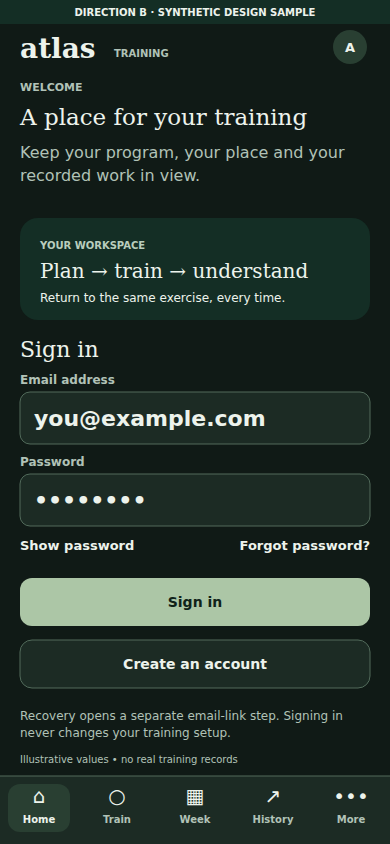

[Full-size PNG](m01-welcome-sign-in.png) · [Native SVG](m01-welcome-sign-in.svg)

All visible text

DIRECTION B  ·  SYNTHETIC DESIGN SAMPLE

atlas

TRAINING

A

WELCOME

A place for your training

⌂

Home

○

Train

▦

Week

↗

History

•••

More

Keep your program, your place and your

recorded work in view.

YOUR WORKSPACE

Plan → train → understand

Return to the same exercise, every time.

Sign in

Email address

you@example.com

Password

••••••••

Show password

Forgot password?

Sign in

Create an account

Recovery opens a separate email-link step. Signing in

never changes your training setup.

Illustrative values • no real training records

## m02 program authority

Choose your authority. Training Atlas conceptual mockup. Synthetic data. Not implemented.

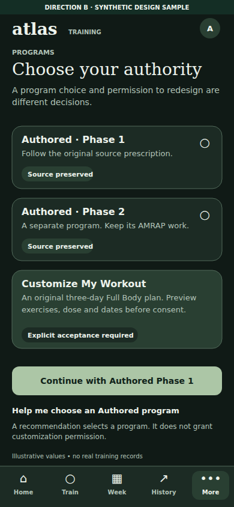

[Full-size PNG](m02-program-authority.png) · [Native SVG](m02-program-authority.svg)

All visible text

DIRECTION B  ·  SYNTHETIC DESIGN SAMPLE

atlas

TRAINING

A

PROGRAMS

Choose your authority

⌂

Home

○

Train

▦

Week

↗

History

•••

More

A program choice and permission to redesign are

different decisions.

Authored · Phase 1

Follow the original source prescription.

Source preserved

○

Authored · Phase 2

A separate program. Keep its AMRAP work.

Source preserved

○

Customize My Workout

An original three-day Full Body plan. Preview

exercises, dose and dates before consent.

Explicit acceptance required

Continue with Authored Phase 1

Help me choose an Authored program

A recommendation selects a program. It does not grant

customization permission.

Illustrative values • no real training records

## m03 equipment units

Your actual setup. Training Atlas conceptual mockup. Synthetic data. Not implemented.

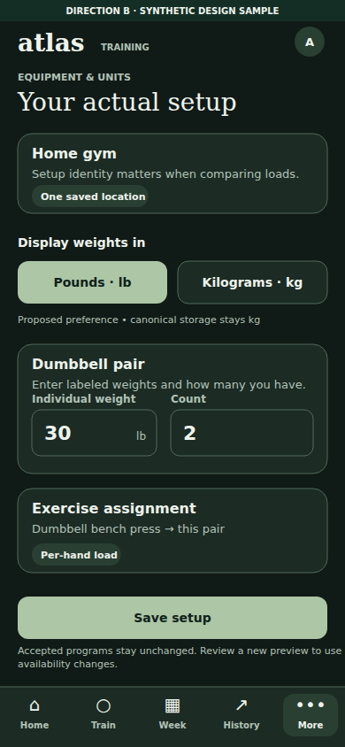

[Full-size PNG](m03-equipment-units.png) · [Native SVG](m03-equipment-units.svg)

All visible text

DIRECTION B  ·  SYNTHETIC DESIGN SAMPLE

atlas

TRAINING

A

EQUIPMENT & UNITS

Your actual setup

⌂

Home

○

Train

▦

Week

↗

History

•••

More

Home gym

Setup identity matters when comparing loads.

One saved location

Display weights in

Pounds · lb

Kilograms · kg

Proposed preference • canonical storage stays kg

Dumbbell pair

Enter labeled weights and how many you have.

Individual weight

30

lb

Count

2

Exercise assignment

Dumbbell bench press → this pair

Per-hand load

Save setup

Accepted programs stay unchanged. Review a new preview to use

availability changes.

## m04 home

Tuesday, in view. Training Atlas conceptual mockup. Synthetic data. Not implemented.

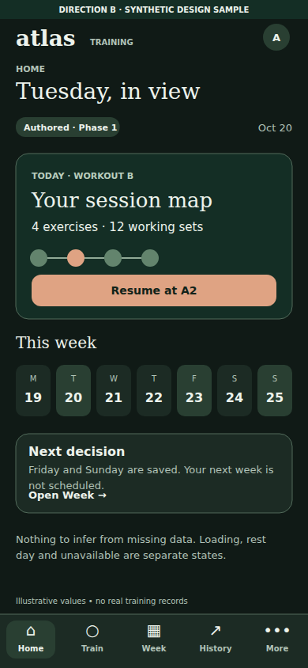

[Full-size PNG](m04-home.png) · [Native SVG](m04-home.svg)

All visible text

DIRECTION B  ·  SYNTHETIC DESIGN SAMPLE

atlas

TRAINING

A

HOME

Tuesday, in view

⌂

Home

○

Train

▦

Week

↗

History

•••

More

Authored · Phase 1

Oct 20

TODAY · WORKOUT B

Your session map

4 exercises · 12 working sets

Resume at A2

This week

M

19

T

20

W

21

T

22

F

23

S

24

S

25

Next decision

Friday and Sunday are saved. Your next week is

not scheduled.

Open Week →

Nothing to infer from missing data. Loading, rest

day and unavailable are separate states.

Illustrative values • no real training records

## m05 week compression

A week that fits. Training Atlas conceptual mockup. Synthetic data. Not implemented.

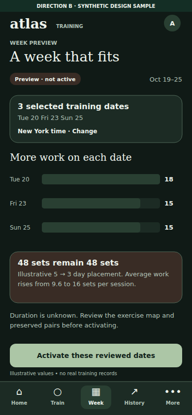

[Full-size PNG](m05-week-compression.png) · [Native SVG](m05-week-compression.svg)

All visible text

DIRECTION B  ·  SYNTHETIC DESIGN SAMPLE

atlas

TRAINING

A

WEEK PREVIEW

A week that fits

⌂

Home

○

Train

▦

Week

↗

History

•••

More

Preview · not active

Oct 19–25

3 selected training dates

Tue 20       Fri 23       Sun 25

New York time · Change

More work on each date

Tue 20

18

Fri 23

15

Sun 25

15

48 sets remain 48 sets

Illustrative 5 → 3 day placement. Average work

rises from 9.6 to 16 sets per session.

Duration is unknown. Review the exercise map and

preserved pairs before activating.

Activate these reviewed dates

Illustrative values • no real training records

## m06 customized consent

Review this program. Training Atlas conceptual mockup. Synthetic data. Not implemented.

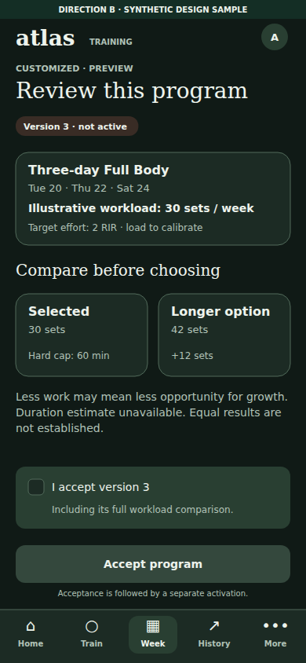

[Full-size PNG](m06-customized-consent.png) · [Native SVG](m06-customized-consent.svg)

All visible text

DIRECTION B  ·  SYNTHETIC DESIGN SAMPLE

atlas

TRAINING

A

CUSTOMIZED · PREVIEW

Review this program

⌂

Home

○

Train

▦

Week

↗

History

•••

More

Version 3 · not active

Three-day Full Body

Tue 20 · Thu 22 · Sat 24

Illustrative workload: 30 sets / week

Target effort: 2 RIR · load to calibrate

Compare before choosing

Selected

30 sets

Longer option

42 sets

Hard cap: 60 min

+12 sets

Less work may mean less opportunity for growth.

Duration estimate unavailable. Equal results are

not established.

I accept version 3

Including its full workload comparison.

Accept program

Acceptance is followed by a separate activation.

## m07 active dates replacement

Your active program. Training Atlas conceptual mockup. Synthetic data. Not implemented.

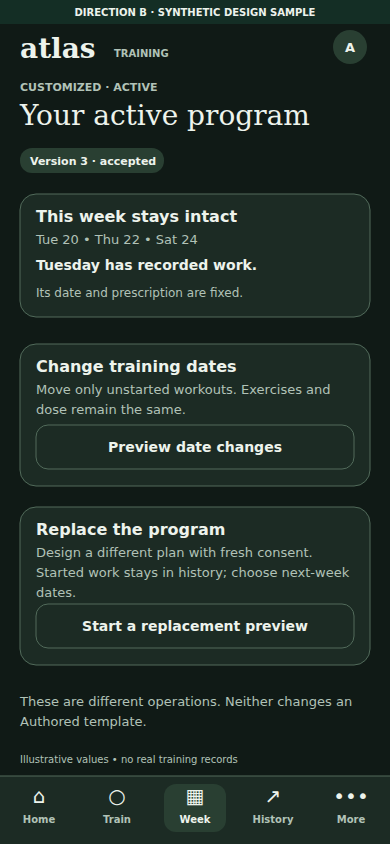

[Full-size PNG](m07-active-dates-replacement.png) · [Native SVG](m07-active-dates-replacement.svg)

All visible text

DIRECTION B  ·  SYNTHETIC DESIGN SAMPLE

atlas

TRAINING

A

CUSTOMIZED · ACTIVE

Your active program

⌂

Home

○

Train

▦

Week

↗

History

•••

More

Version 3 · accepted

This week stays intact

Tue 20  •  Thu 22  •  Sat 24

Tuesday has recorded work.

Its date and prescription are fixed.

Change training dates

Move only unstarted workouts. Exercises and

dose remain the same.

Preview date changes

Replace the program

Design a different plan with fresh consent.

Started work stays in history; choose next-week

dates.

Start a replacement preview

These are different operations. Neither changes an

Authored template.

Illustrative values • no real training records

## m08 first load proposed

Choose a starting point. Training Atlas conceptual mockup. Synthetic data. Not implemented.

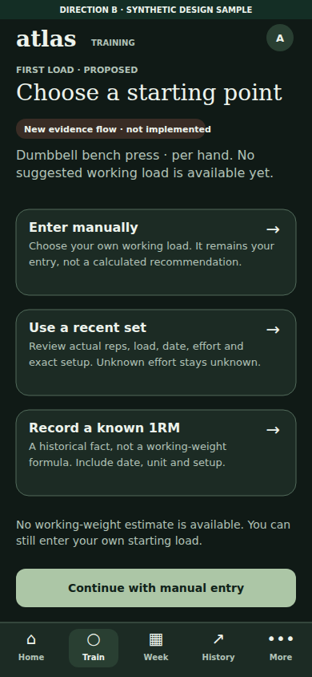

[Full-size PNG](m08-first-load-proposed.png) · [Native SVG](m08-first-load-proposed.svg)

All visible text

DIRECTION B  ·  SYNTHETIC DESIGN SAMPLE

atlas

TRAINING

A

FIRST LOAD · PROPOSED

Choose a starting point

⌂

Home

○

Train

▦

Week

↗

History

•••

More

New evidence flow · not implemented

Dumbbell bench press · per hand. No

suggested working load is available yet.

Enter manually

Choose your own working load. It remains your

entry, not a calculated recommendation.

→

Use a recent set

Review actual reps, load, date, effort and

exact setup. Unknown effort stays unknown.

→

Record a known 1RM

A historical fact, not a working-weight

formula. Include date, unit and setup.

→

No working-weight estimate is available. You can

still enter your own starting load.

Continue with manual entry

## m09 warmup

Dumbbell bench press. Training Atlas conceptual mockup. Synthetic data. Not implemented.

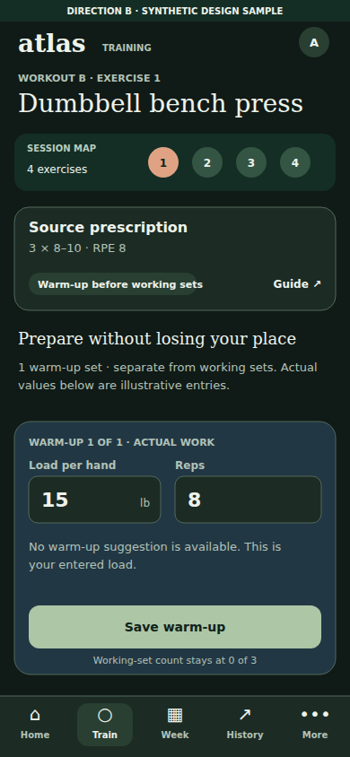

[Full-size PNG](m09-warmup.png) · [Native SVG](m09-warmup.svg)

All visible text

DIRECTION B  ·  SYNTHETIC DESIGN SAMPLE

atlas

TRAINING

A

WORKOUT B · EXERCISE 1

Dumbbell bench press

⌂

Home

○

Train

▦

Week

↗

History

•••

More

SESSION MAP

1

2

3

4

4 exercises

Source prescription

3 × 8–10 · RPE 8

Warm-up before working sets

Guide ↗

Prepare without losing your place

1 warm-up set · separate from working sets. Actual

values below are illustrative entries.

WARM-UP 1 OF 1 · ACTUAL WORK

Load per hand

15

lb

Reps

8

No warm-up suggestion is available. This is

your entered load.

Save warm-up

Working-set count stays at 0 of 3

## m10 set before save

Synthetic before working-set screen. Composer fields remain at x32 and x195, y531, width147 and163, height52. Receipt region has fixed height; unknown effort is not filled from target.

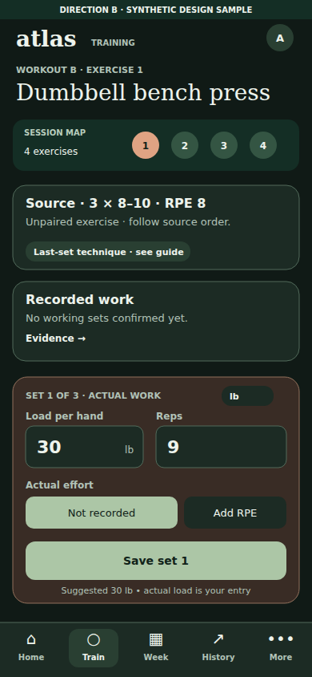

[Full-size PNG](m10-set-before-save.png) · [Native SVG](m10-set-before-save.svg)

All visible text

DIRECTION B  ·  SYNTHETIC DESIGN SAMPLE

atlas

TRAINING

A

WORKOUT B · EXERCISE 1

Dumbbell bench press

⌂

Home

○

Train

▦

Week

↗

History

•••

More

SESSION MAP

1

2

3

4

4 exercises

Source · 3 × 8–10 · RPE 8

Unpaired exercise · follow source order.

Last-set technique · see guide

Recorded work

No working sets confirmed yet.

Evidence  →

SET 1 OF 3  ·  ACTUAL WORK

lb

Load per hand

30

lb

Reps

9

Actual effort

Not recorded

Add RPE

Save set 1

Suggested 30 lb • actual load is your entry

## m11 set after ack rest

Synthetic ack working-set screen. Composer fields remain at x32 and x195, y531, width147 and163, height52. Receipt region has fixed height; unknown effort is not filled from target.

[Full-size PNG](m11-set-after-ack-rest.png) · [Native SVG](m11-set-after-ack-rest.svg)

All visible text

DIRECTION B  ·  SYNTHETIC DESIGN SAMPLE

atlas

TRAINING

A

WORKOUT B · EXERCISE 1

Dumbbell bench press

⌂

Home

○

Train

▦

Week

↗

History

•••

More

SESSION MAP

1

2

3

4

4 exercises

Source · 3 × 8–10 · RPE 8

Unpaired exercise · follow source order.

Last-set technique · see guide

✓ Set 1 saved

30 lb per hand × 9 · effort not recorded

Rest 1:42   /   source range 90–120 sec

SET 2 OF 3  ·  ACTUAL WORK

lb

Load per hand

30

lb

Reps

9

Actual effort

Not recorded

Add RPE

Save set 2

Suggested 30 lb • actual load is your entry

## m12 set pending

Synthetic pending working-set screen. Composer fields remain at x32 and x195, y531, width147 and163, height52. Receipt region has fixed height; unknown effort is not filled from target.

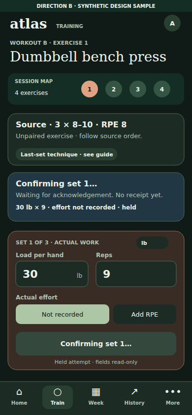

[Full-size PNG](m12-set-pending.png) · [Native SVG](m12-set-pending.svg)

All visible text

DIRECTION B  ·  SYNTHETIC DESIGN SAMPLE

atlas

TRAINING

A

WORKOUT B · EXERCISE 1

Dumbbell bench press

⌂

Home

○

Train

▦

Week

↗

History

•••

More

SESSION MAP

1

2

3

4

4 exercises

Source · 3 × 8–10 · RPE 8

Unpaired exercise · follow source order.

Last-set technique · see guide

Confirming set 1…

Waiting for acknowledgement. No receipt yet.

30 lb × 9 · effort not recorded · held

SET 1 OF 3  ·  ACTUAL WORK

lb

Load per hand

30

lb

Reps

9

Actual effort

Not recorded

Add RPE

Confirming set 1…

Held attempt · fields read-only

## m13 set error retry

Synthetic error working-set screen. Composer fields remain at x32 and x195, y531, width147 and163, height52. Receipt region has fixed height; unknown effort is not filled from target.

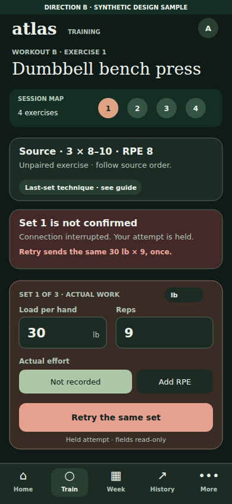

[Full-size PNG](m13-set-error-retry.png) · [Native SVG](m13-set-error-retry.svg)

All visible text

DIRECTION B  ·  SYNTHETIC DESIGN SAMPLE

atlas

TRAINING

A

WORKOUT B · EXERCISE 1

Dumbbell bench press

⌂

Home

○

Train

▦

Week

↗

History

•••

More

SESSION MAP

1

2

3

4

4 exercises

Source · 3 × 8–10 · RPE 8

Unpaired exercise · follow source order.

Last-set technique · see guide

Set 1 is not confirmed

Connection interrupted. Your attempt is held.

Retry sends the same 30 lb × 9, once.

SET 1 OF 3  ·  ACTUAL WORK

lb

Load per hand

30

lb

Reps

9

Actual effort

Not recorded

Add RPE

Retry the same set

Held attempt · fields read-only

## m14 correction undo

Correct recorded work. Training Atlas conceptual mockup. Synthetic data. Not implemented.

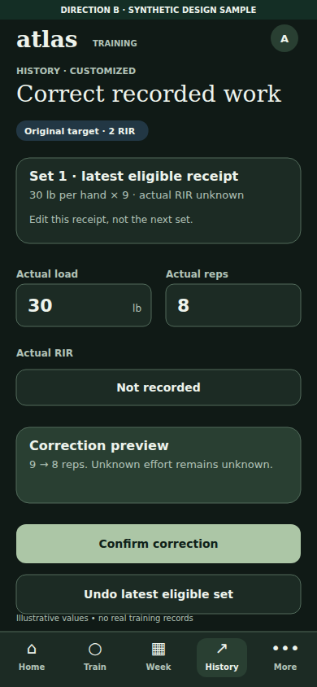

[Full-size PNG](m14-correction-undo.png) · [Native SVG](m14-correction-undo.svg)

All visible text

DIRECTION B  ·  SYNTHETIC DESIGN SAMPLE

atlas

TRAINING

A

HISTORY · CUSTOMIZED

Correct recorded work

⌂

Home

○

Train

▦

Week

↗

History

•••

More

Original target · 2 RIR

Set 1 · latest eligible receipt

30 lb per hand × 9 · actual RIR unknown

Edit this receipt, not the next set.

Actual load

30

lb

Actual reps

8

Actual RIR

Not recorded

Correction preview

9 → 8 reps. Unknown effort remains unknown.

Confirm correction

Undo latest eligible set

Illustrative values • no real training records

## m15 completion history analytics

The work is recorded. Training Atlas conceptual mockup. Synthetic data. Not implemented.

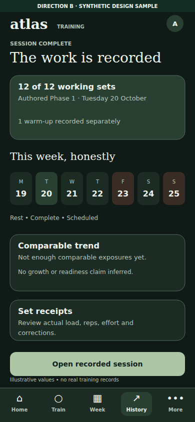

[Full-size PNG](m15-completion-history-analytics.png) · [Native SVG](m15-completion-history-analytics.svg)

All visible text

DIRECTION B  ·  SYNTHETIC DESIGN SAMPLE

atlas

TRAINING

A

SESSION COMPLETE

The work is recorded

⌂

Home

○

Train

▦

Week

↗

History

•••

More

12 of 12 working sets

Authored Phase 1 · Tuesday 20 October

1 warm-up recorded separately

This week, honestly

M

19

T

20

W

21

T

22

F

23

S

24

S

25

Rest    •    Complete    •    Scheduled

Comparable trend

Not enough comparable exposures yet.

No growth or readiness claim inferred.

Set receipts

Review actual load, reps, effort and

corrections.

Open recorded session

Illustrative values • no real training records

## m16 checkin

Review your week. Training Atlas conceptual mockup. Synthetic data. Not implemented.

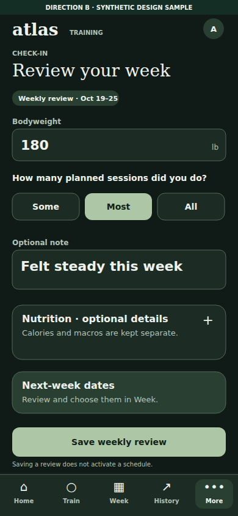

[Full-size PNG](m16-checkin.png) · [Native SVG](m16-checkin.svg)

All visible text

DIRECTION B  ·  SYNTHETIC DESIGN SAMPLE

atlas

TRAINING

A

CHECK-IN

Review your week

⌂

Home

○

Train

▦

Week

↗

History

•••

More

Weekly review · Oct 19–25

Bodyweight

180

lb

How many planned sessions did you do?

Some

Most

All

Optional note

Felt steady this week

Nutrition · optional details

Calories and macros are kept separate.

+

Next-week dates

Review and choose them in Week.

Save weekly review

Saving a review does not activate a schedule.

## m17 settings

Your workspace settings. Training Atlas conceptual mockup. Synthetic data. Not implemented.

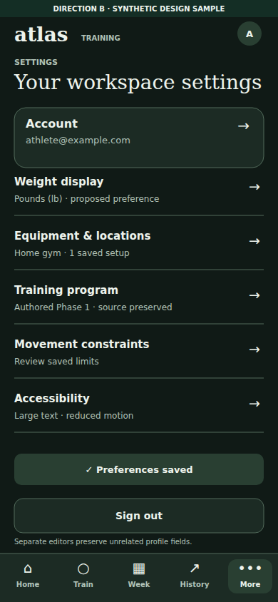

[Full-size PNG](m17-settings.png) · [Native SVG](m17-settings.svg)

All visible text

DIRECTION B  ·  SYNTHETIC DESIGN SAMPLE

atlas

TRAINING

A

SETTINGS

Your workspace settings

⌂

Home

○

Train

▦

Week

↗

History

•••

More

Account

athlete@example.com

→

Weight display

Pounds (lb) · proposed preference

→

Equipment & locations

Home gym · 1 saved setup

→

Training program

Authored Phase 1 · source preserved

→

Movement constraints

Review saved limits

→

Accessibility

Large text · reduced motion

→

✓ Preferences saved

Sign out

Separate editors preserve unrelated profile fields.

## m18 guides

Source, close at hand. Training Atlas conceptual mockup. Synthetic data. Not implemented.

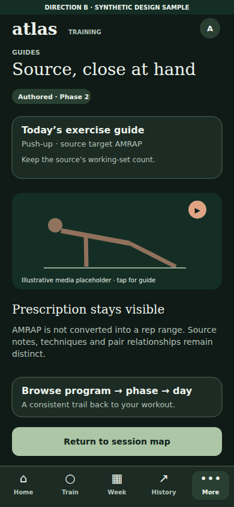

[Full-size PNG](m18-guides.png) · [Native SVG](m18-guides.svg)

All visible text

DIRECTION B  ·  SYNTHETIC DESIGN SAMPLE

atlas

TRAINING

A

GUIDES

Source, close at hand

⌂

Home

○

Train

▦

Week

↗

History

•••

More

Authored · Phase 2

Today’s exercise guide

Push-up · source target AMRAP

Keep the source’s working-set count.

▶

Illustrative media placeholder · tap for guide

Prescription stays visible

AMRAP is not converted into a rep range. Source

notes, techniques and pair relationships remain

distinct.

Browse program → phase → day

A consistent trail back to your workout.

Return to session map

## m19 known 1rm form proposed

Record a known 1RM. Training Atlas conceptual mockup. Synthetic data. Not implemented.

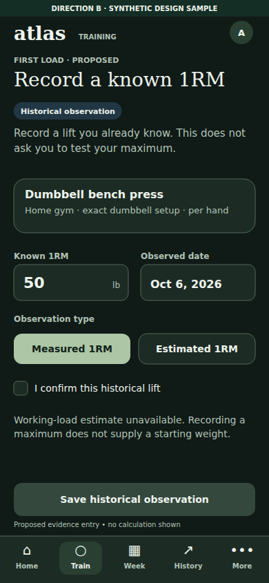

[Full-size PNG](m19-known-1rm-form-proposed.png) · [Native SVG](m19-known-1rm-form-proposed.svg)

All visible text

DIRECTION B  ·  SYNTHETIC DESIGN SAMPLE

atlas

TRAINING

A

FIRST LOAD · PROPOSED

Record a known 1RM

⌂

Home

○

Train

▦

Week

↗

History

•••

More

Historical observation

Record a lift you already know. This does not

ask you to test your maximum.

Dumbbell bench press

Home gym · exact dumbbell setup · per hand

Known 1RM

50

lb

Observed date

Oct 6, 2026

Observation type

Measured 1RM

Estimated 1RM

I confirm this historical lift

Working-load estimate unavailable. Recording a

maximum does not supply a starting weight.

Save historical observation

Proposed evidence entry • no calculation shown

## m20 recent set form proposed

Use a recent set. Training Atlas conceptual mockup. Synthetic data. Not implemented.

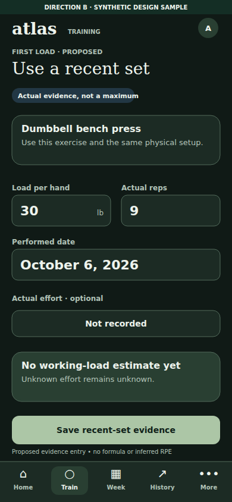

[Full-size PNG](m20-recent-set-form-proposed.png) · [Native SVG](m20-recent-set-form-proposed.svg)

All visible text

DIRECTION B  ·  SYNTHETIC DESIGN SAMPLE

atlas

TRAINING

A

FIRST LOAD · PROPOSED

Use a recent set

⌂

Home

○

Train

▦

Week

↗

History

•••

More

Actual evidence, not a maximum

Dumbbell bench press

Use this exercise and the same physical setup.

Load per hand

30

lb

Actual reps

9

Performed date

October 6, 2026

Actual effort · optional

Not recorded

No working-load estimate yet

Unknown effort remains unknown.

Save recent-set evidence

Proposed evidence entry • no formula or inferred RPE

## m21 manual starting load

Enter your starting load. Training Atlas conceptual mockup. Synthetic data. Not implemented.

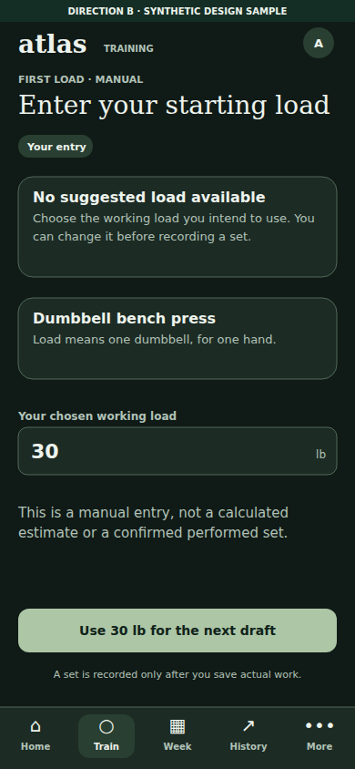

[Full-size PNG](m21-manual-starting-load.png) · [Native SVG](m21-manual-starting-load.svg)

All visible text

DIRECTION B  ·  SYNTHETIC DESIGN SAMPLE

atlas

TRAINING

A

FIRST LOAD · MANUAL

Enter your starting load

⌂

Home

○

Train

▦

Week

↗

History

•••

More

Your entry

No suggested load available

Choose the working load you intend to use. You

can change it before recording a set.

Dumbbell bench press

Load means one dumbbell, for one hand.

Your chosen working load

30

lb

This is a manual entry, not a calculated

estimate or a confirmed performed set.

Use 30 lb for the next draft

A set is recorded only after you save actual work.

## m22 session loading

Opening your session. Training Atlas conceptual mockup. Synthetic data. Not implemented.

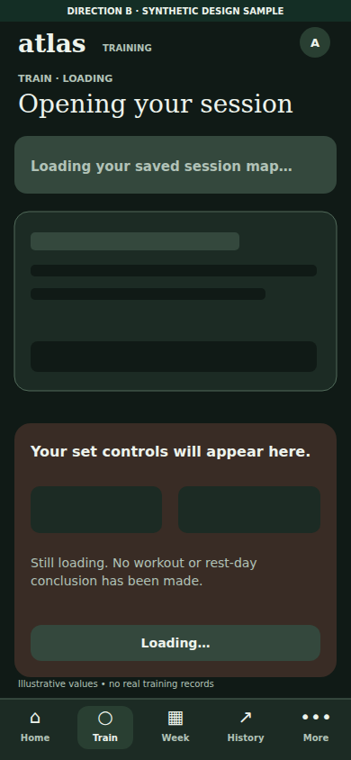

[Full-size PNG](m22-session-loading.png) · [Native SVG](m22-session-loading.svg)

All visible text

DIRECTION B  ·  SYNTHETIC DESIGN SAMPLE

atlas

TRAINING

A

TRAIN · LOADING

Opening your session

⌂

Home

○

Train

▦

Week

↗

History

•••

More

Loading your saved session map…

Your set controls will appear here.

Still loading. No workout or rest-day

conclusion has been made.

Loading…

Illustrative values • no real training records

## m23 planned rest day

A planned day off. Training Atlas conceptual mockup. Synthetic data. Not implemented.

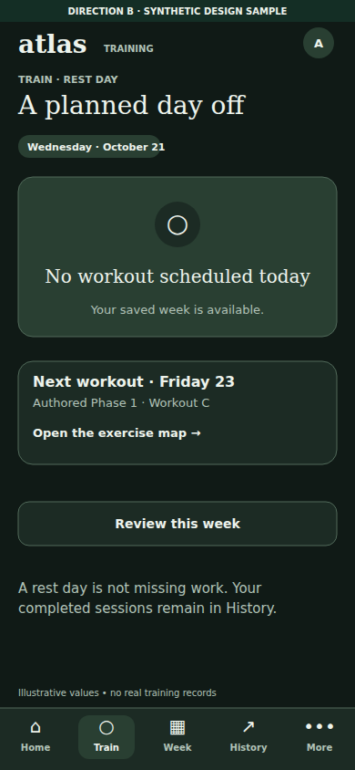

[Full-size PNG](m23-planned-rest-day.png) · [Native SVG](m23-planned-rest-day.svg)

All visible text

DIRECTION B  ·  SYNTHETIC DESIGN SAMPLE

atlas

TRAINING

A

TRAIN · REST DAY

A planned day off

⌂

Home

○

Train

▦

Week

↗

History

•••

More

Wednesday · October 21

○

No workout scheduled today

Your saved week is available.

Next workout · Friday 23

Authored Phase 1 · Workout C

Open the exercise map →

Review this week

A rest day is not missing work. Your

completed sessions remain in History.

Illustrative values • no real training records

## m24 session unavailable

Session unavailable. Training Atlas conceptual mockup. Synthetic data. Not implemented.

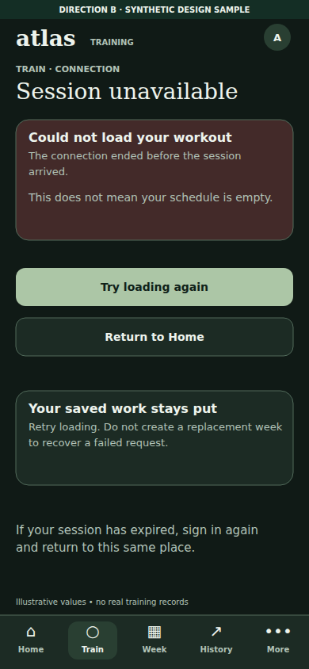

[Full-size PNG](m24-session-unavailable.png) · [Native SVG](m24-session-unavailable.svg)

All visible text

DIRECTION B  ·  SYNTHETIC DESIGN SAMPLE

atlas

TRAINING

A

TRAIN · CONNECTION

Session unavailable

⌂

Home

○

Train

▦

Week

↗

History

•••

More

Could not load your workout

The connection ended before the session

arrived.

This does not mean your schedule is empty.

Try loading again

Return to Home

Your saved work stays put

Retry loading. Do not create a replacement week

to recover a failed request.

If your session has expired, sign in again

and return to this same place.

Illustrative values • no real training records

## m25 account recovery

Recover access in a guest account shell, without signed-in navigation or account avatar. Training Atlas conceptual mockup. Synthetic data. Not implemented.

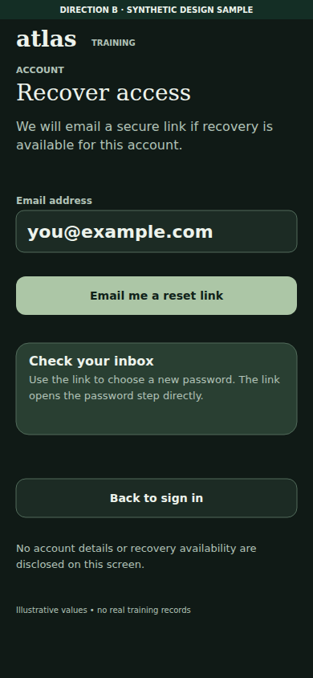

[Full-size PNG](m25-account-recovery.png) · [Native SVG](m25-account-recovery.svg)

All visible text

DIRECTION B  ·  SYNTHETIC DESIGN SAMPLE

atlas

TRAINING

ACCOUNT

Recover access

We will email a secure link if recovery is

available for this account.

Email address

you@example.com

Email me a reset link

Check your inbox

Use the link to choose a new password. The link

opens the password step directly.

Back to sign in

No account details or recovery availability are

disclosed on this screen.

Illustrative values • no real training records

## m26 authored pair variant

Source pair A. Training Atlas conceptual mockup. Synthetic data. Not implemented.

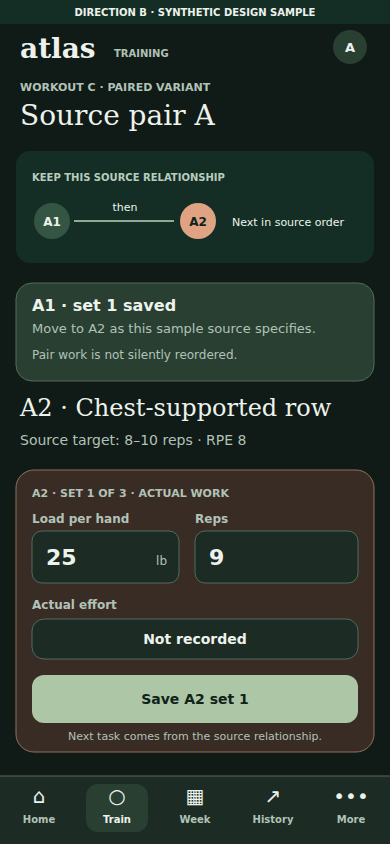

[Full-size PNG](m26-authored-pair-variant.png) · [Native SVG](m26-authored-pair-variant.svg)

All visible text

DIRECTION B  ·  SYNTHETIC DESIGN SAMPLE

atlas

TRAINING

A

WORKOUT C · PAIRED VARIANT

Source pair A

⌂

Home

○

Train

▦

Week

↗

History

•••

More

KEEP THIS SOURCE RELATIONSHIP

A1

then

A2

Next in source order

A1 · set 1 saved

Move to A2 as this sample source specifies.

Pair work is not silently reordered.

A2 · Chest-supported row

Source target: 8–10 reps · RPE 8

A2 · SET 1 OF 3 · ACTUAL WORK

Load per hand

25

lb

Reps

9

Actual effort

Not recorded

Save A2 set 1

Next task comes from the source relationship.

