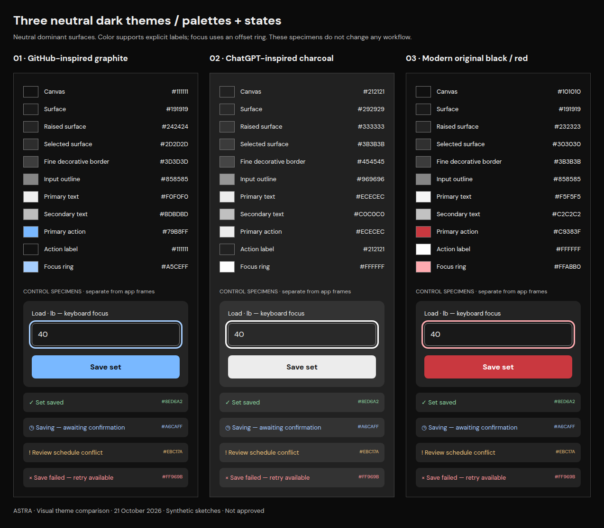

# Astra — three neutral dark themes

**21 October 2026 · Visual comparison only · None approved.** The earlier earthy dark palettes are not approved. This small comparison keeps the existing Next Step and Training Atlas workflows fixed. The audit was not repeated and the complete 64-frame package was not regenerated.

Choose the **palette** separately from **typography** and from the still-unapproved layout directions. GitHub-inspired and ChatGPT-inspired describe the visual inspiration; these are original WorkoutApp palettes, not claims of exact product tokens or copied interfaces.

| Compare | Open |
|---|---|
| A — Next Step: all six screens, three themes side by side | [A comparison gallery](NEXT-STEP.md) |
| B — Training Atlas: all six screens, three themes side by side | [B comparison gallery](TRAINING-ATLAS.md) |
| Colors, borders, keyboard focus and status specimens | [Palette details](PALETTES.md) |
| Existing serif versus modern sans-serif, with color/layout held constant | [Typography comparison](TYPOGRAPHY.md) |
| Accessible text alternatives for the twelve source screens | [Screen transcripts](TRANSCRIPTS.md) |
| Scope, geometry checks, contrast sampling and limitations | [Verification](VALIDATION.md) |

Each direction shows Home, Week/scheduling, before Save Set, after Save Set, Settings and a desktop workout. Each comparison PNG contains all three options in the same left-to-right order. Mobile panels retain 390 × 844 dimensions; desktop panels retain 1440 × 900. Open the full-size image or the individual theme PNG links to inspect desktop text without downscaling.

## Visual choices

| Theme | Character | Advantage | Tradeoff |
|---|---|---|---|
| 1 · GitHub-inspired graphite | Near-black canvas, fine grey boundaries, restrained blue actions | Clear control discovery and precise separation | More outlined and technical in feel |
| 2 · ChatGPT-inspired charcoal | Neutral charcoal layers, restrained boundaries, off-white actions | Quietest overall; comfortable visual balance across dense and simple layouts | Weaker brand personality; bright actions can attract more attention |
| 3 · Modernized WorkoutApp | Near-black layers, selective red action/brand accents | Retains a recognizable black/red identity without the old clutter | Red can suggest danger; error states must retain explicit labels/icons and remain separate from normal actions |

**Astra's visual preference: Option 2, with the sans-serif heading alternative reviewed separately.** It removes the earthy tint without adding another strong color layer to the existing information hierarchy. Option 3 is the strongest alternative if retaining the original identity matters more. This is a recommendation, not approval or a change to the workflow recommendation.

All three use truly neutral dominant surfaces (equal red/green/blue channels). Color is assigned by purpose: neutral surfaces, visible inputs, a primary action, local status text and a focus ring. Saved receipt cards stay neutral; the green success cue is confined to existing saved-status text. No forest, olive, mint or terracotta panels remain in this subset.

## Fixed scope

Twelve existing source sketches produce **36 palette variants**, plus **four heading-family variants** for a separate typography experiment and **15 comparison PNG boards**. Palette variants change only SVG fill/stroke values. Typography variants change only heading/brand font-family against Option 2. Words, values, source prescriptions, RPE/RIR, adaptive guidance, state transitions, control geometry and hierarchy remain unchanged. All example records remain synthetic.

The original 64 mockups, audit evidence and Figma board remain untouched at their prior unapproved revision. The PNGs here are the current theme comparison; they do not imply a full-package refresh. [Original review overview](../README.md).

**STOP — owner selection or revision is required before applying any style across the complete package. No application coding, merge, live-data change or production deployment.**
