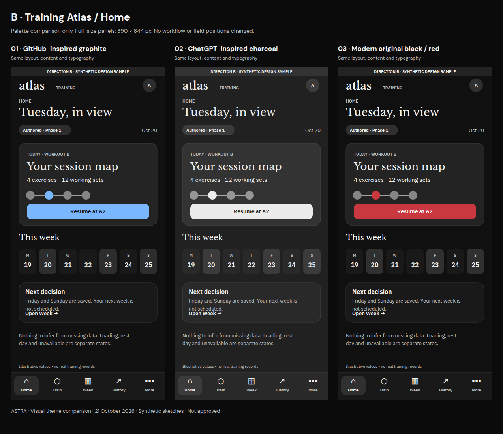
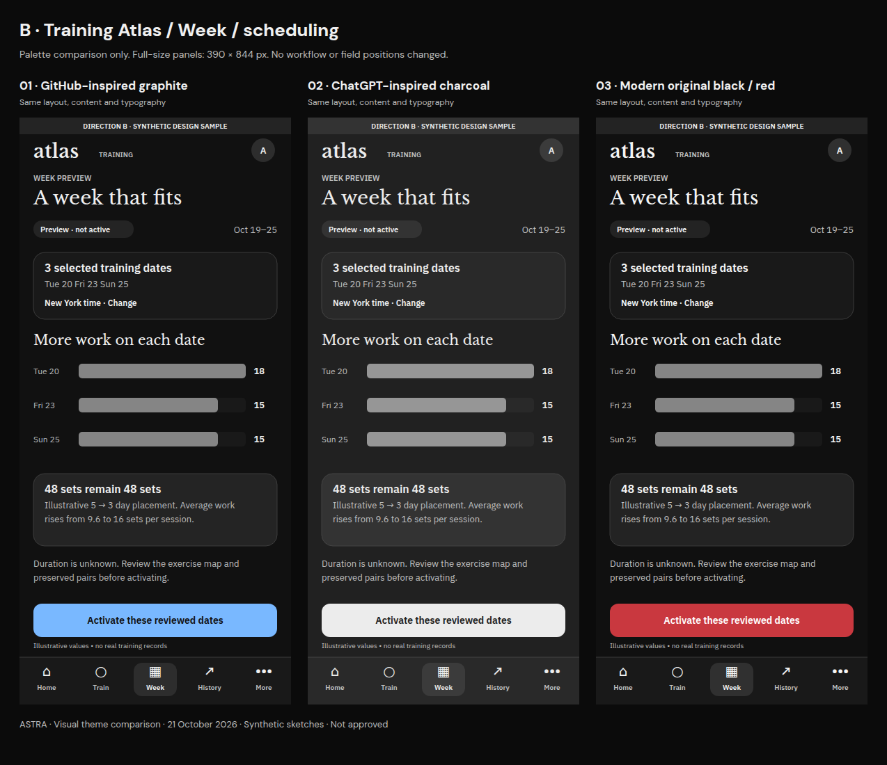
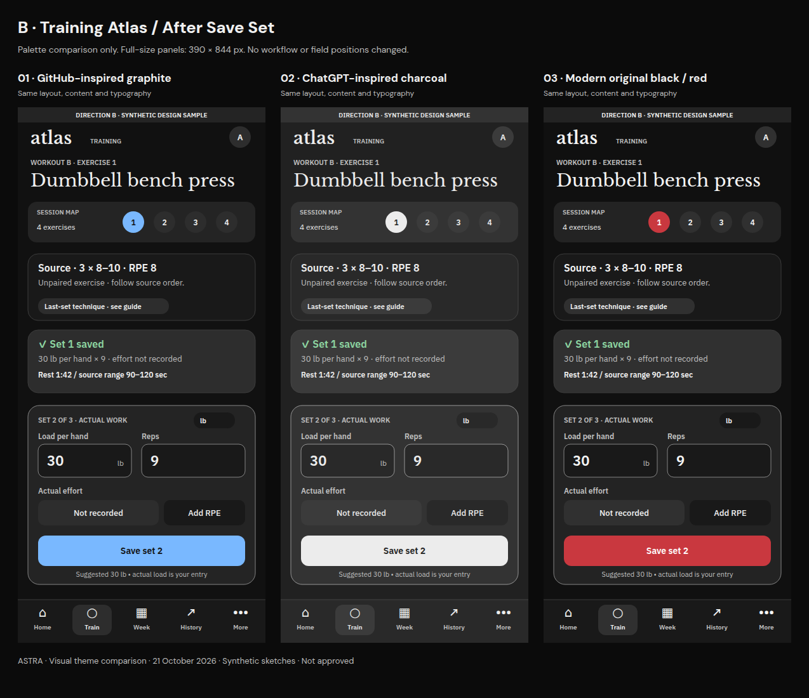
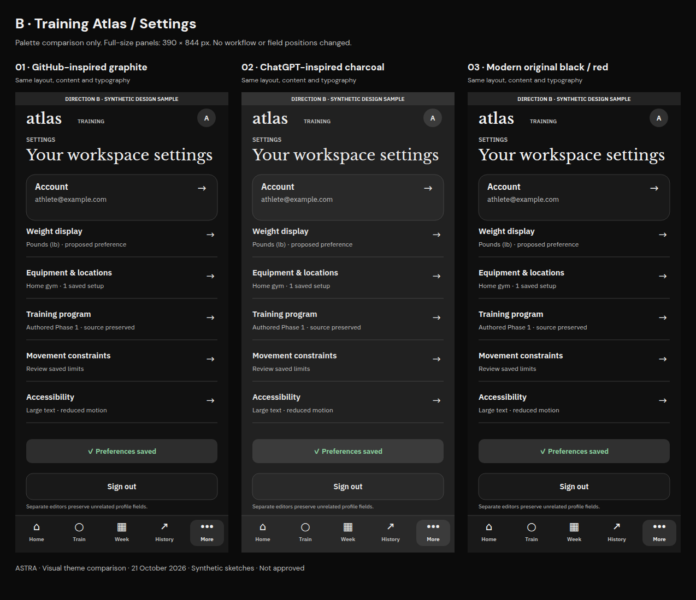
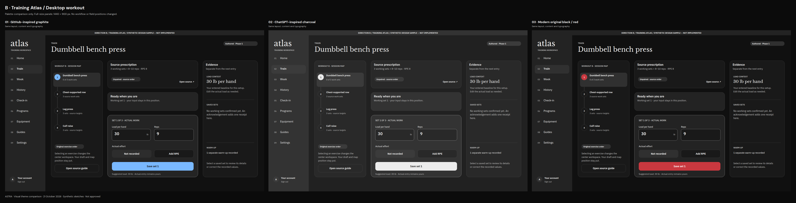

# Training Atlas — three-theme comparison

**Visual theme only; no layout or workflow changes.** Left to right: 1 GitHub-inspired graphite, 2 ChatGPT-inspired charcoal, 3 modernized WorkoutApp black/red. Existing typography is held constant.

[Comparison overview](README.md) · [Palettes](PALETTES.md) · [Separate typography comparison](TYPOGRAPHY.md) · [Text alternatives](TRANSCRIPTS.md)

## Home

[Full-size side-by-side PNG](boards/b-home.png) · [Option 1 PNG](variants/b-home-option-1.png) · [Option 2 PNG](variants/b-home-option-2.png) · [Option 3 PNG](variants/b-home-option-3.png)

## Week / scheduling

[Full-size side-by-side PNG](boards/b-week.png) · [Option 1 PNG](variants/b-week-option-1.png) · [Option 2 PNG](variants/b-week-option-2.png) · [Option 3 PNG](variants/b-week-option-3.png)

## Before Save Set

[Full-size side-by-side PNG](boards/b-before-save.png) · [Option 1 PNG](variants/b-before-save-option-1.png) · [Option 2 PNG](variants/b-before-save-option-2.png) · [Option 3 PNG](variants/b-before-save-option-3.png)

## After Save Set

[Full-size side-by-side PNG](boards/b-after-save.png) · [Option 1 PNG](variants/b-after-save-option-1.png) · [Option 2 PNG](variants/b-after-save-option-2.png) · [Option 3 PNG](variants/b-after-save-option-3.png)

The acknowledgement occupies the same reserved area and the next set stays in the same fields. Palette changes do not move the form or alter the rest/adaptive guidance.

## Settings

[Full-size side-by-side PNG](boards/b-settings.png) · [Option 1 PNG](variants/b-settings-option-1.png) · [Option 2 PNG](variants/b-settings-option-2.png) · [Option 3 PNG](variants/b-settings-option-3.png)

## Desktop workout

[Full-size side-by-side PNG](boards/b-desktop-workout.png) · [Option 1 PNG](variants/b-desktop-workout-option-1.png) · [Option 2 PNG](variants/b-desktop-workout-option-2.png) · [Option 3 PNG](variants/b-desktop-workout-option-3.png)
