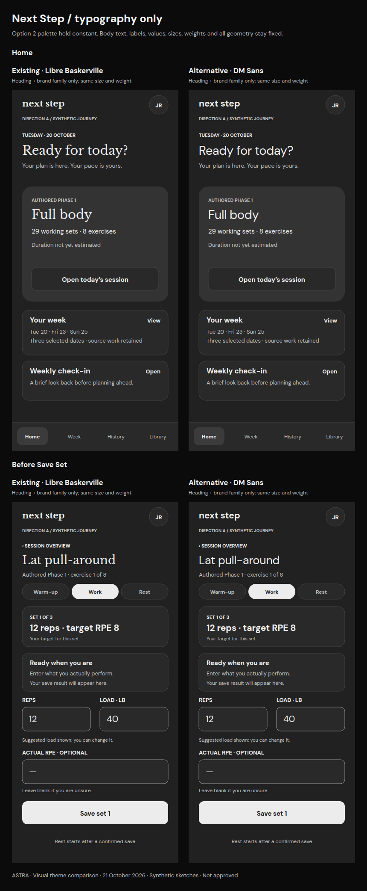
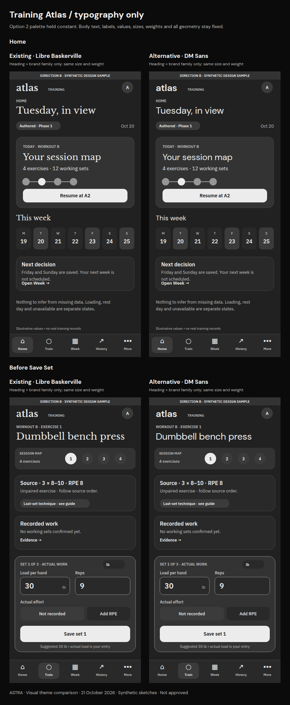

# Typography — a separate decision

**Same Option 2 palette, same layout, same wording, same sizes and weights. Only heading and brand font-family changes.** Palette comparison boards retain the existing serif typography so color and type are not mixed into one decision.

[Comparison overview](README.md) · [Text alternatives](TRANSCRIPTS.md)

Astra recommends reviewing **DM Sans headings** as the modern alternative. Libre Baskerville has an editorial, book-like voice and clearly separates titles from controls; DM Sans feels more immediate in a repeated workout task. The tradeoff is less visual distinction between headings and body text at the unchanged regular weights. No weight, spacing or layout adjustment is included in this experiment.

Next Step body text remains DM Sans; Training Atlas body remains IBM Plex Sans. Numeric inputs and buttons remain unchanged. Both columns use actual font files, rather than comparing a sans font with a serif fallback. Earlier PNGs used system fallbacks; those exports are not a reliable typography control. The named font families are loaded identically in all of these new PNGs.

## A — Next Step

Home and before-save screen, existing Libre Baskerville on the left and DM Sans headings on the right.

[Full-size PNG](boards/typography-a.png) · [Home sans PNG](variants/a-home-sans.png) · [Before-save sans PNG](variants/a-before-save-sans.png)

## B — Training Atlas

Home and before-save screen, existing Libre Baskerville on the left and DM Sans headings on the right.

[Full-size PNG](boards/typography-b.png) · [Home sans PNG](variants/b-home-sans.png) · [Before-save sans PNG](variants/b-before-save-sans.png)

## Font provenance and limits

Upright variable fonts were retrieved from the official Google Fonts repository: [Libre Baskerville](https://github.com/google/fonts/tree/main/ofl/librebaskerville), [DM Sans](https://github.com/google/fonts/tree/main/ofl/dmsans), [IBM Plex Sans](https://github.com/google/fonts/tree/main/ofl/ibmplexsans). Each directory supplies its SIL Open Font License. The fonts were used locally to render the review PNGs; no font binary or application dependency is added. Native SVG files name these fonts and need them installed for matching metrics; PNGs are the canonical appearance for this comparison.

These are fixed-geometry specimens. A type choice can affect line lengths and apparent balance even when every coordinate stays constant. Any future fitting/weight adjustments need a separately reviewed change; none is silently applied here. This small experiment does not replace typography throughout the 64-frame package.
