# WorkoutApp — unified mobile gallery

[Review overview](README.md) · [Other viewport](DESKTOP.md) · [Behavior and accessible transcripts](SCREENS.md)

Every image is a synthetic proposal. Open the PNG for full size or the SVG for editable vectors. This gallery does not show production changes.

## Account and first use

| Ready for your next session? | Welcome back |
|---|---|
| 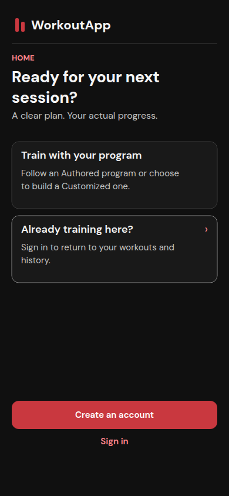 | 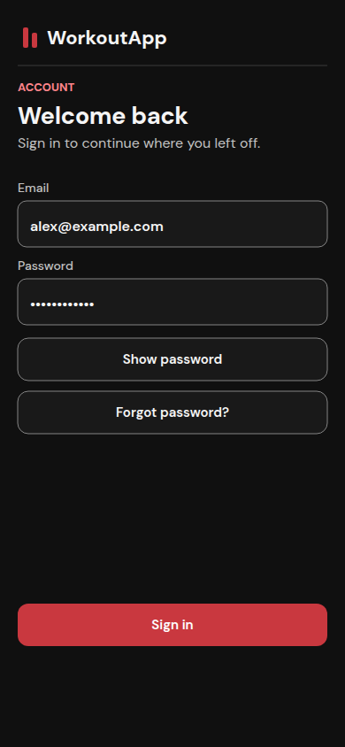 |
| [Full PNG](mobile/01-welcome.png) · [Editable SVG](mobile/01-welcome.svg) | [Full PNG](mobile/02-sign-in.png) · [Editable SVG](mobile/02-sign-in.svg) |

| Reset your password | Make it yours |
|---|---|
| 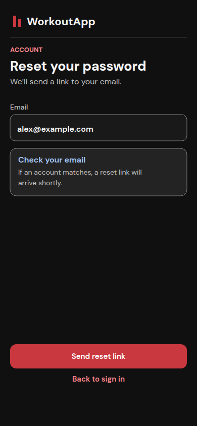 | 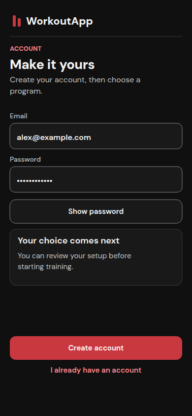 |
| [Full PNG](mobile/03-account-recovery.png) · [Editable SVG](mobile/03-account-recovery.svg) | [Full PNG](mobile/04-new-account.png) · [Editable SVG](mobile/04-new-account.svg) |

| How would you like to train? | Full Body Phase 1 |
|---|---|
| 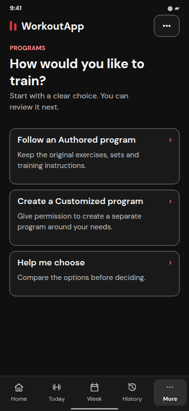 | 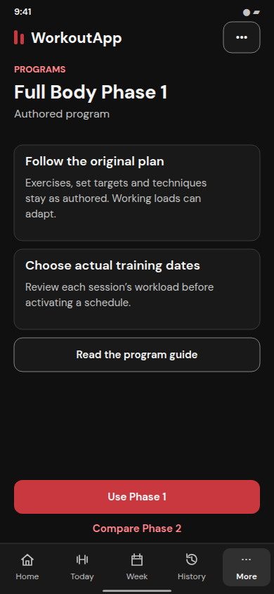 |
| [Full PNG](mobile/05-choose-program.png) · [Editable SVG](mobile/05-choose-program.svg) | [Full PNG](mobile/06-authored-program.png) · [Editable SVG](mobile/06-authored-program.svg) |

| A few essentials | Your equipment |
|---|---|
| 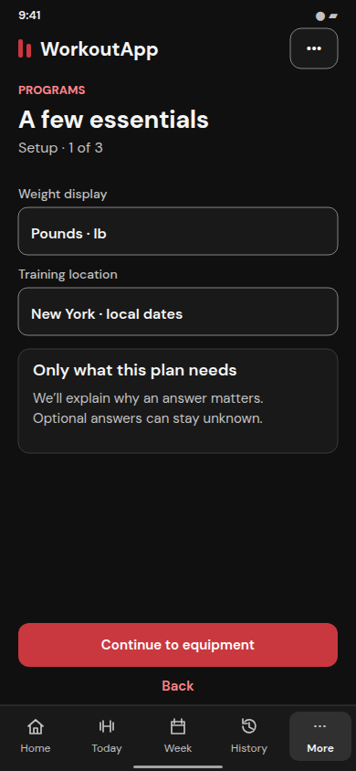 | 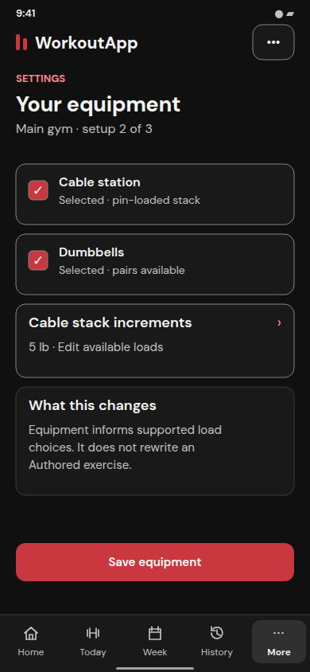 |
| [Full PNG](mobile/07-setup-basics.png) · [Editable SVG](mobile/07-setup-basics.svg) | [Full PNG](mobile/08-equipment.png) · [Editable SVG](mobile/08-equipment.svg) |

| Review your setup |  |
|---|---|
| 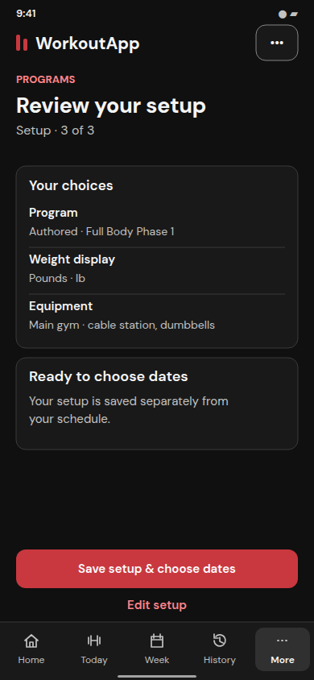 |  |
| [Full PNG](mobile/09-setup-review.png) · [Editable SVG](mobile/09-setup-review.svg) |  |

## Home, programs and scheduling

| Your next session | Your week is open |
|---|---|
| 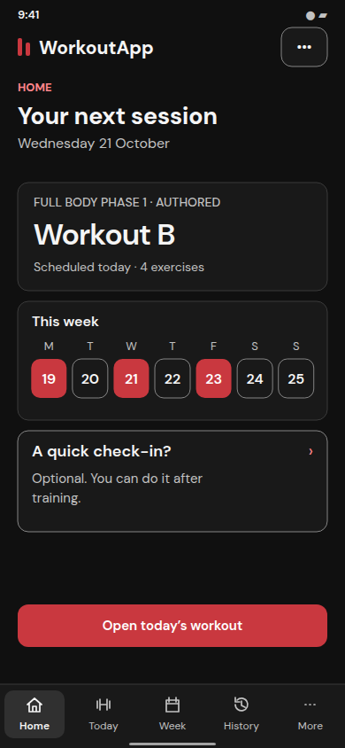 | 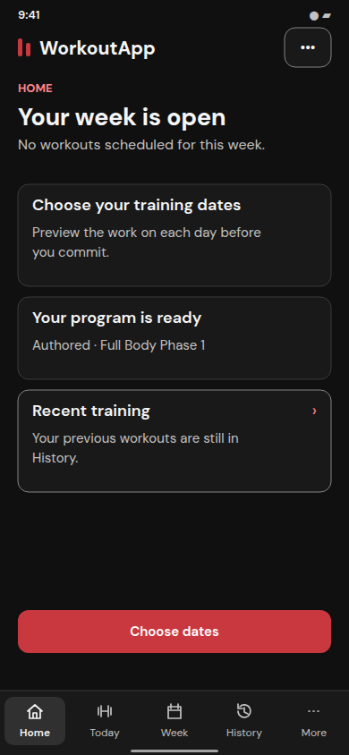 |
| [Full PNG](mobile/10-home.png) · [Editable SVG](mobile/10-home.svg) | [Full PNG](mobile/11-home-no-schedule.png) · [Editable SVG](mobile/11-home-no-schedule.svg) |

| Your programs | Build a Customized program |
|---|---|
| 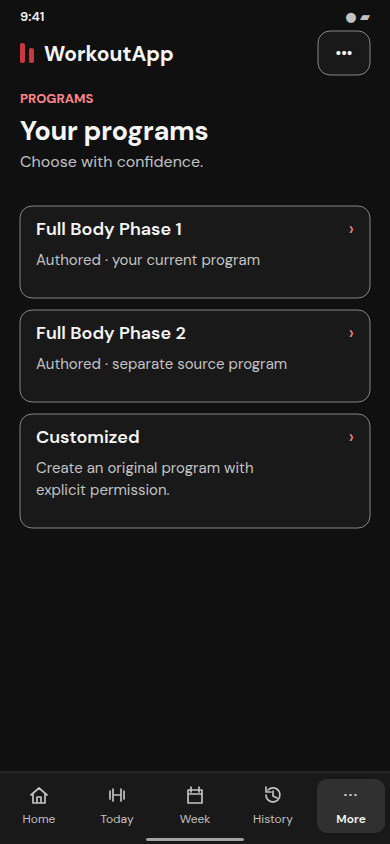 | 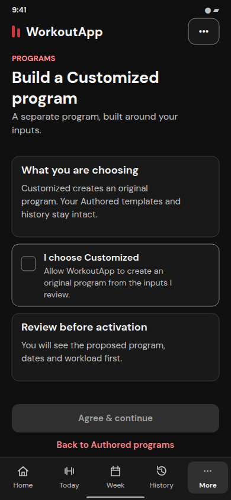 |
| [Full PNG](mobile/12-programs.png) · [Editable SVG](mobile/12-programs.svg) | [Full PNG](mobile/13-customized-consent.png) · [Editable SVG](mobile/13-customized-consent.svg) |

| Shape your program | Review your program |
|---|---|
| 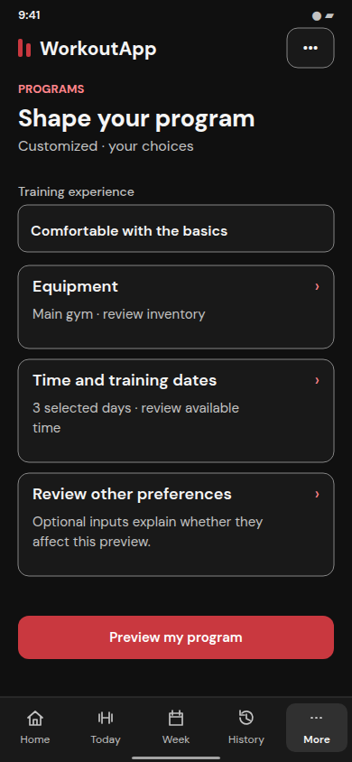 | 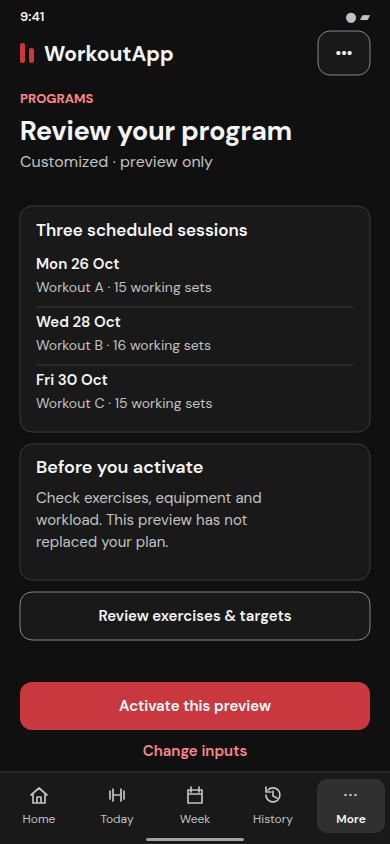 |
| [Full PNG](mobile/14-customized-inputs.png) · [Editable SVG](mobile/14-customized-inputs.svg) | [Full PNG](mobile/15-customized-preview.png) · [Editable SVG](mobile/15-customized-preview.svg) |

| Your training week | Choose actual dates |
|---|---|
| 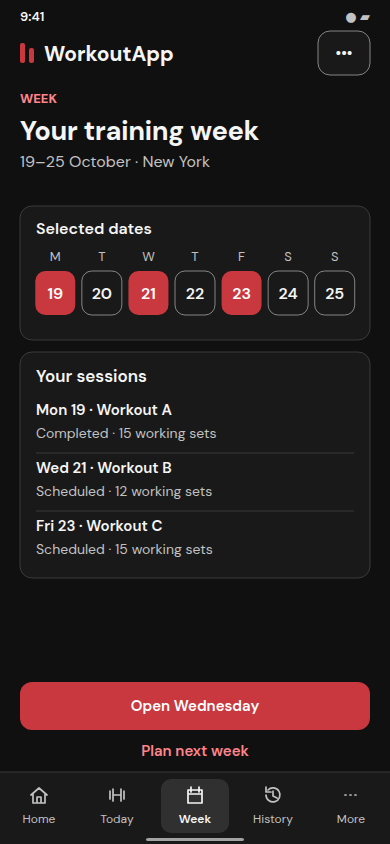 | 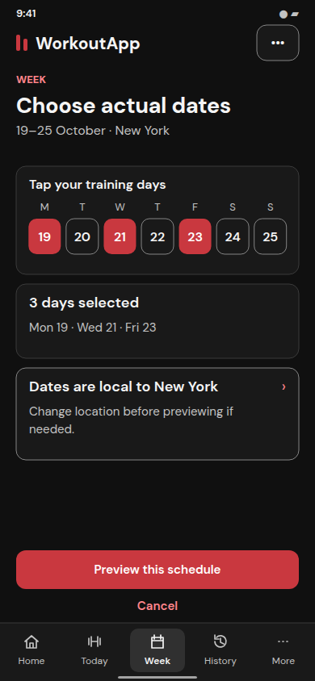 |
| [Full PNG](mobile/16-week.png) · [Editable SVG](mobile/16-week.svg) | [Full PNG](mobile/17-select-dates.png) · [Editable SVG](mobile/17-select-dates.svg) |

| Review the workload | Review the updated week |
|---|---|
| 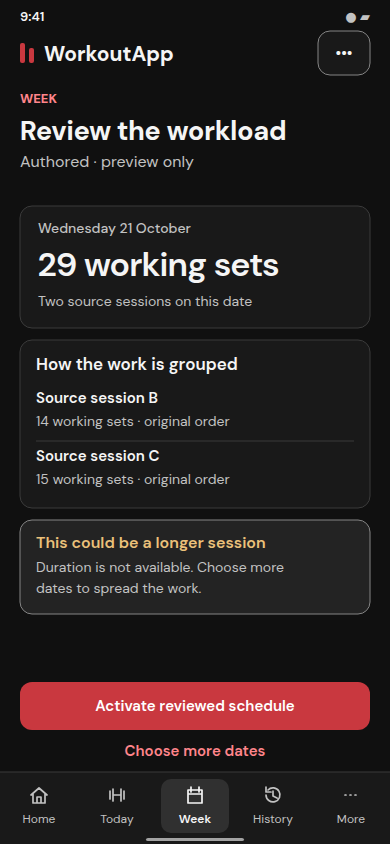 | 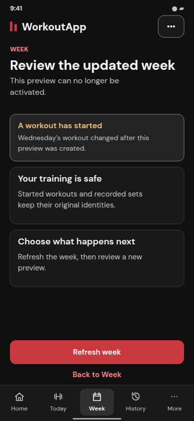 |
| [Full PNG](mobile/18-schedule-preview.png) · [Editable SVG](mobile/18-schedule-preview.svg) | [Full PNG](mobile/19-schedule-conflict.png) · [Editable SVG](mobile/19-schedule-conflict.svg) |

| Review a program change |  |
|---|---|
| 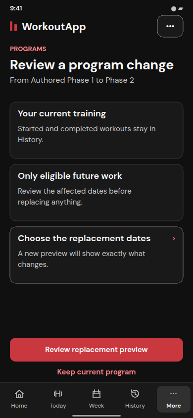 |  |
| [Full PNG](mobile/72-program-change.png) · [Editable SVG](mobile/72-program-change.svg) |  |

## Open, calibrate and warm up

| Opening your workout | A day between sessions |
|---|---|
| 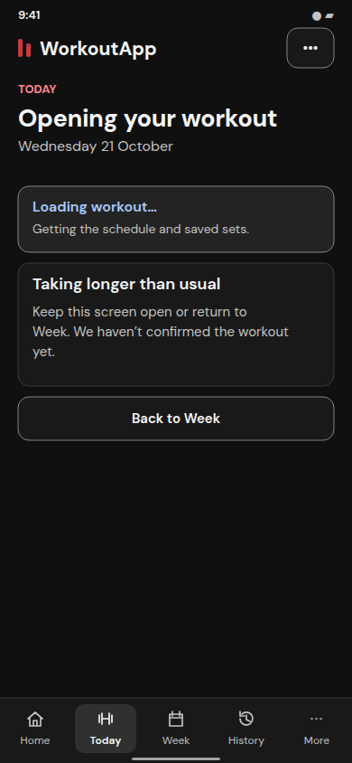 | 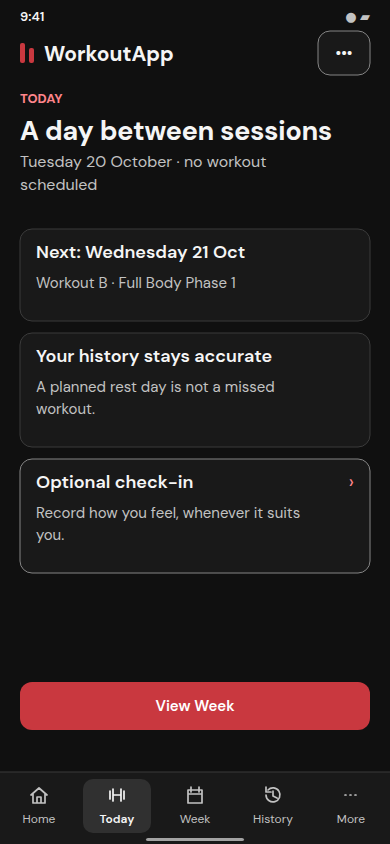 |
| [Full PNG](mobile/20-today-loading.png) · [Editable SVG](mobile/20-today-loading.svg) | [Full PNG](mobile/21-today-rest.png) · [Editable SVG](mobile/21-today-rest.svg) |

| We couldn’t open this workout | Workout B |
|---|---|
| 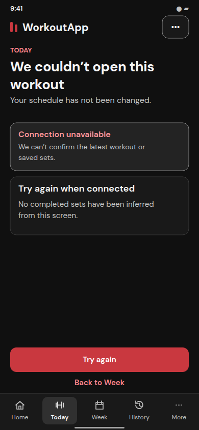 | 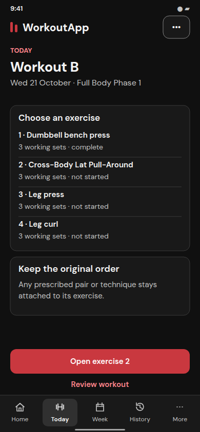 |
| [Full PNG](mobile/22-today-unavailable.png) · [Editable SVG](mobile/22-today-unavailable.svg) | [Full PNG](mobile/23-today-session.png) · [Editable SVG](mobile/23-today-session.svg) |

| Find a starting weight | Your known 1-rep max |
|---|---|
| 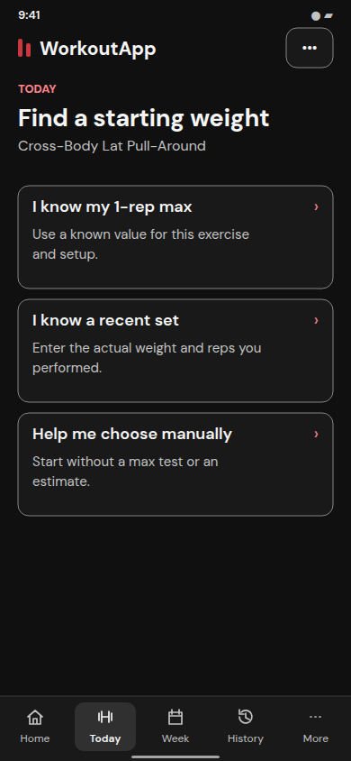 | 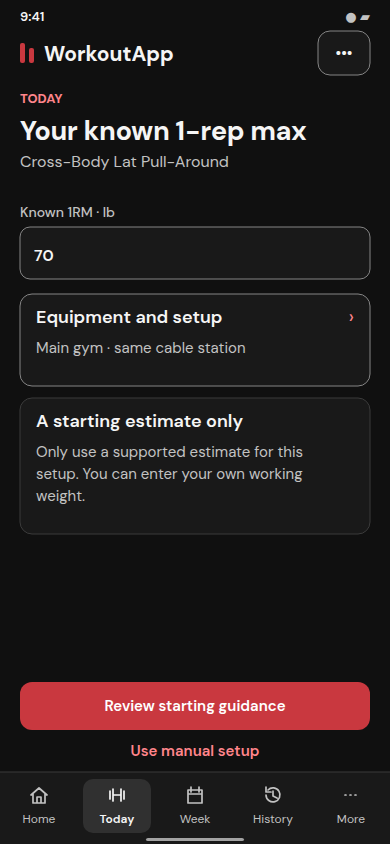 |
| [Full PNG](mobile/24-starting-load.png) · [Editable SVG](mobile/24-starting-load.svg) | [Full PNG](mobile/25-known-max.png) · [Editable SVG](mobile/25-known-max.svg) |

| Use a recent set | Start with your own weight |
|---|---|
| 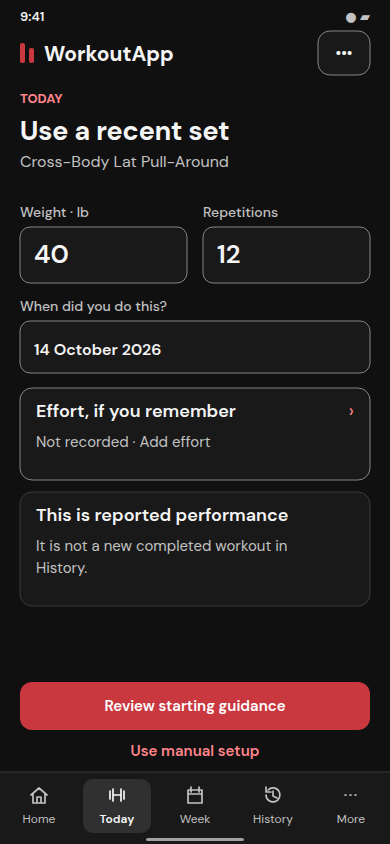 | 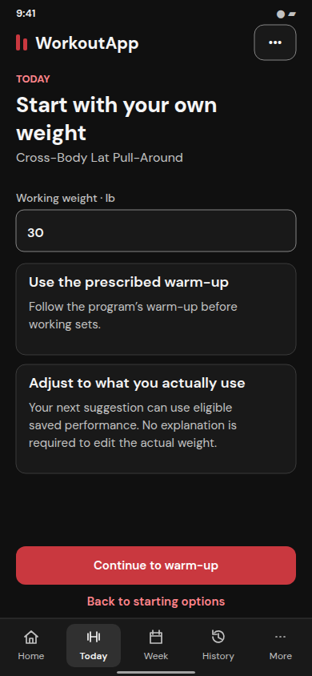 |
| [Full PNG](mobile/26-recent-set.png) · [Editable SVG](mobile/26-recent-set.svg) | [Full PNG](mobile/27-manual-calibration.png) · [Editable SVG](mobile/27-manual-calibration.svg) |

| Choose a weight manually | Prescribed warm-up |
|---|---|
| 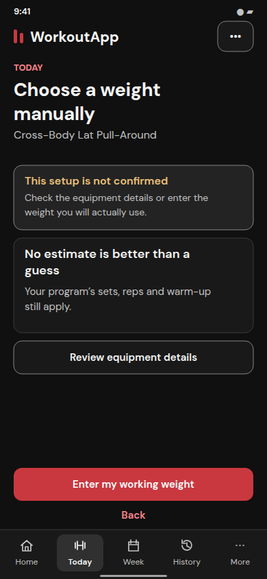 | 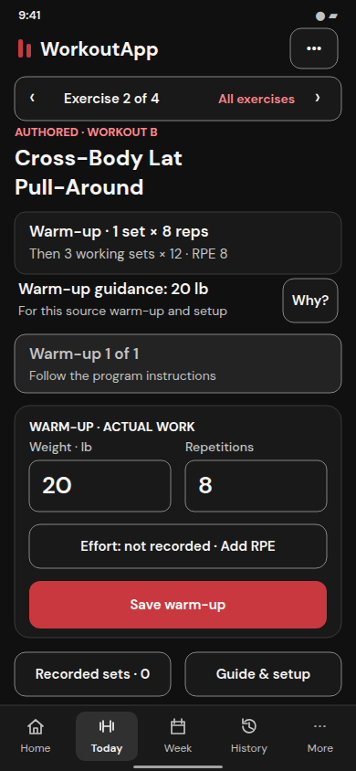 |
| [Full PNG](mobile/28-load-unavailable.png) · [Editable SVG](mobile/28-load-unavailable.svg) | [Full PNG](mobile/29-warmup.png) · [Editable SVG](mobile/29-warmup.svg) |

| Warm-up saved |  |
|---|---|
| 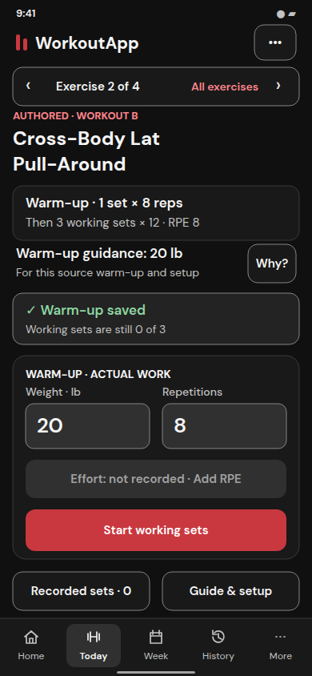 |  |
| [Full PNG](mobile/30-warmup-saved.png) · [Editable SVG](mobile/30-warmup-saved.svg) |  |

## Log, rest and recover

| Before Save set | Save pending |
|---|---|
| 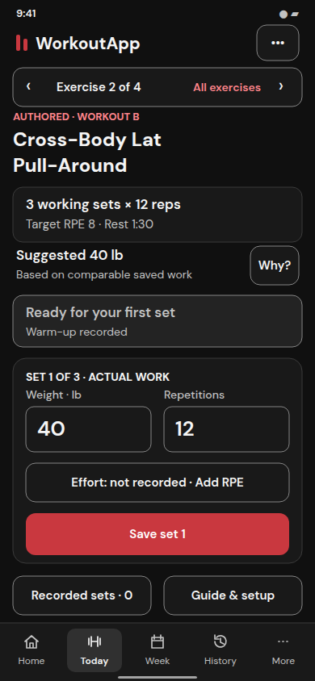 | 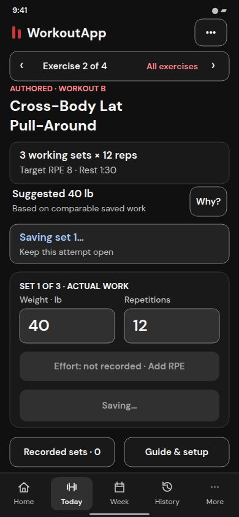 |
| [Full PNG](mobile/31-working-ready.png) · [Editable SVG](mobile/31-working-ready.svg) | [Full PNG](mobile/32-working-pending.png) · [Editable SVG](mobile/32-working-pending.svg) |

| Set saved and rest | Continue to the next set |
|---|---|
| 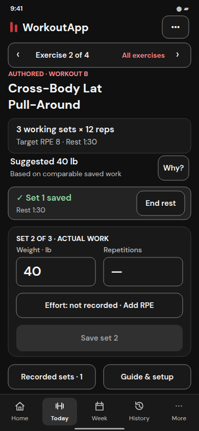 | 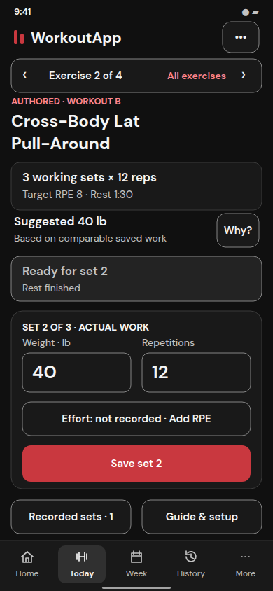 |
| [Full PNG](mobile/33-working-saved.png) · [Editable SVG](mobile/33-working-saved.svg) | [Full PNG](mobile/34-working-next.png) · [Editable SVG](mobile/34-working-next.svg) |

| Definite save failure | Save outcome unknown |
|---|---|
| 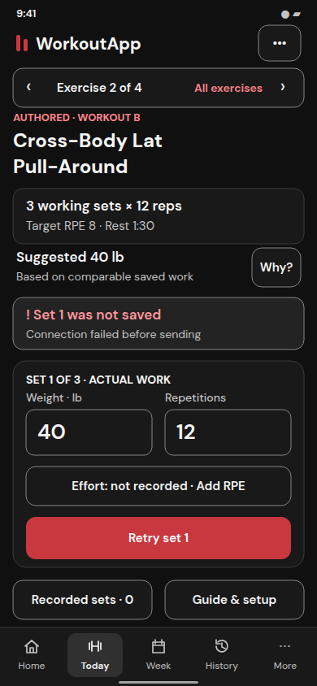 | 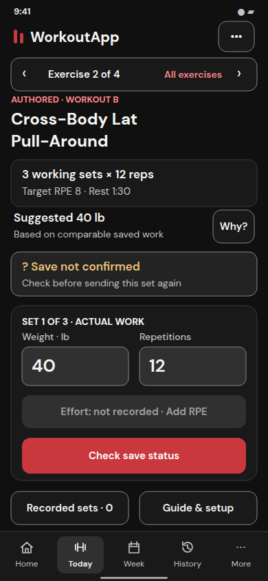 |
| [Full PNG](mobile/35-working-failed.png) · [Editable SVG](mobile/35-working-failed.svg) | [Full PNG](mobile/36-working-unconfirmed.png) · [Editable SVG](mobile/36-working-unconfirmed.svg) |

| Reconcile after returning | How hard was that set? |
|---|---|
| 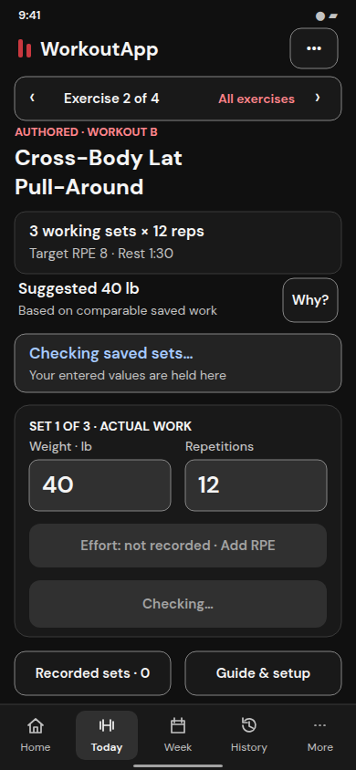 | 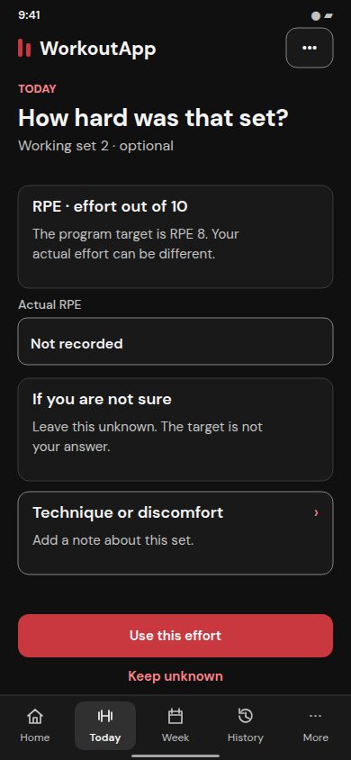 |
| [Full PNG](mobile/37-working-resume.png) · [Editable SVG](mobile/37-working-resume.svg) | [Full PNG](mobile/38-effort.png) · [Editable SVG](mobile/38-effort.svg) |

| Why this suggestion? | You have an unfinished entry |
|---|---|
| 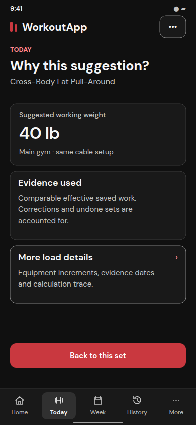 | 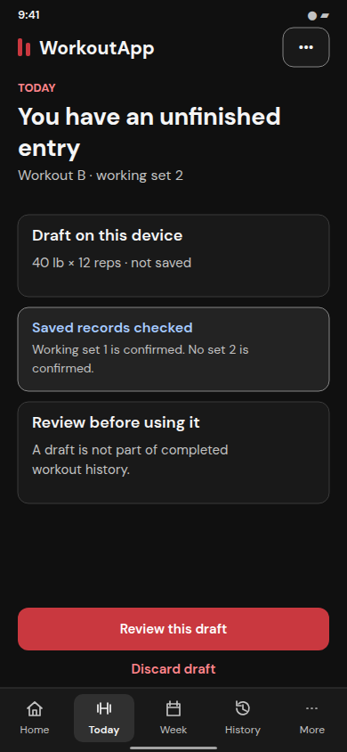 |
| [Full PNG](mobile/39-load-details.png) · [Editable SVG](mobile/39-load-details.svg) | [Full PNG](mobile/68-recovered-draft.png) · [Editable SVG](mobile/68-recovered-draft.svg) |

| Correct an invalid entry | Sign in to continue |
|---|---|
|  | 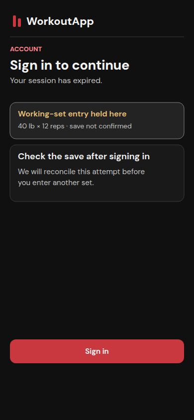 |
| [Full PNG](mobile/69-working-validation.png) · [Editable SVG](mobile/69-working-validation.svg) | [Full PNG](mobile/71-session-expired.png) · [Editable SVG](mobile/71-session-expired.svg) |

| How many more reps? | Set entry with keyboard open |
|---|---|
| 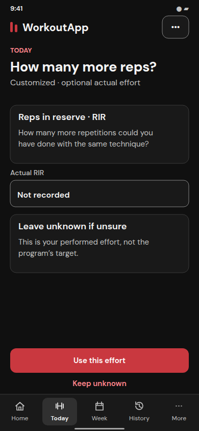 | 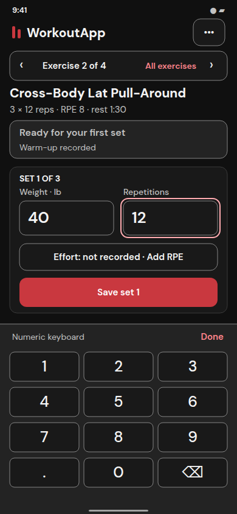 |
| [Full PNG](mobile/74-rir-effort.png) · [Editable SVG](mobile/74-rir-effort.svg) | [Full PNG](mobile/77-keyboard-before.png) · [Editable SVG](mobile/77-keyboard-before.svg) |

| Saved with keyboard still open |  |
|---|---|
| 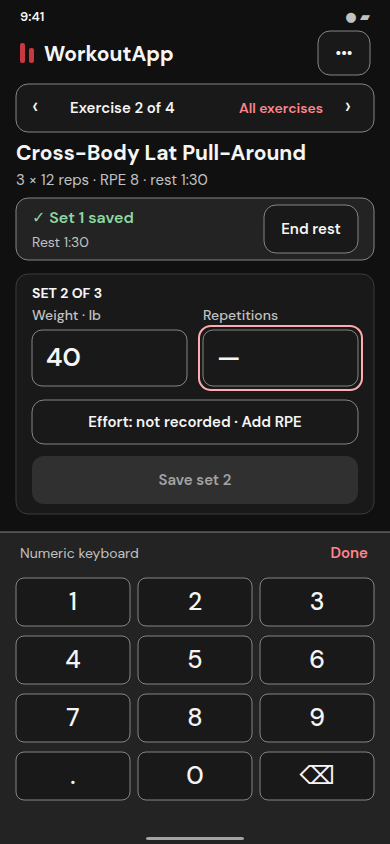 |  |
| [Full PNG](mobile/78-keyboard-after.png) · [Editable SVG](mobile/78-keyboard-after.svg) |  |

## Correct, undo and finish

| Recorded sets | Correct working set 1 |
|---|---|
| 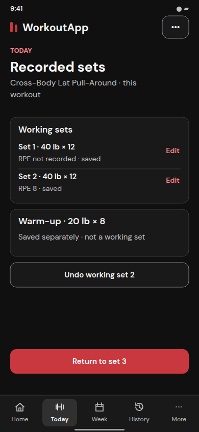 | 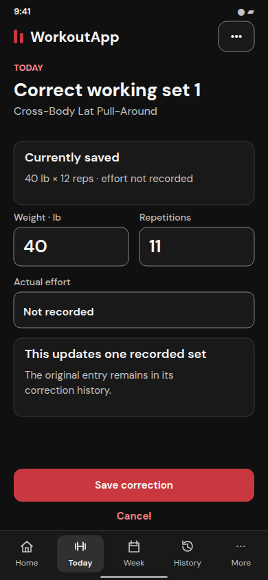 |
| [Full PNG](mobile/40-recorded-sets.png) · [Editable SVG](mobile/40-recorded-sets.svg) | [Full PNG](mobile/41-correct-set.png) · [Editable SVG](mobile/41-correct-set.svg) |

| Saving your correction | Correction saved |
|---|---|
| 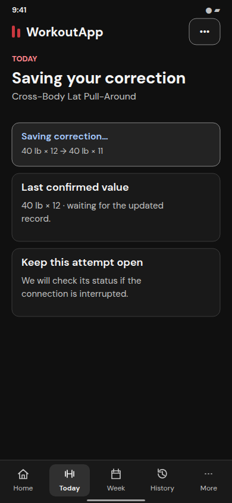 | 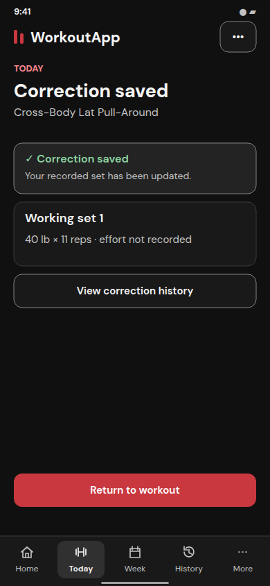 |
| [Full PNG](mobile/42-correction-pending.png) · [Editable SVG](mobile/42-correction-pending.svg) | [Full PNG](mobile/43-correction-confirmed.png) · [Editable SVG](mobile/43-correction-confirmed.svg) |

| Undo working set 2? | Undoing working set 2 |
|---|---|
| 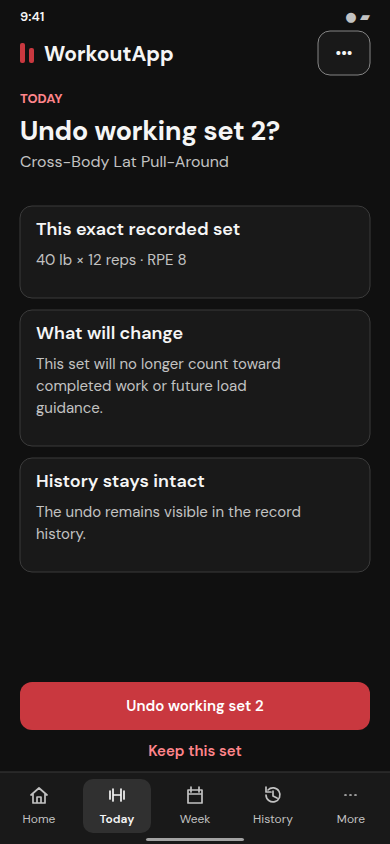 |  |
| [Full PNG](mobile/44-undo-confirm.png) · [Editable SVG](mobile/44-undo-confirm.svg) | [Full PNG](mobile/45-undo-pending.png) · [Editable SVG](mobile/45-undo-pending.svg) |

| Working set 2 undone | Follow this exercise pair |
|---|---|
|  |  |
| [Full PNG](mobile/46-undo-confirmed.png) · [Editable SVG](mobile/46-undo-confirmed.svg) | [Full PNG](mobile/47-pair-technique.png) · [Editable SVG](mobile/47-pair-technique.svg) |

| Review the exercise change | Review before finishing |
|---|---|
|  |  |
| [Full PNG](mobile/48-substitution.png) · [Editable SVG](mobile/48-substitution.svg) | [Full PNG](mobile/49-finish-review.png) · [Editable SVG](mobile/49-finish-review.svg) |

| Workout complete |  |
|---|---|
|  |  |
| [Full PNG](mobile/50-workout-complete.png) · [Editable SVG](mobile/50-workout-complete.svg) |  |

## History, analytics and check-in

| Your training history | Wednesday 21 October |
|---|---|
|  |  |
| [Full PNG](mobile/51-history.png) · [Editable SVG](mobile/51-history.svg) | [Full PNG](mobile/52-history-detail.png) · [Editable SVG](mobile/52-history-detail.svg) |

| Monday 19 October | See your progress |
|---|---|
|  |  |
| [Full PNG](mobile/53-history-loading.png) · [Editable SVG](mobile/53-history-loading.svg) | [Full PNG](mobile/54-analytics.png) · [Editable SVG](mobile/54-analytics.svg) |

| More training will tell the story | How are you feeling? |
|---|---|
|  |  |
| [Full PNG](mobile/55-analytics-empty.png) · [Editable SVG](mobile/55-analytics-empty.svg) | [Full PNG](mobile/56-check-in.png) · [Editable SVG](mobile/56-check-in.svg) |

| Your check-in is saved | The values behind the chart |
|---|---|
|  |  |
| [Full PNG](mobile/57-check-in-saved.png) · [Editable SVG](mobile/57-check-in-saved.svg) | [Full PNG](mobile/76-analytics-table.png) · [Editable SVG](mobile/76-analytics-table.svg) |

## Settings and navigation

| Settings | Theme and appearance |
|---|---|
|  |  |
| [Full PNG](mobile/58-settings.png) · [Editable SVG](mobile/58-settings.svg) | [Full PNG](mobile/59-appearance.png) · [Editable SVG](mobile/59-appearance.svg) |

| Unsaved appearance preview | Saving appearance |
|---|---|
|  |  |
| [Full PNG](mobile/60-appearance-preview.png) · [Editable SVG](mobile/60-appearance-preview.svg) | [Full PNG](mobile/61-appearance-pending.png) · [Editable SVG](mobile/61-appearance-pending.svg) |

| Appearance save failed | Appearance saved |
|---|---|
|  |  |
| [Full PNG](mobile/62-appearance-failed.png) · [Editable SVG](mobile/62-appearance-failed.svg) | [Full PNG](mobile/63-appearance-saved.png) · [Editable SVG](mobile/63-appearance-saved.svg) |

| Account & accessibility | Program library |
|---|---|
|  |  |
| [Full PNG](mobile/64-account-accessibility.png) · [Editable SVG](mobile/64-account-accessibility.svg) | [Full PNG](mobile/65-library.png) · [Editable SVG](mobile/65-library.svg) |

| Exercise guide | More |
|---|---|
|  |  |
| [Full PNG](mobile/66-exercise-guide.png) · [Editable SVG](mobile/66-exercise-guide.svg) | [Full PNG](mobile/67-more-navigation.png) · [Editable SVG](mobile/67-more-navigation.svg) |

| Your preferences changed | Weight display |
|---|---|
|  |  |
| [Full PNG](mobile/70-preference-conflict.png) · [Editable SVG](mobile/70-preference-conflict.svg) | [Full PNG](mobile/73-weight-display.png) · [Editable SVG](mobile/73-weight-display.svg) |

| Preference save not confirmed |  |
|---|---|
|  |  |
| [Full PNG](mobile/75-appearance-unconfirmed.png) · [Editable SVG](mobile/75-appearance-unconfirmed.svg) |  |
