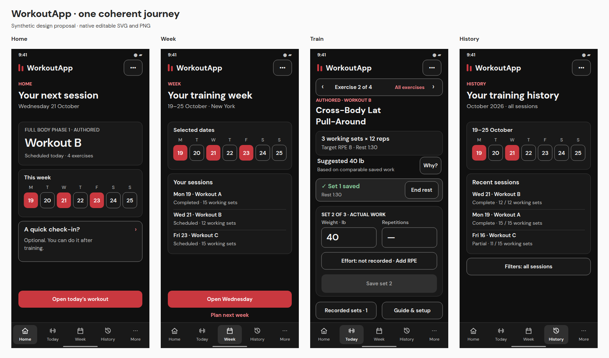

# WorkoutApp — unified final visual review

**21 October 2026 · design assets only · final visual acceptance pending.**

The owner approved the combined direction in [Issue #105](https://github.com/Shadowgar/hypertrophyapp/issues/105): Next Step’s guided Home/onboarding, Training Atlas’s persistent training and review workspace, DM Sans headings, and all six appearances. This package refines that selection into **one WorkoutApp experience**. A and B are historical design references, not product modes or new brands.

| Review | Open |
|---|---|
| Complete mobile journey — 78 states | [Mobile gallery](MOBILE.md) |
| Complete desktop journey — 76 states | [Desktop gallery](DESKTOP.md) |
| Before / pending / saved / rest / retry / keyboard | [Working-set interaction review](WORKING-SET-FLOW.md) |
| All six appearances and Settings | [Appearance gallery](APPEARANCES.md) · [preference behavior](PREFERENCES.md) |
| Final typography and shared components | [Visual system](VISUAL-SYSTEM.md) |
| What each screen does | [Screen-by-screen behavior](SCREENS.md) · [text transcripts](TRANSCRIPTS.md) |
| Every audit finding and Issue #103 | [Traceability](TRACEABILITY.md) |
| Checked assets and limits | [Validation](VALIDATION.md) |

## What has been consolidated

- Home and first use present the next useful task and explain program authority before asking for setup details.
- Training retains the selected workout and exercise. The current-set composer, reserved feedback area and one effective receipt list have stable roles across screen sizes.
- Week places dated workload and source grouping before activation. History distinguishes complete, partial, rest and unknown states. Analytics shows factual performance with a matching text table.
- All screens use DM Sans. The six previously reviewed token maps are preserved exactly; common components resolve semantic roles from the selected palette.
- Existing unconfigured accounts retain **Classic WorkoutApp + Dark**. Valid explicit preferences remain intact. A user can preview another family or appearance and save it deliberately.

The package has **154 canonical screen PNG/SVG pairs** (78 mobile and 76 desktop), **30 representative appearance variants**, and **24 comparison/specimen boards**. Mobile frames are 390 × 844; desktop frames are 1440 × 900. The two numeric-keyboard sketches are mobile only. Canonical views use Classic Dark, except the deliberate Graphite preview/save branch in Settings. The 30 variants demonstrate the shared system without six duplicated workflows, as permitted by the owner’s Issue #105 approval.

## How to review

Start with the working-set flow, then follow the mobile gallery from sign-in through History. The desktop gallery shows the same states with a persistent application rail, a session map during execution and a separate evidence column. Every PNG opens directly on GitHub; every matching SVG retains editable text, shapes and named semantic color roles. [DM Sans and its license](fonts/OFL.txt) are included for editing. No local server or Figma account is needed.

The original [independent audit](../AUDIT.md) and all dated A/B/theme reviews are retained unchanged as evidence/history. This revision does **not repeat the audit**. All new screens contain fictional review data; the 29-set preview illustrates disclosure, not a reproduction or explanation of the owner’s incident. Native RPE and RIR, source prescriptions, Customized consent, effective corrections and original exercise identity remain distinct.

## Scope and approval

This is a proposed final visual package, not a qualified application. Known-1RM intake, safe durable drafts, account preference persistence, exact retry reconciliation and other capabilities shown here still require separately authorized implementation and evidence. A sketch does not add calculation authority, offline saving or historical edit permissions.

The current pass consolidated the owner-approved Astra-originated review assets using the active coding assistant and deterministic SVG/browser rendering. No newly dispatched Astra agents or independent external review are claimed. Original audit/model provenance remains in the dated review documents.

**STOP: owner final visual review is next. No application redesign code, merge, migration, deployment or live-data change is authorized or performed by this package. Implementation requires explicit approval.**
