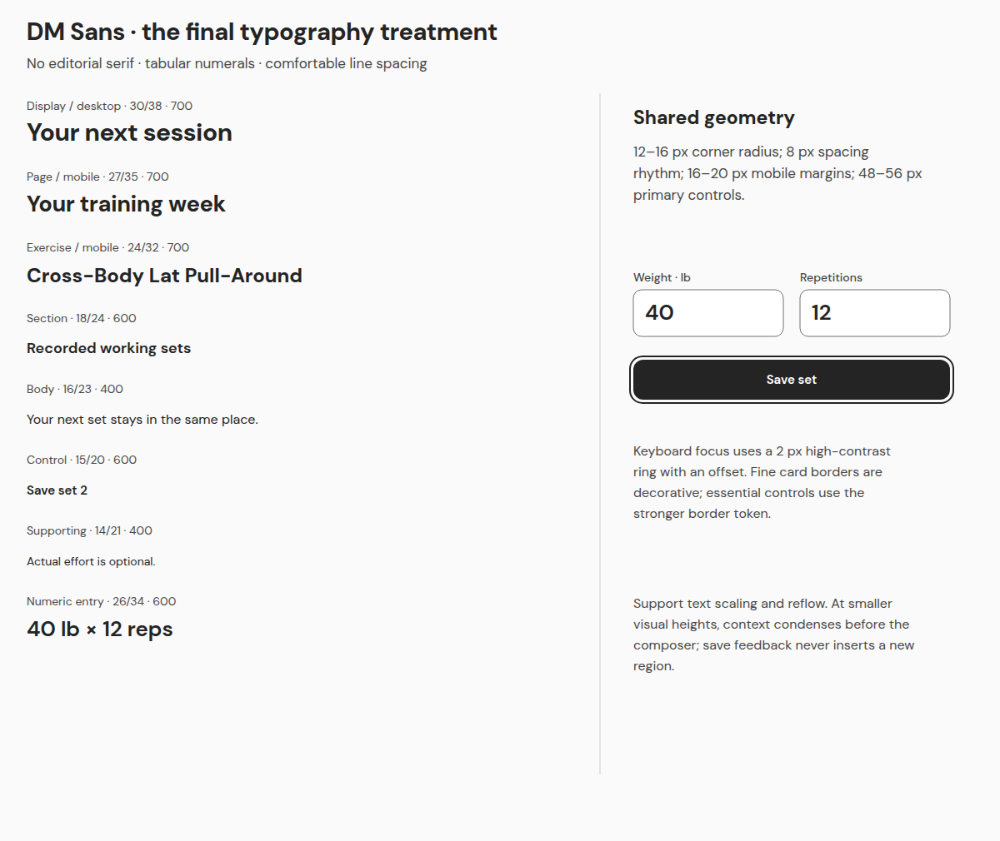

# Unified visual system

[Appearance comparisons](APPEARANCES.md) · [Exact color maps](TOKENS.json) · [Editable typography board](boards/09-typography.svg)

## Typography

DM Sans is used for headings **and the UI/body**, providing one modern sans-serif hierarchy. There is no default editorial serif. The bundled variable font is the same font used for the PNG exports, not a system-font approximation. Tabular numerals stabilize changing values and countdowns.

| Role | Size / line height | Weight |
|---|---|---|
| Desktop page title | 30 / 38 | 700 |
| Mobile page title | 27 / 35 | 700 |
| Long exercise title | 24 / 32 mobile; 28 desktop | 700 |
| Section title | 18 / 24 | 600 |
| Body | 16 / 23 | 400 |
| Primary control | 15 / 20 | 600 |
| Supporting copy / input label | 14 / 21 | 400–500 |
| Eyebrow / compact metadata | 13 / 18 | 600–700 |
| Bottom navigation label | 12 / 16 | 500–600, with icon and full target |
| Numeric entry | 26 / 34 | 600 |

Some long mobile card descriptions use 15 / 22. That is supporting content, not the primary exercise input. Respect OS text scaling; no clipped fixed-height text containers in an implementation. Long source names wrap without ellipsis hiding identity. At 200% text size or narrower widths, stack/reflow content and keep controls reachable rather than scaling the entire interface down.

Font source: the prior review’s official Google Fonts DM Sans asset, included as [DM-Sans.ttf](fonts/DM-Sans.ttf), with its [SIL Open Font License](fonts/OFL.txt). No new font service or application dependency is added.

## One semantic token system

All six appearances retain **the same 23 semantic color roles and values** from the reviewed six-appearance package. [TOKENS.json](TOKENS.json) is a static design artifact, not application configuration. Palette choice selects values; it does not select a separate component or workflow.

| Semantic role | Used for |
|---|---|
| canvas, surface, surface_raised, surface_selected | Neutral page, card, elevated and selected backgrounds. |
| border_subtle | Decorative separators; never the sole necessary control boundary. |
| border_control | Inputs, radio outlines and actionable card/control boundaries. |
| text_primary, text_secondary, text_muted | Text hierarchy with readable contrast on neutral surfaces. |
| accent_text | Selective brand/link/emphasis; no status meaning by itself. |
| action_fill, action_text | The single primary action. |
| focus | Visible 2 px keyboard focus ring, separated by an offset. |
| success_text, warning_text, error_text, info_text | Explicit status word/symbol on status_surface. |
| input_fill | Entry field background. |
| disabled_fill, disabled_text | Clearly disabled control that remains legible. |
| selection_fill, selection_text | Selected calendar/control state, accompanied by semantics. |

Hover and pressed states retain these same semantic roles: primary actions retain action_fill/action_text, with an additional inset action_text outline for interaction feedback; secondary controls use surface_selected plus border_control. Keyboard focus uses focus independently of hover/selection. No global opacity reduction is used for text. These are proposed component rules, not CSS implementation.

## Shared spatial rules

Mobile uses 16–20 px page insets, an 8 px spacing rhythm and 12–16 px card radii. Primary controls are 48–56 px tall; the compact header action is 44 px. Calendar dates have 40 × 44 px visual boxes with future hit areas expanded into the available cell spacing. Radio rows are 48 px or taller and are fully clickable; state must be exposed with native radio/checkbox semantics. Small textual Edit links in a record row need full-height hit areas, not text-only targets.

Desktop uses the available workspace: a 224 px app rail, then task/context columns. During training, the session map, stationary composer and authoritative records column remain visible. At intermediate widths, collapse secondary context before crowding the composer. Mobile keeps the selected exercise and “All exercises” entry visible; detail views return to the same draft. Navigation and controls retain the same names on both viewports.

## Status and accessibility

Saved = check symbol + “saved” after acknowledgement. Warning = review/unknown icon + explicit pending risk. Error = error symbol + a specific failed action. Classic red branding is never the sole error indication. Loading, empty, rest, partial and complete are different words and states.

The [component board](boards/08-six-appearance-components.png) includes all six palettes, control focus, disabled controls and distinct saved/warning/error/pending specimens. The [validation record](VALIDATION.md) reports measured static contrast. Fine decorative borders are not claimed to meet essential-control contrast. Charts use a labeled series and units plus an [equivalent table](mobile/76-analytics-table.png), not color-only interpretation.

Future keyboard/screen-reader implementation must use native controls, persistent labels, accessible names for icon actions, logical headings, visible focus, announced validation and focus restoration. A modal must trap focus; a page must not falsely declare modality. Respect reduced motion. Do not announce every timer tick. Static SVG accessibility labels and transcripts aid review but do not prove application WCAG conformance.

## Editable assets

Each SVG contains selectable text and vector shapes, named composer element IDs where relevant, and data-fill-token/data-stroke-token roles. Import into an SVG-capable design editor and install the bundled DM Sans font. No flattening into a single bitmap is required. PNGs are the exact browser-rendered review images. Comparison boards are editable nested vectors too. The screen manifest describes design states; it is not consumed by the application.
