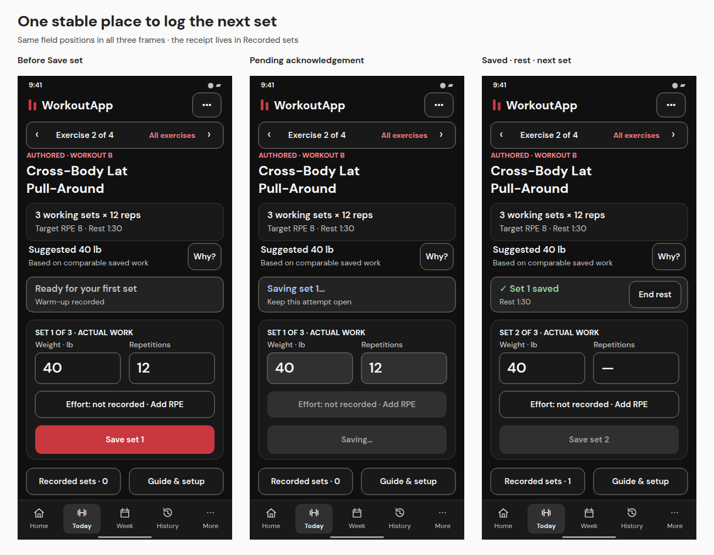
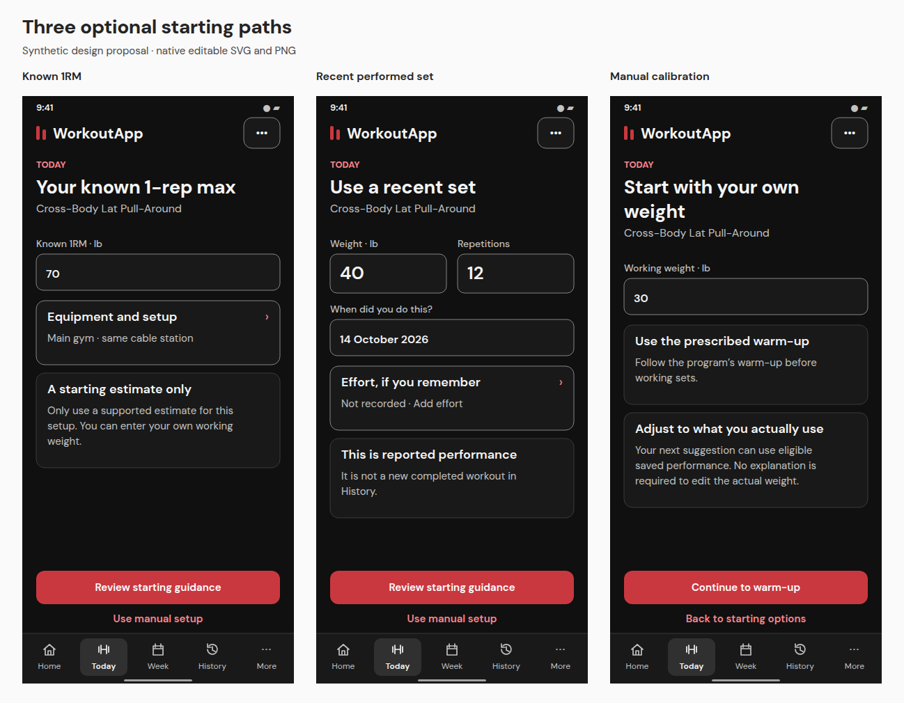
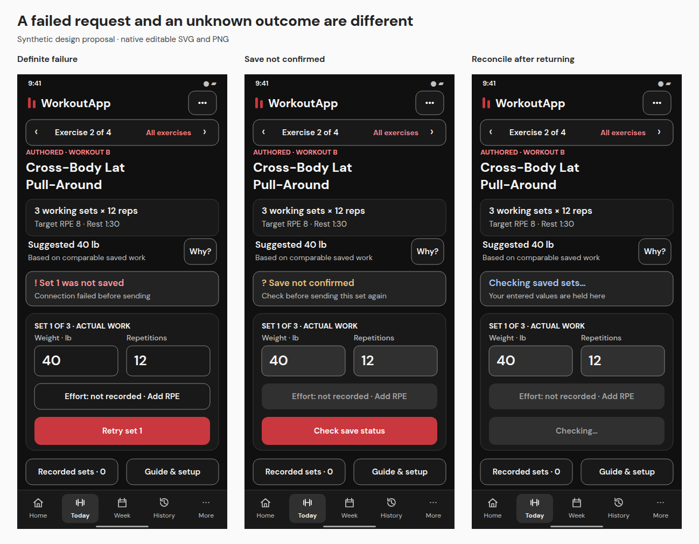
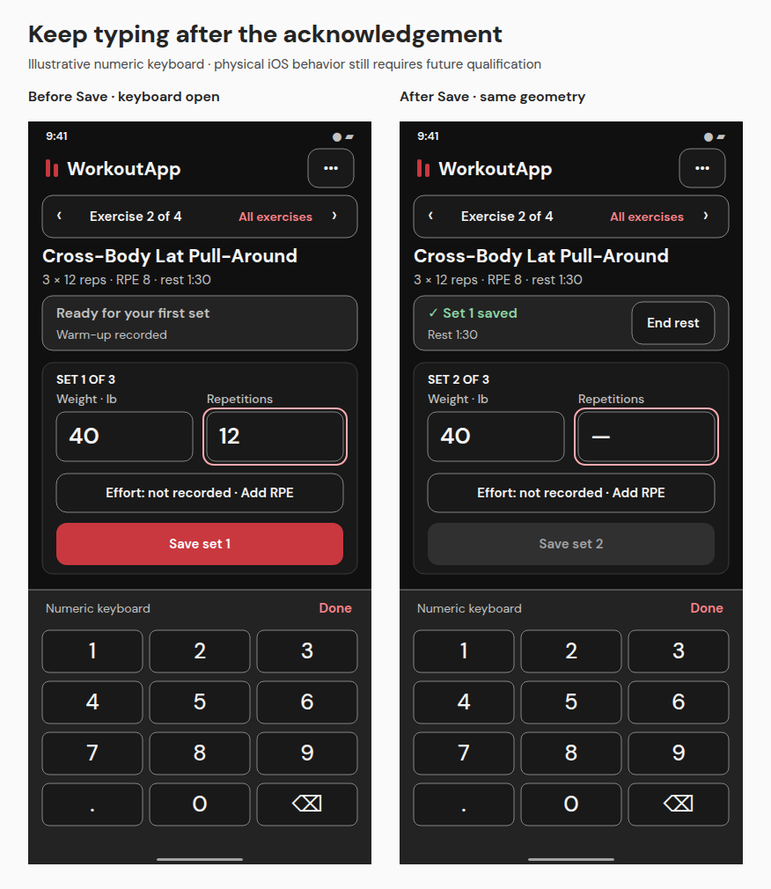
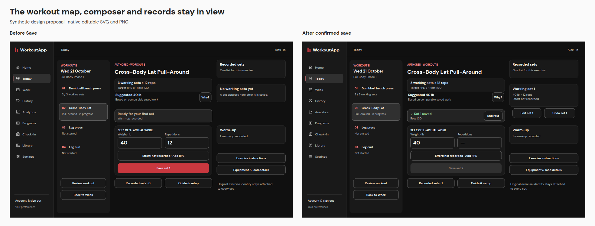

# Working-set interaction review

[Full gallery](MOBILE.md) · [Screen behavior](SCREENS.md) · [Original measured flow](../FLOW-REVIEW.md)

## The actual problem and the proposed result

The earlier synthetic deployed-frontend audit measured the weight input initially at **y=1526.75**, then a **90 px downward shift** after saving at unchanged scroll. The save error was outside the opaque runner. Literal duplicate values and the real two-minute wait were not independently reproduced. These facts remain the [audit’s evidence](../EVIDENCE.md), not new tests in this revision.

The unified sketch places the actual weight and reps in the first screen. On 390 × 844 mobile, both input rectangles stay at **y=504, height 56**, and Save stays at **y=636, height 52**, through ready, pending, acknowledged, next, definite failure, unconfirmed and reconciliation states. Desktop uses **y=490** and **y=622** respectively. Acknowledgement changes content inside reserved regions; it inserts no receipt above the fields.

The sole primary action is Save set. Actual weight remains editable without requiring an override story; the suggestion stays labeled separately. Confirmed set actuals appear once in **Recorded sets**: a dedicated mobile view and a desktop evidence column. The confirmation says “Set 1 saved” without repeating its numbers elsewhere. The next composer retains the weight, clears reps, resets actual effort to unknown and keeps Save disabled until valid next-set input. Unknown effort is never copied from a target or the prior set.

## Full gym sequence

| Step | Sketches | Proposed behavior |
|---|---|---|
| Open scheduled work | [Week](mobile/16-week.png) → [Today](mobile/23-today-session.png) | Use the exact local date and occurrence. Choose a named source exercise; persistent navigation retains that context. |
| Find a starting load | [Options](mobile/24-starting-load.png) → [known 1RM](mobile/25-known-max.png), [recent set](mobile/26-recent-set.png), or [manual](mobile/27-manual-calibration.png) | All are optional. Owned qualified performed evidence takes priority; unsupported estimates lead to [manual fallback](mobile/28-load-unavailable.png). No local percentage formula is authorized. |
| Warm up | [Before](mobile/29-warmup.png) → [saved](mobile/30-warmup-saved.png) | Exact source warm-up remains separate. Actual warm-up load/reps do not satisfy working-set completion. |
| Enter actuals | [Ready](mobile/31-working-ready.png) | Exact set-specific target remains visible. Weight/reps are actual entries with explicit units. |
| Save | [Pending](mobile/32-working-pending.png) → [acknowledged](mobile/33-working-saved.png) | Freeze the attempted command. Disable duplicates. Only a matching authoritative acknowledgement advances the set and starts the confirmed rest deadline. |
| Continue | [Next set](mobile/34-working-next.png) | Rest expiry does not move the form, reset the timer or save a set. Ending the timer does not override a source sequence restriction. |
| Add effort | [RPE](mobile/38-effort.png) / [RIR](mobile/74-rir-effort.png) | Preserve the native scale. Unknown/skip stays available. Feedback before Save belongs to the draft; later feedback is an explicit receipt update. |
| Correct / undo | [Records](mobile/40-recorded-sets.png) → [correction](mobile/41-correct-set.png) / [undo confirmation](mobile/44-undo-confirm.png) | Name the exact receipt/kind. Pending changes do not alter effective work. Preserve original and corrected/voided history. |
| Finish | [Review](mobile/49-finish-review.png) → [complete](mobile/50-workout-complete.png) | Require honest complete/partial classification and resolve uncertain saves first. No automatic program switch or next-week generation. |
| Review later | [History](mobile/51-history.png) → [detail](mobile/52-history-detail.png) | Show units, original identity, actual effort, set kind and correction status. No rest-day “Missed” inference. |

## Failure, retry and recovery

| State | Meaning and permitted next action |
|---|---|
| Validation rejected | [Field error](mobile/69-working-validation.png) retains draft and identifies the invalid value. The rejection is definite; fix it, then submit a valid new command. |
| Definitely not sent | [Failure](mobile/35-working-failed.png) may offer Retry set 1 with the retained payload. This label is allowed only if the system can establish that fact. A generic network failure is insufficient. |
| Sent, no acknowledgement | [Unconfirmed](mobile/36-working-unconfirmed.png) keeps the attempt values locked and offers Check save status. Query/reconcile first; if still unresolved, only the same command identity/payload may be retried under the owned protocol. No second logical set. |
| Return / reload | [Reconciliation](mobile/37-working-resume.png) uses authoritative effective receipts and the pending command, not an optimistic local counter. A supported local draft can be [reviewed](mobile/68-recovered-draft.png) after that reconciliation. |
| Session expires | [Sign in](mobile/71-session-expired.png) resumes the same account and occurrence before reconciliation. Another account never inherits the draft. |
| Correction or undo uncertain | Apply the same pending/unconfirmed/definite-failure distinctions to that specific mutation. No count decrement or guidance replacement until acknowledged. |

Draft retention is a proposed capability with account/occurrence scope, explicit successful local-write detection and clear limits. These sketches do not claim offline set saving, durable backend persistence or cross-device draft sync. The whole session must not be silently labeled “saved” merely because a local draft exists.

## Keyboard, focus and rest

Opening a software keyboard can reduce the available viewport and condense context. Once in that layout, the **save transition itself** must preserve fields, focus, scroll and keyboard state. The two keyboard sketches keep inputs at y=330 and Save at y=456. The drawn keyboard is illustrative, not an iOS screenshot or a real-device test. Smaller windows, text scaling and safe-area changes must reflow without hiding the action or trapping scroll.

Save status is a polite, one-time announcement; an error is associated with the active form. The timer uses an acknowledged deadline and reconciles elapsed time after backgrounding/reload. Announce start and completion, not every second. End rest has a real 48 px control. A source-prescribed pair or sequence remains visible where applicable.

Correction and details panels restore focus to their invoking control. A modal requires focus containment and an accessible title; the desktop workout workspace itself is a page, not a fake modal. Escape/Back must not discard unresolved attempted work.

## Desktop equivalent

The application rail, session map, composer and single receipt column have distinct roles. Responsive collapse changes navigation arrangement, not evidence authority or mutation semantics. Full-size [before](desktop/31-working-ready.png) and [after](desktop/33-working-saved.png) images are available.

## Source and history boundaries

Source-defined per-set targets, nonnumeric targets such as AMRAP, paired order, technique children and warm-up instructions must be rendered verbatim in meaning. The uniform 3 × 12 example is not a template for flattening other source prescriptions. Original exercise slot and performed variant are both preserved; [substitution review](mobile/48-substitution.png) grants no new source choice. Canonical kg and existing records remain unchanged by display conversion. Corrections/voids affect future qualified guidance through the current authority, never a second client-side policy.

These are design requirements for future implementation and qualification. Static geometry and token checks do not establish real browser focus, timing, network reconciliation, backend data durability or prescription parity.
